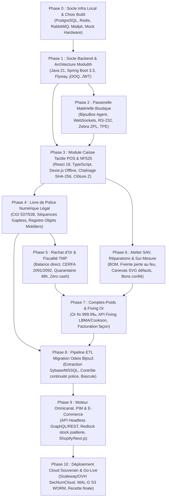

# 🗺️ FEUILLE DE ROUTE OPÉRATIONNELLE : MODERNISATION ERP BIJOU3 (HBJO)
## Guide Pas-à-Pas d'Exécution : Tâches, Ordre Chronologique & Stacks Utilisées

Ce document décrit **l'intégralité des étapes de réalisation** pour reconstruire le progiciel **Bijou3 (Odeis)** sous forme d'application web moderne avec backend Java et moteur omnicanal/e-commerce.

Chaque étape est ordonnée logiquement avec les **stacks technologiques exactes** associées, la **liste des tâches concrètes**, les **livrables attendus** et les **critères d'acceptation (Definition of Done)**.

---

## 📊 Matrice Chronologique des 10 Phases

---

## 🛠️ PHASE 0 : Socle d'Infrastructure Locale & Environnement de Développement

### 🎯 Objectif
Disposer d'un environnement de dev conteneurisé prêt en 1 commande, permettant d'exécuter l'ERP et de simuler le matériel physique (balance, imprimante thermique) sans avoir besoin des machines physiques.

### 💻 Stacks & Outils
* **Conteneurisation** : Docker, Docker Compose v2.
* **Bases de données** : PostgreSQL 16 Alpine (double instance logique : `erp_bijoux` opérationnelle + `erp_bijoux_audit` WORM inaltérable).
* **Cache & Verrous** : Redis 7 Alpine.
* **Bus d'événements** : RabbitMQ 3.13 avec console de gestion.
* **Serveur SMTP Mock** : Mailpit (inspection des e-mails en local sur le port 8025).
* **Simulateur Matériel** : Python 3.11 / `asyncio` (émulateur balance protocole Mettler Toledo SICS et imprimante Zebra ZPL sur port RAW TCP 9100).
* **Gestionnaire de paquets JS** : Node.js 20 LTS, `pnpm` v9, Turborepo.

### 📝 Tâches dans l'Ordre Chronologique
1. **Validation Docker Compose** : Lancer `docker compose up -d postgres redis rabbitmq mailpit mock-hardware` et vérifier la bonne santé des conteneurs (`healthy`).
2. **Initialisation des bases PostgreSQL** : Exécuter le script `deploy/compose/init-db.sql` créant les extensions `uuid-ossp`, `pgcrypto` et les deux bases distinctes.
3. **Test du Mock Hardware** :
   - Tester l'interrogation de la balance : `curl http://localhost:8089/scale/weight` (vérifier la réception de la trame `S S 14.852 g`).
   - Tester l'envoi d'un ordre d'impression ZPL sur le port TCP 9100.
4. **Configuration de l'environnement frontend** : Exécuter `pnpm install` à la racine pour installer les dépendances de `frontend/pos-app`, `frontend/backoffice-app` et `frontend/shared-ui`.

### ✅ Critères de Validation (DoD)
- Tous les conteneurs tournent sans erreur.
- La console RabbitMQ (`http://localhost:15672`) et Mailpit (`http://localhost:8025`) sont accessibles.
- Le mock balance répond aux requêtes HTTP et stream WebSocket.

---

## 🏛️ PHASE 1 : Socle Backend & Architecture Modulith

### 🎯 Objectif
Poser le squelette Java Spring Boot avec isolation stricte des 10 modules métier, sécurité d'accès RBAC et persistence relationnelle.

### 💻 Stacks & Outils
* **Langage & Runtime** : Java 21 LTS (Virtual Threads / Loom, Records, Pattern Matching).
* **Framework Backend** : Spring Boot 3.3+, Spring Modulith 1.2+.
* **Sécurité & Auth** : Spring Security 6.3, JWT signés asymétriquement, BCrypt, RBAC.
* **Accès Données** : Dualité Spring Data JPA (Hibernate 6) + jOOQ 3.19 (requêtes SQL typesafe analytiques).
* **Gestionnaire de Migrations** : Flyway (scripts SQL versionnés immuables).
* **Tests** : JUnit 5, AssertJ, Mockito, Testcontainers PostgreSQL 16.

### 📝 Tâches dans l'Ordre Chronologique
1. **Configuration du build (Maven ou Gradle selon votre choix)** :
   - Déclarer les 10 sous-modules : `core`, `catalog`, `pos`, `police-book`, `gold`, `workshop`, `weight-account`, `crm`, `api-public`, `integration-api`.
2. **Implémentation du module `backend/core`** :
   - Créer les *Value Objects* immuables : `WeightInGrams` (NUMERIC 10,3), `Carat` (NUMERIC 10,4), `GoldFineness` (750‰, 375‰, etc.), `MoneyAmount` (en centimes entiers pour éviter les flottants IEEE 754).
   - Mettre en place le Journal des Événements Techniques (JET) WORM : table d'audit `jet_audit_log` avec trigger SQL bloquant tout `UPDATE` ou `DELETE`.
3. **Sécurité & Authentification** :
   - Authentification JWT avec claims : `storeId`, `operatorId`, `roles` (`VENDEUR`, `RESPONSABLE_MAGASIN`, `BIJOUTIER_ATELIER`, `ADMIN`).
   - Mécanisme de verrouillage de session après 5 minutes d'inactivité au comptoir.
4. **Configuration Flyway & Schéma initial** :
   - Écrire `V1__init_security_and_crm.sql` et `V2__init_catalog_and_inventory.sql`.
5. **Vérification d'Architecture Modulith** :
   - Écrire le test unitaire `ApplicationModulesTest` avec `ApplicationModules.of(ErpApplication.class).verify()` pour interdire tout couplage cyclique entre modules.

### ✅ Critères de Validation (DoD)
- `verify()` de Spring Modulith passe au vert.
- Les tests unitaires Testcontainers démarrent un vrai PostgreSQL 16 et exécutent les migrations Flyway.
- Les Value Objects rejettent formellement les poids négatifs et les arrondis non conformes.

---

## 🔌 PHASE 2 : Passerelle Matérielle Boutique (BijouBox Agent)

### 🎯 Objectif
Permettre au navigateur web de communiquer de manière sécurisée et bidirectionnelle avec les balances de précision, imprimantes thermiques d'étiquettes et terminaux bancaires TPE.

### 💻 Stacks & Outils
* **Daemon Local** : Node.js / TypeScript compilé en binaire standalone (ou Go / Rust ultra-léger) tournant en service d'arrière-plan sur le PC de caisse.
* **Serveur WebSocket local** : `ws://127.0.0.1:8989` (avec résolution DNS locale et certificat TLS pour éviter les blocages de mixed-content dans le navigateur).
* **Protocoles Matériels** :
  - Balances : Liaison série RS-232 / USB sous protocole **Mettler Toledo MT-SICS** et **Kern**.
  - Imprimantes étiquettes : Protocole **Zebra ZPL II** via TCP Socket raw (port 9100) ou USB.
  - TPE Carte Bancaire : Protocole bancaire français **Concert V3 / CB2A** (port Ethernet IP 8888 ou USB série).
  - Imprimante ticket / Tiroir-caisse : Protocole **Epson ESC/POS** avec impulsion solenoid RJ11 `\x1B\x70`.

### 📝 Tâches dans l'Ordre Chronologique
1. **Développement du Daemon `hardware-agent`** :
   - Créer le serveur WebSocket local avec heartbeat et reconnexion automatique.
2. **Driver Balance de Précision** :
   - Écouter le port série, envoyer la commande `SI` (stream continu) et `S` (poids stabilisé certifié).
   - Parser la trame MT-SICS : extraire statut (`S` = stable, `D` = dynamique), valeur numérique et unité (`g` ou `ct`).
   - Diffuser l'événement `{ type: "SCALE_WEIGHT", weight: 14.852, isStable: true }` sur le WebSocket.
3. **Driver Imprimante Étiquettes Bijoux Zebra** :
   - Réceptionner le payload ZPL généré par l'ERP et le pousser sur le socket TCP port 9100 de l'imprimante thermique.
4. **Driver TPE (Protocole Concert CB)** :
   - Implémenter la séquence : Envoi `ENQ` -> Réception `ACK` -> Envoi trame montant en centimes -> Attente réponse TPE (accord / refus) -> Récupération ticket télécollecte.
5. **Composants d'intégration Frontend** :
   - Hook React `usePrecisionScale` avec indicateur de stabilité visuel (vert/jaune).
   - Hook React `useZebraPrinter` pour déclenchement direct depuis l'interface.

### ✅ Critères de Validation (DoD)
- Une pesée sur la balance physique (ou sur le simulateur) met à jour l'écran React en moins de 100 ms.
- L'appui sur le bouton "Imprimer étiquette" sort instantanément une étiquette haltère sur l'imprimante Zebra.
- Une transaction test TPE remonte l'accord bancaire dans le panier caisse.

---

## 💳 PHASE 3 : Module Caisse Tactile POS & Conformité Fiscale NF525

### 🎯 Objectif
Remplacer l'interface d'encaissement de Bijou3 par une caisse tactile moderne, ultra-rapide (<50ms par action), tolérante aux pannes réseau et certifiée conforme à la loi anti-fraude TVA (NF525).

### 💻 Stacks & Outils
* **Frontend** : React 19, TypeScript, Vite, Tailwind CSS v4, Lucide Icons, Shadcn UI / Radix.
* **State Management** : Zustand 5 (store panier & caisse), TanStack Query v5.
* **Mode Hors-Ligne** : Service Worker PWA, IndexedDB avec Dexie.js (mise en attente des tickets hors réseau).
* **Backend** : Module `backend/pos` (Spring Modulith), PostgreSQL 16.
* **Cryptographie Fiscale** : Algorithme HMAC-SHA256 avec clé privée secrète, séquences gapless PostgreSQL via advisory locks.

### 📝 Tâches dans l'Ordre Chronologique
1. **Interface de Caisse Tactile & Raccourcis Clavier** :
   - Implémenter le layout caisse plein écran avec pavé numérique géant (touch target >= 64px).
   - Mappage des touches fonction : `F1` (recherche article/client), `F2` (affecter client), `F3` (remise avec contrôle de droits), `F5`/`F6` (mise en attente/rappel paniers), `F8` (balance), `F9` (tiroir), `F12` (encaissement).
2. **Gestionnaire Scanner Code-Barres HID (`useBarcodeScanner`)** :
   - Capturer les frappes douchette ultra-rapides (<35ms entre caractères) au niveau de `window` sans perdre le focus et injecter l'article dans le panier.
3. **Moteur d'Encaissement Multi-règlements** :
   - Gestion des règlements combinés : CB, Espèces (blocage automatique si > 1 000 € pour résident français), Chèques (gestion des cautions et différés), Avoirs numériques, Cartes cadeaux, Acomptes (facture d'acompte avec TVA exigible dès encaissement selon CGI art. 269).
4. **Moteur de Scellement Cryptographique NF525 (Backend)** :
   - Créer la table `fiscal_sequence_counter` pour garantir l'absence totale de trous dans les numéros de tickets (`SELECT ... FOR UPDATE`).
   - Calculer pour chaque ticket :
     $$\text{Hash}_N = \text{HMAC-SHA256}(\text{Key}, \text{Hash}_{N-1} \parallel \text{NumSéquence}_N \parallel \text{DateISO}_N \parallel \text{TotalTTC}_N \parallel \text{CumulCA}_N)$$
   - Enregistrer le cumul perpétuel de chiffre d'affaires (*Grand Total*).
5. **Clôtures Périodiques (Ticket X et Z)** :
   - Clôture journalière Z : scellement de la journée, ventilation du CA par taux de TVA (20%, 5.5%, TVA sur marge), impression du ticket récapitulatif inaltérable.
   - Clôtures mensuelle et annuelle consolidées.
6. **Moteur Hors-Ligne & Synchronisation Résiliente** :
   - Stocker localement dans Dexie.js les ventes effectuées pendant une coupure réseau.
   - Synchroniser automatiquement avec l'ERP dès reconnexion en marquant l'horodatage d'audit.

### ✅ Critères de Validation (DoD)
- Temps d'ajout d'un article au scan douchette < 30 ms.
- La chaîne des hash SHA-256 est vérifiable par un script externe sans aucune rupture.
- Une tentative de suppression SQL d'un ticket vendu est rejetée par un trigger PostgreSQL immuable.
- La caisse fonctionne et imprime un ticket même si le câble réseau est débranché.

---

## 📖 PHASE 4 : Livre de Police Numérique Légal (CGI Art. 537 & 538)

### 🎯 Objectif
Informatiser le Livre de Police des métaux précieux et objets mobiliers d'occasion avec dispense officielle de registre papier, contrôlable par la Douane et la Police.

### 💻 Stacks & Outils
* **Backend** : Module `backend/police-book` (Spring Modulith), PostgreSQL 16.
* **Sécurité des Données** : Partitionnement annuel PostgreSQL, advisory locks, chaînage SHA-256.
* **Frontend** : Module Back-Office `features/police-book`, TanStack Table v8 avec virtualisation, exports PDF certifiés et réquisitions douanières.

### 📝 Tâches dans l'Ordre Chronologique
1. **Modèle de Données du Livre de Police** :
   - Créer la table `police_book_entry` : numéro d'ordre continu sans rupture, date d'entrée, description détaillée, titre exact du métal en millièmes (750‰, 375‰, 925‰, 950‰), poids brut, poids net estimé de métal fin, poinçons constatés (Maître + Garantie d'État), identité complète du cédant, prix/valeur, destination/date de sortie.
2. **Automatisation des Entrées/Sorties** :
   - Écouteur d'événements Modulith `@ApplicationModuleListener` :
     * Achat occasion ou rachat d'or -> création automatique d'une entrée de police.
     * Vente d'un bijou d'occasion -> renseignement automatique de la sortie et du numéro de ticket.
     * Envoi en fonte -> sortie pour lot d'affinage fonderie.
3. **Moteur de Vérification d'Intégrité** :
   - Implémenter le script de validation d'absence de trou séquentiel.
   - Trigger PostgreSQL empêchant toute modification ou suppression d'une ligne enregistrée.
4. **Interface d'Inspection & Module d'Exportation Légal** :
   - Écran de consultation Back-office filtrable par date, titre, cédant.
   - Génération de l'export officiel PDF et CSV conforme au format réquisitionné par les services des Douanes (DGDDI).

### ✅ Critères de Validation (DoD)
- Tout rachat ou entrée d'occasion génère immédiatement une ligne de police sans intervention manuelle.
- La numérotation chronologique ne présente aucun saut (1, 2, 3... sans aucun trou même en cas d'erreur de saisie).
- L'export douanier officiel est généré en un clic.

---

## 💰 PHASE 5 : Rachat d'Or aux Particuliers & Fiscalité TMP

### 🎯 Objectif
Automatiser le processus réglementaire de rachat d'or, bijoux et débris précieux : pesée certifiée en direct, fiscalité TMP, contrat légal et respect du délai de rétractation.

### 💻 Stacks & Outils
* **Backend** : Module `backend/gold` (Spring Modulith), PostgreSQL 16.
* **Frontend** : Assistant pas-à-pas `features/gold-repurchase`, signature électronique sur tablette / écran tactile.
* **Matériel** : Balance de précision RS-232 connectée, imprimante bureautique laser / ticket.

### 📝 Tâches dans l'Ordre Chronologique
1. **Assistant de Rachat en 4 Étapes (Frontend)** :
   - *Étape 1 : Identification du vendeur* : Scan/saisie de la pièce d'identité officielle (CNI, Passeport, Titre de séjour valide), contrôle KYC et anti-blanchiment (LCB-FT).
   - *Étape 2 : Pesée live & Titrage* : Récupération automatique du poids depuis la balance connectée (saisie clavier interdite pour métrologie légale), sélection du titre (9K, 14K, 18K, 24K, Argent 925, Platine).
   - *Étape 3 : Calcul Fiscal Automatisé* :
     * Calcul de la TMP (Taxe sur les Métaux Précieux) : $11\% + 0,5\% \text{ CRDS} = 11,5\%$ prélevés à la source sur le montant brut.
     * Option alternative TPV (Taxe sur la Plus-Value réelle avec abattement de 5%/an à partir de la 3e année sur justificatif d'acquisition).
     * Calcul du net à payer au client.
   - *Étape 4 : Contrat & Règlements* :
     * Blocage formel des espèces (interdiction pénale : 0 € en cash).
     * Règlement exclusif par chèque barré nominatif ou virement bancaire.
2. **Gestion de la Quarantaine Légale de 48 Heures (Art. L224-96 C. Conso)** :
   - Mise sous séquestre informatique : compte à rebours de 48h pendant lequel l'objet racheté ne peut être ni fondu, ni revendu, ni transformé.
   - Génération du contrat écrit avec bordereau détachable de rétractation.
3. **Constitution des Lots de Fonderie / Affinage** :
   - Regroupement des débris d'or libérés de leur délai de rétractation.
   - Émission du bordereau d'envoi affineur (Cookson-CLAL / Saamp) avec scellés et rapprochement contradictoire au retour du résultat d'analyse.

### ✅ Critères de Validation (DoD)
- Impossible de valider un rachat sans pièce d'identité valide.
- Le mode de règlement "Espèces" est physiquement grisé et rejeté par l'API backend.
- Un lot d'or sous quarantaine de 48h est verrouillé contre toute refonte ou expédition.

---

## 🔨 PHASE 6 : Atelier SAV, Réparations & Fabrication Sur-Mesure

### 🎯 Objectif
Digitaliser l'atelier joaillier et horloger : prise en charge des bijoux confiés avec photos macro et repérage vectoriel des défauts, suivi Kanban des réparations, fiches de fabrication et gestion de la perte au feu.

### 💻 Stacks & Outils
* **Backend** : Module `backend/workshop` (Spring Modulith), PostgreSQL 16.
* **Frontend** : Canevas interactif SVG (`JewelryInspectionCanvas`), Kanban d'atelier (`@dnd-kit`), notifications SMS/Email automatiques via RabbitMQ.

### 📝 Tâches dans l'Ordre Chronologique
1. **Prise en Charge SAV & Bon de Confié Client** :
   - Saisie du dépôt avec numéro unique.
   - Composant interactif SVG de repérage des défauts : positionnement de pastilles sur les silhouettes de bagues/montres/colliers (rayures, griffe cassée, pierre manquante, choc boîtier).
   - Prise de photos macro via webcam/tablette.
   - Signature contradictoire de décharge de responsabilité sur écran tactile.
   - Impression du bon de dépôt client avec code-barres et mentions de réserve.
2. **Tableau de Bord Kanban d'Atelier** :
   - Colonnes de flux : *1. À expertiser / Devis* ➔ *2. Attente accord client* ➔ *3. À l'Établi (Assigné à un artisan)* ➔ *4. Contrôle Qualité (test étanchéité ISO, contrôle serti)* ➔ *5. Prêt pour retrait*.
   - Déplacement drag-and-drop avec mise à jour temps réel WebSocket pour tous les postes.
3. **Module Fabrication Sur-Mesure & Nomenclature (BOM)** :
   - Définition de la nomenclature : composants (corps de bague, chaton, bélière), pierres certifiées avec caractéristiques 4C (diamants naturels ou diamants synthétiques conformément au Décret 2002-65), poids d'or brut engagé.
   - Calcul de la perte au feu (freinte normale d'atelier de 3% à 8%) et réconciliation du métal recyclé (limailles, boues de polissage).
4. **Notifications Automatisées** :
   - Envoi automatique d'un SMS et e-mail au client lorsque le bijou passe au statut "Prêt pour retrait" avec rappel du solde restant dû.

### ✅ Critères de Validation (DoD)
- Le bon de dépôt affiche clairement le schéma du bijou avec les anomalies marquées et la signature client.
- L'artisan décrémente les composants de son stock atelier lors de la fabrication.
- Le passage en "Prêt pour retrait" déclenche instantanément la notification client.

---

## ⚖️ PHASE 7 : Comptes-Poids Métaux Précieux & Cours de l'Or

### 🎯 Objectif
Gérer la comptabilité matière rigoureuse en métal fin (Or 999.9‰) avec les fondeurs, affineurs et clients grossistes, découplée de la facturation de la façon en euros.

### 💻 Stacks & Outils
* **Backend** : Module `backend/weight-account` (Spring Modulith), Redis 7 (cache cours de l'or).
* **Flux de Données** : API externe de fixing officiel de l'or (LBMA, Cookson-CLAL, Saamp en temps réel).
* **Frontend** : Dashboard compte-poids, graphiques d'évolution des cours de l'or, balance matière en temps réel.

### 📝 Tâches dans l'Ordre Chronologique
1. **Comptabilité Matière en Or Fin** :
   - Table `weight_account_ledger` : enregistrement de chaque mouvement exprimé en milligrammes d'Or Fin 999.9‰ (Titrage $\times \text{Poids Net}$).
   - Suivi distinct : Compte-poids affineurs (Cookson, Saamp) et Compte-poids clients (transformation de vieil or).
2. **Dissociation Facturation Façon vs Métal** :
   - Facturation de la main-d'œuvre (façon, sertissage, rhodiage) en € soumise à TVA standard 20%.
   - Compensation matière en or fin ou rachat au cours du fixing.
3. **Ingestion du Cours de l'Or en Direct** :
   - Tâche planifiée de récupération du fixing LBMA / Euronext toutes les 60 secondes avec mise en cache Redis.
   - Alerte de volatilité si le cours varie de plus de $\pm 2\%$.
   - Mise à jour matricielle automatique des prix de vente des bijoux en vitrine et sur le site e-commerce.

### ✅ Critères de Validation (DoD)
- Le solde du compte-poids fournisseur correspond au milligramme près avec le relevé de l'affineur.
- La facturation sépare distinctement la ligne de Façon HT/TTC et la ligne de Métal Fin compensé.

---

## 🔄 PHASE 8 : Pipeline ETL de Migration depuis l'Ancien Odeis Bijou3

### 🎯 Objectif
Extraire l'intégralité du patrimoine de données de l'ancien logiciel Bijou3 (Odeis), assainir les données, valider la continuité du Livre de Police et basculer sans perte d'activité lors d'un week-end de transition.

### 💻 Stacks & Outils
* **Extraction** : Scripts Python / JDBC spécifiques aux bases legacy Bijou3 (Sybase SQL Anywhere, Paradox BDE, Microsoft SQL Server).
* **Transformation & Contrôle** : Script Python `migration/transformers/validate_police_continuity.py`, règles de dédoublonnage flou Levenshtein.
* **Chargement** : Spring Batch & requêtes PostgreSQL haute performance `COPY` dans `migration/sql/01_legacy_staging_schema.sql`.

### 📝 Tâches dans l'Ordre Chronologique
1. **Extraction à Froid (Staging)** :
   - Dumper les tables sources : `Articles`, `Tiers/Clients`, `Fournisseurs`, `LivrePolice`, `ComptesPoids`, `FichesSAV`, `HistoriqueVentes`.
   - Charger les données brutes dans le schéma `legacy_odeis` de PostgreSQL.
2. **Nettoyage & Standardisation des Données** :
   - Dédoublonnage des fiches clients (fusion sur nom phonétique + code postal + téléphone).
   - Normalisation des titrages d'or hétérogènes ("18 CARATS", "750/000", "OR JAUNE") vers les constantes strictes de l'énumération (`GOLD_750`, `GOLD_375`, `SILVER_925`).
3. **Contrôle d'Intégrité du Livre de Police Legacy** :
   - Exécuter le script `validate_police_continuity.py`.
   - Identifier d'éventuels trous historiques ou pièces d'identité manquantes et générer un rapport d'audit avant migration.
4. **Chargement dans le Schéma Cible & Rapprochement** :
   - Injecter les données assainies dans les tables cibles de `erp_bijoux`.
   - Établir le **Procès-Verbal de Rapprochement Contradictoire** : contrôle de l'égalité exacte du nombre d'articles en stock, de la valeur d'achat HT/TTC, des soldes comptes-poids et du dernier numéro de Livre de Police.
5. **Répétition Générale & Bascule Finale (Go-Live Week-End)** :
   - *Vendredi 19h* : Clôture Z définitive sur l'ancien Bijou3, arrêt des postes Odeis, freeze des données.
   - *Samedi 08h-14h* : Exécution du pipeline ETL complet.
   - *Samedi 15h-18h* : Rapprochement contradictoire et validation par le gérant.
   - *Dimanche* : Ventes tests à blanc avec périphériques connectés.
   - *Lundi 08h30* : Démarrage officiel des boutiques sur le nouvel ERP (avec maintien de l'ancien Bijou3 en consultation d'archive).

### ✅ Critères de Validation (DoD)
- Le procès-verbal de migration certifie 100% de concordance des stocks et comptes-poids.
- Zéro trou introduit dans la numérotation du Livre de Police.
- Temps d'exécution de la migration < 4 heures.

---

## 🌐 PHASE 9 : Moteur Omnicanal, PIM Joaillerie & E-Commerce

### 🎯 Objectif
Exposer le catalogue joaillier et synchroniser les stocks en temps réel entre les boutiques physiques et les canaux e-commerce (Storefront sur-mesure headless, Shopify, PrestaShop ou WooCommerce) en éliminant tout risque de survente sur les pièces uniques de joaillerie.

### 💻 Stacks & Outils
* **API Headless** : GraphQL Storefront API & REST OpenAPI 3.1 dans `backend/api-public`.
* **Verrous Distribués** : Redis Redlock (réservation temporaire panier web avec TTL 15 min).
* **Bus Asynchrone** : RabbitMQ Topic Exchanges (`erp.events`) avec schéma CloudEvents v1.0.
* **Storefront** : Next.js 15 Commerce (React Server Components, Three.js pour 3D/VTO) ou connecteurs CMS (Shopify Plus, PrestaShop 8, WooCommerce).

### 📝 Tâches dans l'Ordre Chronologique
1. **PIM Spécialisé Joaillerie** :
   - Modélisation matricielle des tailles de bague : tours de doigt 48 à 64 avec calcul dynamique du supplément de métal précieux au-delà du tour 54.
   - Moteur de personnalisation de gravure (limite de caractères selon le tour et génération de fichier vectoriel SVG pour machines Gravotech).
   - Fiches diamants certifiés avec critères 4C et lien direct de vérification laser GIA/HRD.
2. **Moteur de Stock Omnicanal Anti-Survente (ATP)** :
   - Formule : $\text{ATP} = \text{Stock Physique} - \text{Réservations Web Actives} - \text{Stock Sécurité}$.
   - Pose d'un verrou distribué Redis Redlock dès l'entrée dans le checkout en ligne.
   - Arbitrage prioritaire magasin physique : si un vendeur en boutique scanne une pièce engagée dans un panier web non payé, la caisse physique a la priorité.
3. **Scénarios Omnicanaux** :
   - **Click & Collect 2h** : Alerte sonore sur le POS caisse en boutique, mise de côté par le vendeur en vitrine et SMS de confirmation au client.
   - **Ship-from-Store Sécurisé** : Génération de l'étiquette transporteur Valeur Déclarée (VD) Chronopost Précio / Colissimo assuré (jusqu'à 50 000 €).
   - **Retour Web en Boutique** : Protocole d'inspection gemmologique obligatoire sur le POS avant validation du remboursement.
4. **Connecteurs E-Commerce** :
   - Développer le connecteur bidirectionnel vers votre plateforme cible (Storefront headless Next.js ou CMS Shopify/PrestaShop).

### ✅ Critères de Validation (DoD)
- Une vente effectuée en caisse physique désactive la pièce unique sur le site web en moins d'une seconde.
- Le calcul de supplément de prix pour les grands tours de doigt est automatique et exact.
- Les flux d'expédition Valeur Déclarée sont générés sans intervention manuelle.

---

## 🚀 PHASE 10 : Déploiement en Production sur Cloud Souverain & Recette Finale

### 🎯 Objectif
Déployer la solution complète sur une infrastructure cloud française sécurisée et souveraine, conforme aux exigences de conservation légale des Douanes françaises, et valider la recette finale.

### 💻 Stacks & Outils
* **Hébergement Souverain** : Scaleway ou OVHcloud SecNumCloud (datacenters certifiés en France, protégés contre le *US Cloud Act*).
* **Orchestration** : Kubernetes Managé (Kapsule / MKS) ou instances Docker Swarm / Compose managées.
* **Sauvegarde & PRA** : WAL-G avec archivage continu PostgreSQL vers stockage S3 souverain avec Object Lock (WORM). RPO < 15 min, RTO < 1h.
* **CI/CD** : GitHub Actions (`.github/workflows/ci.yml`), SonarQube, Trivy security scanner.

### 📝 Tâches dans l'Ordre Chronologique
1. **Provisioning de l'Infrastructure Souveraine** :
   - Déploiement des bases managées PostgreSQL 16 multi-zones et du cluster Redis.
   - Configuration du stockage objet S3 avec verrouillage WORM (inaltérabilité 10 ans pour les archives fiscales et de police).
2. **Pipeline CI/CD Automatisé** :
   - Tests automatisés Testcontainers, analyse de vulnérabilités Trivy et Quality Gate SonarQube.
3. **Mise en Place du Plan de Continuité d'Activité (PCA/PRA)** :
   - Déploiement des scripts `wal-g-backup.sh` et test de restauration `restore-pitr.sh` (Point-In-Time Recovery) validant un RTO inférieur à 45 minutes.
4. **Recette Finale & Homologation** :
   - Tests de conformité NF525 (vérification de la signature cryptographique et des clôtures Z).
   - Simulation de contrôle des Douanes (vérification de l'intégrité du Livre de Police et des CERFA 2091 rachat d'or).
   - Validation de l'ergonomie caisse par les vendeurs en conditions réelles.

### ✅ Critères de Validation (DoD)
- Toutes les données résident sur des serveurs hébergés en France.
- Le test de restauration PRA restaure une base intègre en moins d'une heure.
- L'audit fiscal et légal confirme la parfaite conformité du système.

---

## 📌 Récapitulatif de l'Ordre de Démarrage Immédiat

Pour démarrer concrètement dès aujourd'hui :
1. **Choisir le gestionnaire de build backend** : Valider l'arbitrage entre **Maven** (votre préférence naturelle, stable, ultra-standard) ou **Gradle** (cache multi-projets optimisé).
2. **Lancer la Phase 0** : Démarrer `docker-compose.yml` pour valider PostgreSQL, Redis et le simulateur matériel sur votre machine.
3. **Implémenter la Phase 1 & 2** : Poser le socle Spring Boot avec les Value Objects du domaine HBJO et connecter le premier hook React à la balance connectée.
