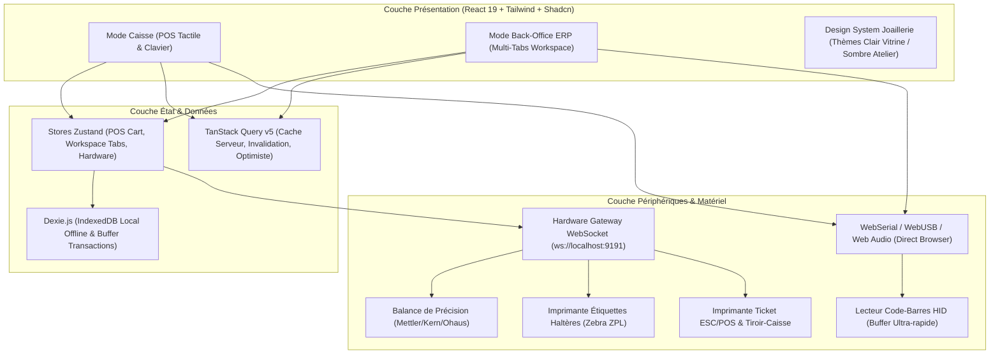
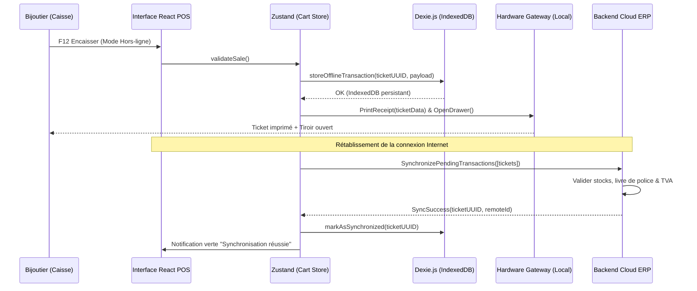
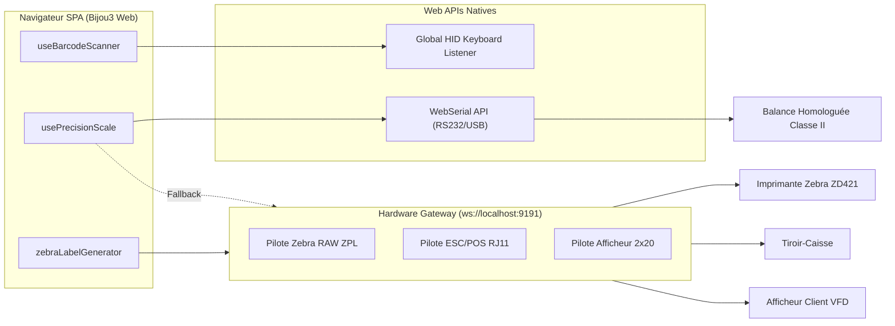

# 💎 ERP BIJOU3 MODERNISÉ : ARCHITECTURE FRONTEND & SPÉCIFICATIONS UX
**Auteur :** Lead Architecte Frontend Web & UX Expert  
**Version :** 1.0.0 — Production Ready  
**Statut :** Spécification d'Ingénierie & Document Maître  

---

## TABLE DES MATIÈRES
1. [Vision Produit & Objectifs de Modernisation](#1-vision-produit--objectifs-de-modernisation)
2. [Choix Technologiques & Stack Frontend](#2-choix-technologiques--stack-frontend)
3. [Expérience Dual-Mode : Caisse (POS) vs Back-Office ERP](#3-expérience-dual-mode--caisse-pos-vs-back-office-erp)
   - [3.1 Mode Caisse (POS) : Ergonomie Tactile, Clavier & Offline-First](#31-mode-caisse-pos--ergonomie-tactile-clavier--offline-first)
   - [3.2 Mode Back-Office ERP : Multi-Tabs, Atelier SAV & Rachat d'Or](#32-mode-back-office-erp--multi-tabs-atelier-sav--rachat-dor)
4. [Intégration Matériel via le Frontend (Hardware Gateway & Web APIs)](#4-intégration-matériel-via-le-frontend-hardware-gateway--web-apis)
   - [4.1 Architecture Hybride WebSocket & WebSerial/WebUSB](#41-architecture-hybride-websocket--webserialwebusb)
   - [4.2 Module Balance de Précision Temps Réel](#42-module-balance-de-précision-temps-réel)
   - [4.3 Moteur d'Étiquettes Bijoux ZPL (Haltères avec Filot)](#43-moteur-détiquettes-bijoux-zpl-haltères-avec-filot)
5. [Implémentations TypeScript & Hooks Clés](#5-implémentations-typescript--hooks-clés)
   - [5.1 `useBarcodeScanner.ts` (Écouteur HID Global Ultra-rapide)](#51-usebarcodescannerts)
   - [5.2 `usePrecisionScale.ts` (Connexion Hybride Balance & Parsing SICS/Kern)](#52-useprecisionscalets)
   - [5.3 `useMultiTabWorkspace.ts` (Gestionnaire d'Onglets Virtuels & Dirty Check)](#53-usemultitabworkspacets)
   - [5.4 `JewelryInspectionCanvas.tsx` (Schéma SVG Interactif d'Inspection SAV)](#54-jewelryinspectioncanvas-tsx)
   - [5.5 `zebraLabelGenerator.ts` (Moteur ZPL & Rendu SVG pour Étiquette Haltère)](#55-zebralabelgenerator-ts)
6. [Arborescence Complète du Projet Frontend](#6-arborescence-complète-du-projet-frontend)
7. [Directives Ergonomiques & UX Joaillerie / Atelier](#7-directives-ergonomiques--ux-joaillerie--atelier)

---

## 1. VISION PRODUIT & OBJECTIFS DE MODERNISATION

L'ERP Bijou3 historique souffre des limites inhérentes aux clients lourds Windows des années 2000 :
* Interfaces surchargées de champs et de fenêtres modales bloquantes.
* Rigidité des postes de travail (dépendance stricte à l'OS Windows, DLLs COM/OLE pour le matériel).
* Perte de saisie dramatique lorsqu'un vendeur est interrompu au comptoir.
* Ergonomie inadaptée aux écrans tactiles modernes et aux ambiances lumineuses contrastées des bijouteries.

Le projet de modernisation propose une **Single Page Application (SPA / PWA)** conçue avec les standards web les plus avancés. Elle garantit :
1. **Zéro latence perçue (Sub-16ms / 60 FPS)** sur les listes de plusieurs dizaines de milliers d'articles et pierres.
2. **Dual-Mode instantané** : Un affichage Caisse (POS) optimisé grand écran tactile avec touches rapides, et un Back-Office ERP modulaire multi-tâches.
3. **Résilience réseau absolue (Offline-First)** : Le tiroir s'ouvre, le scanner bipe et les tickets s'impriment même si le routeur fibre de la boutique tombe en panne.
4. **Intégration périphérique sans couture** : Pilotage direct des balances de précision homologuées, imprimantes d'étiquettes de joaillerie, et scanners HID.



---

## 2. CHOIX TECHNOLOGIQUES & STACK FRONTEND

| Domaine | Technologie retenue | Justification technique & Métier |
| :--- | :--- | :--- |
| **Framework & Core** | **React 19 + TypeScript 5.5+** | Concurrency native, hooks modernes (`useActionState`, `useOptimistic`), typage strict pour la métrologie (grammes, carats, ‰). |
| **Build Tool & HMR** | **Vite 6** | Démarrage à froid < 300ms, HMR instantané pour les ateliers, support PWA via `vite-plugin-pwa` et Workbox. |
| **UI Kit & Styling** | **Tailwind CSS v4 + Radix UI / Shadcn UI + Lucide Icons** | Composants headless accessibles (WAI-ARIA), stylage sans runtime, tokens de design pour finitions luxe (Gold, Platinum, Slate). |
| **Gestion d'État Client** | **Zustand 5** | Stores minuscules, réactivité chirurgicale hors du cycle React, idéal pour le panier caisse, les onglets multi-dossiers et le flux matériel. |
| **Cache Serveur & Sync** | **TanStack Query v5** | Dédoublonnage des requêtes, synchronisation en arrière-plan, mutateurs optimistes pour l'encaissement immédiat. |
| **Grilles de Données** | **TanStack Table v8 + `@tanstack/react-virtual`** | Rendu virtualisé de 50 000+ références sans fuite mémoire, filtres composites (poids, titrage, forme de taille diamant, fournisseur). |
| **Formulaires & Schémas** | **React Hook Form + Zod** | Formulaires isolés sans re-render intempestif, validation stricte des règles réglementaires (CERFA, livre de police, TMP). |
| **Base Locale Hors-Ligne** | **Dexie.js (IndexedDB)** | Moteur ACID local, stockage du catalogue offline et queue d'attente des tickets caisse non synchronisés. |
| **Drag & Drop** | **`@dnd-kit/core`** | Gestion fluide du Kanban de l'atelier de réparation avec support tactile et clavier. |

### Architecture de Typage Métier (Domain Primitives)
Pour éliminer les erreurs de virgule flottante IEEE 754 inacceptables en joaillerie :
* Les **devises** sont traitées en entiers représentant les centimes (`type Cents = number`).
* Les **poids d'or** sont stockés au millième de gramme (`type Milligrams = number`).
* Les **carats de pierres** sont stockés au centième de carat (`type HundredthCarats = number`).

---

## 3. EXPÉRIENCE DUAL-MODE : CAISSE (POS) VS BACK-OFFICE ERP

Le bijoutier navigue entre deux contextes opérationnels distincts. La bascule s'effectue sans rechargement de page via `Alt + Space` ou via l'interrupteur global dans la barre d'état.

```
+---------------------------------------------------------------------------------------------------+
|  [BIJOUX ERP]  (Mode ERP) [Bascule Caisse Alt+Space]    |  Balance: 14.582g [STABLE] | Op: Sophie |
+---------------------------------------------------------------------------------------------------+
|  Onglets: [Caisse Comptoir] [SAV: #2026-084 Bague Saphir x] [Devis: Bague Or 750 x] [+]          |
+---------------------------------------------------------------------------------------------------+
|                                                                                                   |
|   <Zone de Travail Principale (Multi-Tabs Workspace ou Écran POS plein écran)>                    |
|                                                                                                   |
+---------------------------------------------------------------------------------------------------+
|  F1:Article | F2:Client | F5:Attente | F8:Pesée | F9:Tiroir | F11:Rachat Or | F12:Encaisser [Entrée]  |
+---------------------------------------------------------------------------------------------------+
```

---

### 3.1 MODE CAISSE (POS) : ERGONOMIE TACTILE, CLAVIER & OFFLINE-FIRST

Le mode Caisse est taillé pour un écran de comptoir 15" à 24" tactile tout en offrant une productivité clavier maximale pour les vendeurs chevronnés.

#### A. Maquette Textuelle de l'Interface Caisse
```
+----------------------------------------------------------+----------------------------------------+
| 🛒 TICKET EN COURS : #2026-1104-01       Client: [Passage] |  [F1] Recherche Manuel / Douchette     |
+----------------------------------------------------------+----------------------------------------+
| Réf        Désignation          Poids   Qté   P.U.  Total | [ [ 3700123456789 ] Scan Ready... ]  |
| -------------------------------------------------------- |----------------------------------------|
| B-0142     Alliance Or 750      3.42g     1   450€   450€ | [ 7 ] [ 8 ] [ 9 ] | [ F2 Client      ] |
| P-0891     Pendentif Diamant    1.15g     1   620€   620€ | [ 4 ] [ 5 ] [ 6 ] | [ F3 Remise %    ] |
| REP-04     Mise à taille bague  --        1    45€    45€ | [ 1 ] [ 2 ] [ 3 ] | [ F4 Ligne Libre ] |
|                                                          | [ 0 ] [ . ] [CLR] | [ F5 En Attente  ] |
+----------------------------------------------------------+----------------------------------------+
| SOUS-TOTAL :  1 115,00 €                                 |  MOYENS DE RÈGLEMENT RAPIDES :         |
| REMISE (0%) :      0,00 €                                |  [ CB Bancaire ]  [ Espèces ] [ Avoir] |
| NET À PAYER : 1 115,00 €                                 |  [ Virement    ]  [ Chèque  ] [ Cadeau]|
+----------------------------------------------------------+----------------------------------------+
| [F8 PESER BALANCE] | [F9 OUVRIR TIROIR] | [F11 RACHAT OR]|  >>> [F12 ENCAISSER / VALIDER] <<<     |
+----------------------------------------------------------+----------------------------------------+
```

#### B. Mappage des Raccourcis Clavier POS
* **`F1`** : Focus sur la barre de recherche rapide / douchette.
* **`F2`** : Recherche et affectation client (recherche nom, portable, carte fidélité).
* **`F3`** : Application d'une remise ligne ou globale (en % ou en montant fixe).
* **`F4`** : Ajout d'une ligne libre (prestation minute, pile de montre, perçage d'oreille).
* **`F5`** : Mise en attente du panier en cours (parcage du ticket pour servir le client suivant).
* **`F6`** : Rappel des tickets en attente avec badge de décompte.
* **`F8`** : Interrogation balance de précision (injection automatique du poids net).
* **`F9`** : Ouverture manuelle du tiroir-caisse (avec journalisation du motif).
* **`F10`** : Mouvements de caisse (apport de monnaie, prélèvement coffre).
* **`F11`** : Lancement rapide du module Rachat d'Or.
* **`F12` ou `Entrée`** : Déclenchement de l'écran d'encaissement multi-règlements.
* **`Échap`** : Annulation de l'action en cours ou retour à la vente.

#### C. Tolérance aux Pannes & Architecture Offline-First
En cas de rupture de la connexion Internet (coupure fibre en galerie marchande) :
1. Le **Service Worker** sert les assets applicatifs via le cache local.
2. Les requêtes de lecture interrogent **IndexedDB via Dexie.js** qui héberge le catalogue des pièces et clients locaux.
3. À la validation du panier, un **Ticket Local Déconnecté** est généré avec un identifiant UUID v4 et un horodatage immuable.
4. L'impression du ticket et l'ouverture du tiroir s'exécutent normalement via la **Hardware Gateway locale** (qui réside sur le réseau local `localhost:9191` ou port USB).
5. Le composant `SyncEngine` détecte le rétablissement de la connexion (`navigator.onLine` + ping serveur) et procède à la synchronisation par lots avec résolution des conflits et horodatage certifié.



---

### 3.2 MODE BACK-OFFICE ERP : MULTI-TABS, ATELIER SAV & RACHAT D'OR

#### A. Système d'Onglets Virtuels Multi-Dossiers (Workspace Multi-Tabs)
Dans une bijouterie, le personnel est sans cesse interrompu : un vendeur qui prépare un devis complexe de bague sur-mesure doit pouvoir instantanément ouvrir une fiche SAV ou renseigner un client entrant, **sans perdre aucune donnée de son formulaire non validé**.

* **Architecture** : Chaque onglet conserve son instance d'état, ses validations partielles et son drapeau `isDirty`.
* **Persistance de Session** : Les onglets ouverts et leurs brouillons sont persistés dans `sessionStorage` pour résister à un rafraîchissement accidentel (`F5`).
* **Protection contre la fermeture accidentelle** : Un dialogue modal Radix intercepte la fermeture si `isDirty === true`.

#### B. Atelier & Réparations (SAV) : Kanban Interactif & Schéma d'Inspection SVG
Le flux des réparations est orchestré via un Kanban visuel à 5 couloirs :
1. **À chiffrer / Dépôt** : Analyse initiale, photos du bijou, pesée brute.
2. **Attente accord devis** : SMS / Email de validation automatique envoyé au client avec lien de signature électronique.
3. **À l'Établi (En réparation)** : Affectation horloger/joaillier, suivi du temps et des fournitures (apprêts, or d'apport, brasure).
4. **Contrôle Qualité & Finition** : Polissage, rhodiage, passage aux ultrasons, contrôle sertissage sous loupe x10.
5. **Prêt pour retrait** : Notification client par SMS automatique, rangement en coffre SAV.

##### Composant d'Inspection Visuelle SVG
Pour se prémunir des litiges ("Ma bague n'était pas rayée avant", "Il manque un diamant"), le formulaire de dépôt intègre un canevas SVG interactif :
* Gabarits vectoriels : Bague (vue de face, dessus, profil chaton), Collier, Montre.
* Placement de pastilles de défauts géolocalisées avec code couleur :
  * 🔴 **Rayure / Choc profond**
  * 🟡 **Pierre manquante / Ébréchée**
  * 🟣 **Griffe tordue / Serti fragile**
  * 🔵 **Corps de bague fendu / Déformé**
* Capture webcam/microscope intégrée et signature conjointe sur le bon de prise en charge.

#### C. Module Rachat d'Or Pas-à-Pas (Livre de Police & TMP)
Le rachat d'or aux particuliers est soumis à une réglementation stricte (art. 537 du Code Général des Impôts, art. L112-6 du Code Monétaire et Financier). Le module guide l'opérateur en 4 étapes infranchissables :

```
[ Étape 1 : Vendeur ] ---> [ Étape 2 : Expertise & Pesée ] ---> [ Étape 3 : Calcul & TMP ] ---> [ Étape 4 : Contrat & Police ]
- Scan CNI / Passeport      - Titrage (9K, 14K, 18K, 24K)       - Cours de l'or en direct        - Contrat rétractation 48h
- Vérification majorité     - Capture balance automatique       - TMP (11% + 0.5% CRDS)          - Signature tablette
- Fiche de police           - Test acide / spectromètre         - Mode de paiement (Chèque/Vir)   - Écriture Livre de Police
```

* **Paiement strictement sans espèces** : Le frontend bloque toute option de règlement liquide pour le rachat de métaux précieux (obligation légale).
* **Calcul automatique de la Taxe sur les Métaux Précieux (TMP)** :
  $$\text{TMP Total} = \text{Montant Brut} \times 11{,}5\% \quad (11\% \text{ TMP} + 0{,}5\% \text{ CRDS})$$
  ou régime optionnel des plus-values réelles (art. 150 VL du CGI) avec saisie de la date et du prix d'acquisition d'origine.

---

## 4. INTÉGRATION MATÉRIEL VIA LE FRONTEND

### 4.1 ARCHITECTURE HYBRIDE WEBSOCKET & WEBSERIAL/WEBUSB

Pour affranchir l'ERP des pilotes propriétaires tout en assurant une flexibilité totale :
1. **Périphériques Directs Navigateur (Chrome/Edge)** : Utilisation de la **WebSerial API** et **WebUSB API** pour communiquer directement avec les balances et scanners connectés en USB-Série, sans aucun logiciel intermédiaire requis sur le poste client.
2. **Périphériques Réseau ou Legacy** : Connexion via WebSocket (`ws://localhost:9191`) à une micro-passerelle locale (Hardware Gateway) pilotant les imprimantes d'étiquettes Zebra réseau, les afficheurs clients VFD (2x20 caractères) et le tiroir-caisse ESC/POS.



---

### 4.2 MODULE BALANCE DE PRÉCISION TEMPS RÉEL

Les balances de bijouterie (ex: Mettler Toledo JP, Ohaus Pioneer, Kern EMB) communiquent via le protocole standardisé **SICS** (Standard Interface Command Set) ou des flux périodiques en continu.

* **Commande d'interrogation** : `SI` (Send Immediate) ou `S` (Send Stable weight).
* **Format de trame type** : `S S    14.582 g` (Stable) ou `S D    14.571 g` (Dynamic/Instable).
* **Gestion de la Tare** : Commande `Z` (Zéro) ou `T` (Tare).
* **Indicateur de Stabilité** : Verrouillage visuel vert et son discret de confirmation dès que la balance émet le statut stable `S`.

---

### 4.3 MOTEUR D'ÉTIQUETTES BIJOUX ZPL (HALTÈRES AVEC FILOT)

Les étiquettes de bijouterie imposent un format physique particulier dit "haltère" (*dumbbell label*) avec une bande centrale transparente non adhésive (filot) qui s'enroule autour de l'anneau de la bague sans laisser de colle sur le métal précieux.

```
+---------------+                              +---------------+
| Pastille Gche |==============================| Pastille Drte |
| Ref / Matière |      Filot Transparent       | Prix / Barcode|
+---------------+                              +---------------+
```

* **Dimensions types** : 85mm x 10mm (Pastille gauche 25x10mm, filot 35x2mm, Pastille droite 25x10mm).
* **Résolution thermique** : 203 DPI (8 dots/mm) ou 300 DPI (12 dots/mm).
* Le générateur fournit le flux **ZPL pur** directement envoyé à l'imprimante thermique, ainsi qu'une **prévisualisation vectorielle SVG temps réel** à l'écran.

---

## 5. IMPLÉMENTATIONS TYPESCRIPT & HOOKS CLÉS

### 5.1 `useBarcodeScanner.ts`

Ce hook résout le problème classique des lecteurs codes-barres émulant un clavier : il distingue la saisie humaine (espacée de 80ms à 200ms) de la rafale du scanner (< 35ms par caractère), intercepte le code même sans focus actif sur un champ, et prévient la pollution de la saisie utilisateur.

```typescript
// src/hooks/useBarcodeScanner.ts
import { useEffect, useRef, useCallback } from 'react';

export interface BarcodeScannerOptions {
  onScan: (barcode: string) => void;
  maxIntervalMs?: number; // Vitesse maximale inter-frappes (défaut: 35ms)
  minLength?: number;     // Longueur minimale d'un code-barres (défaut: 6)
  prefix?: string;        // Préfixe éventuel configuré sur le scanner
  suffixKey?: string;     // Touche de fin d'émission (souvent 'Enter')
  soundFeedback?: boolean;// Bip sonore de confirmation
  disabled?: boolean;     // Suspension temporaire
}

export function useBarcodeScanner({
  onScan,
  maxIntervalMs = 35,
  minLength = 6,
  prefix = '',
  suffixKey = 'Enter',
  soundFeedback = true,
  disabled = false,
}: BarcodeScannerOptions) {
  const bufferRef = useRef<string>('');
  const lastKeyTimeRef = useRef<number>(0);

  // Génération d'un bip de validation via la Web Audio API
  const playBeep = useCallback((success: boolean = true) => {
    try {
      const audioCtx = new (window.AudioContext || (window as unknown as { webkitAudioContext: typeof AudioContext }).webkitAudioContext)();
      const osc = audioCtx.createOscillator();
      const gain = audioCtx.createGain();

      osc.type = 'sine';
      osc.frequency.setValueAtTime(success ? 1800 : 400, audioCtx.currentTime);
      gain.gain.setValueAtTime(0.08, audioCtx.currentTime);
      gain.gain.exponentialRampToValueAtTime(0.001, audioCtx.currentTime + (success ? 0.08 : 0.25));

      osc.connect(gain);
      gain.connect(audioCtx.destination);
      osc.start();
      osc.stop(audioCtx.currentTime + (success ? 0.08 : 0.25));
    } catch {
      // Ignorer si audio non autorisé
    }
  }, []);

  useEffect(() => {
    if (disabled) return;

    const handleKeyDown = (event: KeyboardEvent) => {
      // Si l'utilisateur est activement en train de taper dans un champ texte standard
      // avec une frappe lente, nous ne devrions pas détourner la saisie.
      const target = event.target as HTMLElement | null;
      const isInputFocused =
        target && (target.tagName === 'INPUT' || target.tagName === 'TEXTAREA' || target.isContentEditable);

      const currentTime = performance.now();
      const timeDiff = currentTime - lastKeyTimeRef.current;
      lastKeyTimeRef.current = currentTime;

      // Si le délai entre deux touches dépasse le seuil, réinitialiser le tampon
      if (timeDiff > maxIntervalMs) {
        bufferRef.current = '';
      }

      // Si la touche de terminaison est reçue
      if (event.key === suffixKey) {
        if (bufferRef.current.length >= minLength) {
          let code = bufferRef.current;
          if (prefix && code.startsWith(prefix)) {
            code = code.slice(prefix.length);
          }

          // Intercepter l'événement pour éviter la soumission de formulaire inopinée
          event.preventDefault();
          event.stopPropagation();

          if (soundFeedback) playBeep(true);
          onScan(code.trim());
          bufferRef.current = '';
        }
        return;
      }

      // Concaténer uniquement les caractères imprimables
      if (event.key.length === 1) {
        bufferRef.current += event.key;

        // Si la vitesse démontre clairement un lecteur HID (> 2 caractères à < 35ms)
        // et qu'un input non ciblé était actif, on empêche l'insertion brute
        if (bufferRef.current.length > 2 && isInputFocused && timeDiff <= maxIntervalMs) {
          event.preventDefault();
        }
      }
    };

    window.addEventListener('keydown', handleKeyDown, { capture: true });
    return () => {
      window.removeEventListener('keydown', handleKeyDown, { capture: true });
    };
  }, [onScan, maxIntervalMs, minLength, prefix, suffixKey, soundFeedback, disabled, playBeep]);
}
```

---

### 5.2 `usePrecisionScale.ts`

Ce hook gère l'acquisition en continu du poids depuis une balance de précision homologuée classe II via la WebSerial API ou la Gateway WebSocket locale, en décodant le protocole Mettler-Toledo SICS / Kern.

```typescript
// src/hooks/usePrecisionScale.ts
import { useState, useEffect, useRef, useCallback } from 'react';

export interface ScaleReading {
  weight: number;       // Poids en grammes
  unit: 'g' | 'ct' | 'dwt';
  isStable: boolean;    // Poids stabilisé (certification légale)
  isOverload: boolean;  // Surcharge
  raw: string;          // Trame brute
  timestamp: number;
}

export interface PrecisionScaleConfig {
  mode: 'serial' | 'websocket';
  wsUrl?: string;       // Défaut: ws://localhost:9191/scale
  baudRate?: number;    // Défaut: 9600 (standard Mettler SICS / Kern)
}

export function usePrecisionScale(config: PrecisionScaleConfig = { mode: 'websocket', wsUrl: 'ws://localhost:9191/scale' }) {
  const [reading, setReading] = useState<ScaleReading>({
    weight: 0,
    unit: 'g',
    isStable: false,
    isOverload: false,
    raw: '',
    timestamp: Date.now(),
  });
  const [isConnected, setIsConnected] = useState<boolean>(false);
  const [error, setError] = useState<string | null>(null);

  const wsRef = useRef<WebSocket | null>(null);
  const serialPortRef = useRef<SerialPort | null>(null);
  const readerRef = useRef<ReadableStreamDefaultReader<string> | null>(null);

  // Parsing standard Mettler-Toledo SICS : "S S   14.582 g" ou "S D   14.570 g"
  // et Kern / Ohaus : "ST,GS,+  14.58g"
  const parseScaleFrame = useCallback((line: string): ScaleReading | null => {
    const trimmed = line.trim();
    if (!trimmed) return null;

    // Détection Protocole SICS (Mettler)
    if (trimmed.startsWith('S S') || trimmed.startsWith('S D')) {
      const parts = trimmed.split(/\s+/);
      const isStable = parts[1] === 'S';
      const weightVal = parseFloat(parts[2]);
      const unit = (parts[3]?.toLowerCase() === 'ct' ? 'ct' : 'g') as 'g' | 'ct';

      return {
        weight: isNaN(weightVal) ? 0 : weightVal,
        unit,
        isStable,
        isOverload: trimmed.includes('OL') || trimmed.includes('+---'),
        raw: trimmed,
        timestamp: Date.now(),
      };
    }

    // Détection Protocole Kern / Ohaus (ex: ST,GS,+  12.345g)
    const kernRegex = /(ST|US),([A-Z]+),([+-]?\s*\d+\.?\d*)\s*(g|ct)/i;
    const match = trimmed.match(kernRegex);
    if (match) {
      const isStable = match[1].toUpperCase() === 'ST';
      const weightVal = parseFloat(match[3].replace(/\s+/g, ''));
      const unit = (match[4].toLowerCase() === 'ct' ? 'ct' : 'g') as 'g' | 'ct';

      return {
        weight: isNaN(weightVal) ? 0 : weightVal,
        unit,
        isStable,
        isOverload: false,
        raw: trimmed,
        timestamp: Date.now(),
      };
    }

    return null;
  }, []);

  // Connexion WebSocket locale
  const connectWebSocket = useCallback(() => {
    const url = config.wsUrl || 'ws://localhost:9191/scale';
    const ws = new WebSocket(url);
    wsRef.current = ws;

    ws.onopen = () => {
      setIsConnected(true);
      setError(null);
      // Envoyer commande de streaming continu SICS "SIR" ou "SI"
      ws.send('SIR\r\n');
    };

    ws.onmessage = (event) => {
      const parsed = parseScaleFrame(event.data);
      if (parsed) setReading(parsed);
    };

    ws.onerror = () => {
      setError('Erreur de communication avec la passerelle balance');
    };

    ws.onclose = () => {
      setIsConnected(false);
      // Tentative de reconnexion automatique
      setTimeout(connectWebSocket, 3000);
    };
  }, [config.wsUrl, parseScaleFrame]);

  // Connexion WebSerial directe (sans passerelle intermédiaire)
  const connectWebSerial = useCallback(async () => {
    if (!('serial' in navigator)) {
      setError("WebSerial n'est pas supporté par ce navigateur (utilisez Chrome ou Edge)");
      return;
    }

    try {
      const port = await navigator.serial.requestPort();
      await port.open({ baudRate: config.baudRate || 9600 });
      serialPortRef.current = port;
      setIsConnected(true);
      setError(null);

      const textDecoder = new TextDecoderStream();
      port.readable?.pipeTo(textDecoder.writable);
      const reader = textDecoder.readable.getReader();
      readerRef.current = reader;

      let buffer = '';
      while (true) {
        const { value, done } = await reader.read();
        if (done) break;
        if (value) {
          buffer += value;
          const lines = buffer.split(/[\r\n]+/);
          buffer = lines.pop() || '';
          for (const line of lines) {
            const parsed = parseScaleFrame(line);
            if (parsed) setReading(parsed);
          }
        }
      }
    } catch (err) {
      setError(err instanceof Error ? err.message : 'Échec de connexion au port série');
      setIsConnected(false);
    }
  }, [config.baudRate, parseScaleFrame]);

  // Commande de Tare
  const triggerTare = useCallback(() => {
    if (wsRef.current && wsRef.current.readyState === WebSocket.OPEN) {
      wsRef.current.send('T\r\n');
    }
  }, []);

  // Commande de Zéro
  const triggerZero = useCallback(() => {
    if (wsRef.current && wsRef.current.readyState === WebSocket.OPEN) {
      wsRef.current.send('Z\r\n');
    }
  }, []);

  useEffect(() => {
    if (config.mode === 'websocket') {
      connectWebSocket();
      return () => wsRef.current?.close();
    }
  }, [config.mode, connectWebSocket]);

  return {
    reading,
    isConnected,
    error,
    triggerTare,
    triggerZero,
    connectWebSerial,
  };
}
```

---

### 5.3 `useMultiTabWorkspace.ts`

Ce store Zustand gère la navigation multi-onglets persistante, essentielle pour qu'un bijoutier puisse basculer d'une fiche client à un devis SAV sans perdre ses formulaires en cours.

```typescript
// src/hooks/useMultiTabWorkspace.ts
import { create } from 'zustand';
import { persist, createJSONStorage } from 'zustand/middleware';

export type TabType = 
  | 'POS_CART'
  | 'SAV_REPAIR'
  | 'CUSTOM_QUOTE'
  | 'CUSTOMER_FILE'
  | 'GOLD_REPURCHASE'
  | 'STOCK_INVENTORY'
  | 'POLICE_BOOK';

export interface WorkspaceTab {
  id: string;               // Identifiant unique (ex: "sav-rep-2026-44")
  type: TabType;
  title: string;            // Titre de l'onglet (ex: "SAV: Bague Solitaire")
  iconName: string;         // Nom icône Lucide
  isDirty: boolean;         // Indique une saisie en cours non sauvegardée
  entityId?: string;        // ID de l'entité sous-jacente
  draftData: Record<string, unknown>; // Données partielles du formulaire
  createdAt: number;
}

interface WorkspaceState {
  tabs: WorkspaceTab[];
  activeTabId: string;
  openTab: (tab: Omit<WorkspaceTab, 'id' | 'createdAt'> & { id?: string }) => void;
  closeTab: (tabId: string, force?: boolean) => boolean;
  setActiveTab: (tabId: string) => void;
  updateTabDraft: (tabId: string, draftData: Record<string, unknown>, isDirty?: boolean) => void;
  setTabClean: (tabId: string) => void;
}

export const useMultiTabWorkspace = create<WorkspaceState>()(
  persist(
    (set, get) => ({
      tabs: [
        {
          id: 'pos-main',
          type: 'POS_CART',
          title: 'Caisse Vente',
          iconName: 'ShoppingCart',
          isDirty: false,
          draftData: {},
          createdAt: Date.now(),
        },
      ],
      activeTabId: 'pos-main',

      openTab: (newTab) => {
        const id = newTab.id || `${newTab.type.toLowerCase()}-${Date.now()}`;
        const existingIndex = get().tabs.findIndex((t) => t.id === id);

        if (existingIndex >= 0) {
          // Si l'onglet existe déjà, on l'active simplement
          set({ activeTabId: id });
          return;
        }

        const tab: WorkspaceTab = {
          ...newTab,
          id,
          createdAt: Date.now(),
        };

        set((state) => ({
          tabs: [...state.tabs, tab],
          activeTabId: id,
        }));
      },

      closeTab: (tabId, force = false) => {
        const tab = get().tabs.find((t) => t.id === tabId);
        if (!tab) return false;

        // Si l'onglet a des modifications non enregistrées et que force n'est pas actif
        if (tab.isDirty && !force) {
          return false; // L'UI doit déclencher un dialogue de confirmation
        }

        set((state) => {
          const remainingTabs = state.tabs.filter((t) => t.id !== tabId);
          // Si on ferme l'onglet actif, basculer sur le dernier disponible
          let nextActiveId = state.activeTabId;
          if (state.activeTabId === tabId) {
            nextActiveId = remainingTabs[remainingTabs.length - 1]?.id || 'pos-main';
          }
          return {
            tabs: remainingTabs.length > 0 ? remainingTabs : state.tabs,
            activeTabId: nextActiveId,
          };
        });
        return true;
      },

      setActiveTab: (tabId) => {
        set({ activeTabId: tabId });
      },

      updateTabDraft: (tabId, draftData, isDirty = true) => {
        set((state) => ({
          tabs: state.tabs.map((tab) =>
            tab.id === tabId
              ? { ...tab, draftData: { ...tab.draftData, ...draftData }, isDirty }
              : tab
          ),
        }));
      },

      setTabClean: (tabId) => {
        set((state) => ({
          tabs: state.tabs.map((tab) =>
            tab.id === tabId ? { ...tab, isDirty: false } : tab
          ),
        }));
      },
    }),
    {
      name: 'bijoux-workspace-tabs',
      storage: createJSONStorage(() => sessionStorage), // Survit au rechargement de page
    }
  )
);
```

---

### 5.4 `JewelryInspectionCanvas.tsx`

Composant interactif permettant de pointer visuellement les défauts d'un bijou confié en réparation sur un gabarit SVG. Il génère un JSON de métadonnées et un export graphique pour le contrat SAV.

```tsx
// src/features/workshop/components/JewelryInspectionCanvas.tsx
import React, { useState, useRef } from 'react';
import { AlertCircle, Trash2, Camera, ShieldCheck } from 'lucide-react';

export type DefectType = 'SCRATCH' | 'MISSING_STONE' | 'BENT_PRONG' | 'DEFORMED' | 'WORN_RHODIUM';

export interface InspectionPin {
  id: string;
  xPercent: number; // Coordonnées relatives en %
  yPercent: number;
  type: DefectType;
  description: string;
}

const DEFECT_CONFIG: Record<DefectType, { label: string; color: string; badge: string }> = {
  SCRATCH: { label: 'Rayure / Choc', color: '#EF4444', badge: 'bg-red-500' },
  MISSING_STONE: { label: 'Pierre manquante', color: '#F59E0B', badge: 'bg-amber-500' },
  BENT_PRONG: { label: 'Griffe tordue/usée', color: '#8B5CF6', badge: 'bg-purple-500' },
  DEFORMED: { label: 'Corps déformé/fendu', color: '#3B82F6', badge: 'bg-blue-500' },
  WORN_RHODIUM: { label: 'Rhodiage jauni/usé', color: '#10B981', badge: 'bg-emerald-500' },
};

interface JewelryInspectionCanvasProps {
  initialPins?: InspectionPin[];
  onChange?: (pins: InspectionPin[]) => void;
  readOnly?: boolean;
}

export const JewelryInspectionCanvas: React.FC<JewelryInspectionCanvasProps> = ({
  initialPins = [],
  onChange,
  readOnly = false,
}) => {
  const [pins, setPins] = useState<InspectionPin[]>(initialPins);
  const [selectedDefectType, setSelectedDefectType] = useState<DefectType>('SCRATCH');
  const [selectedPinId, setSelectedPinId] = useState<string | null>(null);
  const containerRef = useRef<HTMLDivElement>(null);

  const handleCanvasClick = (e: React.MouseEvent<HTMLDivElement>) => {
    if (readOnly || !containerRef.current) return;
    const rect = containerRef.current.getBoundingClientRect();
    const x = ((e.clientX - rect.left) / rect.width) * 100;
    const y = ((e.clientY - rect.top) / rect.height) * 100;

    const newPin: InspectionPin = {
      id: `pin-${Date.now()}`,
      xPercent: parseFloat(x.toFixed(2)),
      yPercent: parseFloat(y.toFixed(2)),
      type: selectedDefectType,
      description: DEFECT_CONFIG[selectedDefectType].label,
    };

    const updated = [...pins, newPin];
    setPins(updated);
    setSelectedPinId(newPin.id);
    onChange?.(updated);
  };

  const removePin = (id: string, e: React.MouseEvent) => {
    e.stopPropagation();
    const updated = pins.filter((p) => p.id !== id);
    setPins(updated);
    if (selectedPinId === id) setSelectedPinId(null);
    onChange?.(updated);
  };

  return (
    <div className="flex flex-col gap-4 rounded-xl border border-slate-200 bg-white p-4 shadow-sm dark:border-slate-800 dark:bg-slate-900">
      <div className="flex items-center justify-between border-b pb-3 dark:border-slate-800">
        <div className="flex items-center gap-2">
          <AlertCircle className="h-5 w-5 text-amber-500" />
          <h3 className="font-semibold text-slate-900 dark:text-slate-100">
            Schéma d'Inspection de Prise en Charge SAV
          </h3>
        </div>
        <span className="text-xs text-slate-500">
          {pins.length} défaut(s) répertorié(s)
        </span>
      </div>

      {/* Barre d'outils de sélection du type de défaut */}
      {!readOnly && (
        <div className="flex flex-wrap gap-2">
          {(Object.keys(DEFECT_CONFIG) as DefectType[]).map((type) => (
            <button
              key={type}
              type="button"
              onClick={() => setSelectedDefectType(type)}
              className={`flex items-center gap-1.5 rounded-lg px-3 py-1.5 text-xs font-medium transition-all ${
                selectedDefectType === type
                  ? 'ring-2 ring-slate-900 dark:ring-slate-100 shadow-sm'
                  : 'opacity-70 hover:opacity-100'
              }`}
              style={{ backgroundColor: `${DEFECT_CONFIG[type].color}15`, color: DEFECT_CONFIG[type].color }}
            >
              <span className={`h-2.5 w-2.5 rounded-full ${DEFECT_CONFIG[type].badge}`} />
              {DEFECT_CONFIG[type].label}
            </button>
          ))}
        </div>
      )}

      {/* Zone du canevas interactif SVG */}
      <div
        ref={containerRef}
        onClick={handleCanvasClick}
        className="relative mx-auto h-[320px] w-full max-w-[500px] cursor-crosshair select-none rounded-lg border border-dashed border-slate-300 bg-slate-50 dark:border-slate-700 dark:bg-slate-950/40"
      >
        {/* SVG Vectoriel d'une Bague avec Chaton Solitaire */}
        <svg viewBox="0 0 400 300" className="h-full w-full pointer-events-none opacity-80 stroke-slate-600 dark:stroke-slate-300">
          {/* Corps de bague vue de face */}
          <circle cx="200" cy="180" r="75" fill="none" strokeWidth="12" />
          <circle cx="200" cy="180" r="63" fill="none" strokeWidth="2" strokeDasharray="4 2" />
          {/* Chaton et Griffes */}
          <polygon points="185,105 215,105 225,75 175,75" fill="none" strokeWidth="3" />
          {/* Pierre taillée brillant */}
          <polygon points="180,75 220,75 200,50" fill="#E2E8F0" strokeWidth="2" />
          <line x1="200" y1="50" x2="200" y2="75" strokeWidth="1" />
          <line x1="185" y1="75" x2="195" y2="58" strokeWidth="1" />
          <line x1="215" y1="75" x2="205" y2="58" strokeWidth="1" />
        </svg>

        {/* Rendu des Pastilles / Pins sur le schéma */}
        {pins.map((pin, idx) => {
          const config = DEFECT_CONFIG[pin.type];
          const isSelected = selectedPinId === pin.id;
          return (
            <div
              key={pin.id}
              onClick={(e) => {
                e.stopPropagation();
                setSelectedPinId(pin.id);
              }}
              style={{ left: `${pin.xPercent}%`, top: `${pin.yPercent}%` }}
              className={`group absolute -translate-x-1/2 -translate-y-1/2 cursor-pointer transition-transform ${
                isSelected ? 'scale-125 z-20' : 'hover:scale-110 z-10'
              }`}
            >
              <div
                className="flex h-6 w-6 items-center justify-center rounded-full text-[11px] font-bold text-white shadow-md ring-2 ring-white dark:ring-slate-900"
                style={{ backgroundColor: config.color }}
              >
                {idx + 1}
              </div>

              {/* Info-bulle au survol */}
              <div className="pointer-events-none absolute bottom-full left-1/2 mb-1.5 hidden -translate-x-1/2 whitespace-nowrap rounded bg-slate-900 px-2 py-1 text-[10px] text-white shadow-lg group-hover:block dark:bg-slate-100 dark:text-slate-900">
                {pin.description}
              </div>
            </div>
          );
        })}
      </div>

      {/* Liste des anomalies et signature */}
      <div className="space-y-2">
        <h4 className="text-xs font-semibold uppercase tracking-wider text-slate-500">
          Points d'attention consignés
        </h4>
        {pins.length === 0 ? (
          <p className="text-xs italic text-slate-400">Aucun défaut relevé. Cliquez sur le bijou pour marquer une zone.</p>
        ) : (
          <div className="grid grid-cols-1 gap-1.5 sm:grid-cols-2">
            {pins.map((pin, idx) => (
              <div
                key={pin.id}
                className="flex items-center justify-between rounded-lg border border-slate-100 bg-slate-50 px-2.5 py-1.5 text-xs dark:border-slate-800 dark:bg-slate-800/50"
              >
                <div className="flex items-center gap-2">
                  <span
                    className="flex h-4 w-4 items-center justify-center rounded-full text-[10px] font-bold text-white"
                    style={{ backgroundColor: DEFECT_CONFIG[pin.type].color }}
                  >
                    {idx + 1}
                  </span>
                  <span className="font-medium text-slate-800 dark:text-slate-200">{pin.description}</span>
                </div>
                {!readOnly && (
                  <button
                    type="button"
                    onClick={(e) => removePin(pin.id, e)}
                    className="text-slate-400 hover:text-red-500"
                  >
                    <Trash2 className="h-3.5 w-3.5" />
                  </button>
                )}
              </div>
            ))}
          </div>
        )}
      </div>
    </div>
  );
};
```

---

### 5.5 `zebraLabelGenerator.ts`

Ce module produit le code ZPL exact pour imprimer des étiquettes haltères avec filot sur les imprimantes Zebra de joaillerie (ex: Zebra ZD421T 300 DPI), et offre un visualiseur SVG pour le frontend.

```typescript
// src/lib/hardware/zebraLabelGenerator.ts

export interface JewelryLabelData {
  reference: string;      // Réf interne (ex: "B-750-DIAM-04")
  barcode: string;        // EAN13 ou Code 128
  metalTitle: string;     // Ex: "OR 750 (18K)"
  stoneSummary?: string;  // Ex: "DIAM 0.25ct H-SI"
  weightGrams: number;    // Ex: 3.42
  priceTTC: number;       // Ex: 890 (en Euros)
}

export interface ZplConfig {
  dpi: 203 | 300;         // Résolution de la tête thermique
  labelWidthMm: number;   // Largeur totale dépliée (défaut: 85mm)
  labelHeightMm: number;  // Hauteur de la pastille (défaut: 10mm)
  darkness?: number;      // Contraste thermique (0 à 30, défaut 22)
}

export class ZebraLabelGenerator {
  private config: ZplConfig;

  constructor(config: Partial<ZplConfig> = {}) {
    this.config = {
      dpi: config.dpi || 300,
      labelWidthMm: config.labelWidthMm || 85,
      labelHeightMm: config.labelHeightMm || 10,
      darkness: config.darkness ?? 24,
    };
  }

  private mmToDots(mm: number): number {
    const dotsPerMm = this.config.dpi === 300 ? 11.81 : 8;
    return Math.round(mm * dotsPerMm);
  }

  /**
   * Génère la chaîne ZPL standard pour étiquette haltère joaillerie
   * Pastille Gauche (25mm) | Filot Transparent (35mm) | Pastille Droite (25mm)
   */
  public generateZpl(item: JewelryLabelData): string {
    const totalDotsW = this.mmToDots(this.config.labelWidthMm);
    const totalDotsH = this.mmToDots(this.config.labelHeightMm);
    const rightSideOffset = this.mmToDots(60); // Début de la pastille droite après le filot

    const formattedPrice = `${item.priceTTC.toFixed(0)} €`;
    const formattedWeight = `${item.weightGrams.toFixed(2)}g`;

    return `
^XA
^PW${totalDotsW}
^LL${totalDotsH}
^PR2,2
^SD${this.config.darkness}
^LH0,0

// --- PASTILLE GAUCHE (Description, Titre & Poids) ---
^FO20,15^A0N,20,18^FD${item.reference}^FS
^FO20,40^A0N,18,16^FD${item.metalTitle}^FS
^FO20,62^A0N,16,14^FD${item.stoneSummary || ''}^FS
^FO20,84^A0N,20,18^FB180,1,0,R^FD${formattedWeight}^FS

// --- PASTILLE DROITE (Code-Barres 2D DataMatrix & Prix) ---
^FO${rightSideOffset + 15},15^BXN,3,200,,,,1^FD${item.barcode}^FS
^FO${rightSideOffset + 85},20^A0N,28,24^FD${formattedPrice}^FS
^FO${rightSideOffset + 85},55^A0N,16,14^FD${item.barcode}^FS

^XZ
`.trim();
  }

  /**
   * Génère une représentation vectorielle SVG pour prévisualisation exacte à l'écran
   */
  public generatePreviewSvg(item: JewelryLabelData): string {
    return `
      <svg width="425" height="50" viewBox="0 0 850 100" xmlns="http://www.w3.org/2000/svg" class="select-none">
        <!-- Fond étiquette haltère -->
        <rect x="0" y="0" width="250" height="100" rx="10" fill="#FFFFFF" stroke="#CBD5E1" stroke-width="2"/>
        <!-- Filot transparent avec hachures indicatives -->
        <rect x="250" y="42" width="350" height="16" fill="#F1F5F9" stroke="#94A3B8" stroke-dasharray="4 2"/>
        <!-- Pastille droite -->
        <rect x="600" y="0" width="250" height="100" rx="10" fill="#FFFFFF" stroke="#CBD5E1" stroke-width="2"/>

        <!-- Textes Pastille Gauche -->
        <text x="15" y="28" font-family="monospace" font-size="20" font-weight="bold" fill="#0F172A">${item.reference}</text>
        <text x="15" y="52" font-family="sans-serif" font-size="18" font-weight="600" fill="#B45309">${item.metalTitle}</text>
        <text x="15" y="74" font-family="sans-serif" font-size="15" fill="#475569">${item.stoneSummary || ''}</text>
        <text x="235" y="90" font-family="sans-serif" font-size="18" text-anchor="end" font-weight="bold" fill="#0F172A">${item.weightGrams.toFixed(2)}g</text>

        <!-- Pastille Droite (Code & Prix) -->
        <!-- Simulation visuelle du carré DataMatrix -->
        <rect x="615" y="15" width="60" height="60" fill="#0F172A"/>
        <text x="690" y="45" font-family="sans-serif" font-size="30" font-weight="900" fill="#0F172A">${item.priceTTC} €</text>
        <text x="690" y="75" font-family="monospace" font-size="16" fill="#64748B">${item.barcode}</text>
      </svg>
    `.trim();
  }
}
```

---

## 6. ARBORESCENCE COMPLÈTE DU PROJET FRONTEND

L'organisation suit les principes d'une **Clean Architecture / Screaming Architecture par domaines métier (Feature-Sliced)** pour garantir la modularité et la maintenabilité à long terme :

```
src/
├── app/                                 # Initialisation & Configuration racine
│   ├── providers/                       # TanStack Query, ThemeProvider, ToastProvider
│   ├── routes/                          # Définition du routeur (React Router v7 / TanStack Router)
│   ├── App.tsx                          # Point d'entrée de l'application
│   └── main.tsx                         # Bootstrap ReactDOM & Service Worker registration
│
├── assets/                              # Images, logos bijouterie, sons WAV (scan, alert)
│   ├── audio/
│   │   ├── scan-success.wav
│   │   └── scale-stable.wav
│   └── templates/
│       └── svg-jewelry-silhouettes/     # Gabarits vectoriels (bagues, solitaires, colliers)
│
├── components/                          # Composants transversaux & Design System
│   ├── layout/                          # Layout dual-mode
│   │   ├── PosLayout.tsx                # Structure plein-écran caisse
│   │   ├── ErpLayout.tsx                # Structure avec barre latérale & Workspace Tabs
│   │   ├── WorkspaceTabBar.tsx          # Barre d'onglets persistants avec badges dirty
│   │   └── HardwareStatusBar.tsx        # Widget persistant (Balance, Douchette, Imprimante)
│   └── ui/                              # Composants atomiques Shadcn UI / Radix
│       ├── button.tsx
│       ├── dialog.tsx
│       ├── input.tsx
│       ├── table.tsx
│       ├── badge.tsx
│       └── tabs.tsx
│
├── features/                            # DOMAINES MÉTIER (Encapsulation stricte)
│   │
│   ├── pos/                             # Mode Caisse & Vente Comptoir
│   │   ├── components/
│   │   │   ├── PosNumpad.tsx            # Pavé tactile 15-24"
│   │   │   ├── PosCartTable.tsx         # Grille de lignes de vente
│   │   │   ├── FastFavoritesGrid.tsx    # Tuiles des services rapides (piles, perçage)
│   │   │   └── PaymentModal.tsx         # Multi-règlements (CB, Espèces, Avoirs)
│   │   ├── hooks/
│   │   │   └── usePosCart.ts            # Store Zustand spécifique au panier en cours
│   │   └── pos.types.ts
│   │
│   ├── inventory/                       # Gestion des Stocks & Métrologie
│   │   ├── components/
│   │   │   ├── StockVirtualTable.tsx    # Table TanStack virtualisée pour 50k+ pièces
│   │   │   ├── GemstoneAttributes.tsx   # Saisie 4C (Carat, Cut, Color, Clarity)
│   │   │   └── LabelPrintDialog.tsx     # Prévisualisation et tirage Zebra
│   │   ├── hooks/
│   │   │   └── useInventoryQueries.ts
│   │   └── inventory.types.ts
│   │
│   ├── workshop/                        # SAV, Réparations & Créations Atelier
│   │   ├── components/
│   │   │   ├── RepairKanban.tsx         # Kanban 5 colonnes (@dnd-kit)
│   │   │   ├── JewelryInspectionCanvas.tsx # Canevas SVG interactif de repérage des défauts
│   │   │   └── WorkshopQuoteForm.tsx    # Chiffrage or d'apport, pierres et façon
│   │   └── workshop.types.ts
│   │
│   ├── gold-repurchase/                 # Rachat d'Or aux particuliers (Livre de Police & TMP)
│   │   ├── components/
│   │   │   ├── GoldStepper.tsx          # Assistant pas-à-pas (Vendeur -> Pesée -> Taxe -> Contrat)
│   │   │   ├── LiveScaleWeighing.tsx    # Widget d'acquisition balance en direct
│   │   │   ├── TaxCalculator.tsx        # Moteur fiscal TMP (11.5%) vs Plus-value
│   │   │   └── ElectronicContractSign.tsx # Pad de signature tactile légale
│   │   └── gold-repurchase.types.ts
│   │
│   ├── police-book/                     # Livre de Police Numérique Réglementaire
│   │   ├── components/
│   │   │   ├── PoliceLedgerTable.tsx    # Registre inaltérable horodaté
│   │   │   └── CerfaExportButton.tsx    # Export officiel CERFA 14811*03
│   │   └── police.types.ts
│   │
│   └── customers/                       # Fiches Clients, CRM & Métriques
│       ├── components/
│       │   ├── CustomerQuickSearch.tsx
│       │   └── CustomerHistoryTab.tsx
│       └── customers.types.ts
│
├── hooks/                               # Hooks Globaux Transversaux
│   ├── useBarcodeScanner.ts             # Capture HID globale à haute vélocité
│   ├── usePrecisionScale.ts             # Acquisition balance SICS/Kern
│   ├── useMultiTabWorkspace.ts          # Store multi-onglets virtuels
│   ├── useKeyboardShortcuts.ts          # Dispatcher global des touches F1 à F12
│   └── useOfflineSync.ts                # Gestionnaire de synchronisation IndexedDB
│
├── lib/                                 # Utilitaires & Infrastructure
│   ├── db/
│   │   └── dexieDatabase.ts             # Schéma IndexedDB (tables: offline_sales, catalog)
│   ├── hardware/
│   │   ├── gatewayClient.ts             # Client WebSocket ws://localhost:9191
│   │   └── zebraLabelGenerator.ts       # Moteur ZPL & SVG preview
│   ├── formatters/
│   │   ├── currency.ts                  # Formatage centimes -> Euro (€)
│   │   ├── preciousMetals.ts            # Poids millièmes, Titres (750‰, 999‰), Carats
│   │   └── dates.ts
│   └── validators/
│       └── domainSchemas.ts             # Schémas Zod (Validation stricte poids, carats, CERFA)
│
└── types/                               # Typages globaux partagés
    ├── hardware.types.ts
    └── domain.types.ts
```

---

## 7. DIRECTIVES ERGONOMIQUES & UX JOAILLERIE / ATELIER

### A. Palette de Couleurs & Contraste "Haute Joaillerie"
Les boutiques et ateliers de joaillerie présentent des contraintes lumineuses opposées :
1. **En Boutique (Comptoir Caisse)** : Éclairage ultra-intense (spots halogènes et LED directionnelles 4000K-5000K pour faire scintiller les diamants).
   * **Directive UX** : Thème clair à haut contraste (`Light High Contrast`), typographies nettes, bordures franches, absence de teintes gris pâle illisibles sous forte lumière.
2. **En Atelier (Établi & SAV)** : Éclairage focalisé par lampe loupe ou microscope, environnement ambiant tamisé.
   * **Directive UX** : Thème sombre atelier (`Dark Bench Mode`), fond ardoise sombre (`#0F172A`), évitant l'éblouissement lors du relevé des défauts sous binoculaire.

#### Nuancier Métaux Précieux
Pour une identification cognitive immédiate des matières lors de la vente et du rachat :
* 🟡 **Or 750 / 18 Carats** : Badge ambré lumineux `#D97706` avec bordure `#B45309`.
* ⚪ **Or Blanc 750** : Badge blanc nacré avec contour ardoise clair.
* 🔴 **Or Rose 750** : Badge cuivré doux `#F43F5E`.
* 🔘 **Argent 925** : Badge gris argenté métallisé `#64748B`.
* 🔷 **Platine 950** : Badge bleu nuit polaire `#0EA5E9`.

### B. Précision Typographique & Zéro Confusion Métrologique
* **Distinction obligatoire** :
  * `ct` = Carat métrique gemmologique (0,200 gramme) pour les pierres précieuses.
  * `K` ou `kt` = Titre d'alliage d'or (ex: 18K = 750/1000).
* **Affichage des poids** : Toujours au millième de gramme (`0.001g`) pour les métaux précieux et au centième de carat (`0.01 ct`) pour les diamants.

### C. Sécurité Opérationnelle & Feedback Sensoriel
* **Double feedback caisse** :
  * Scan réussi = Bip mélodique aigu (1800 Hz, 80ms) + flash vert discret de la ligne.
  * Alerte ou lecture incomplète = Tonalité grave (400 Hz, 250ms) + secousse visuelle (`shake` CSS).
* **Indicateur de pesée légale** :
  * L'icône de la balance passe du jaune pulsant (*poids instable / main du vendeur sur le plateau*) au **vert émeraude fixe avec cadenas** (*poids certifié stable*).
  * Le bouton de validation du rachat d'or est physiquement désactivé tant que la balance n'a pas émis son signal de stabilité `S`.
