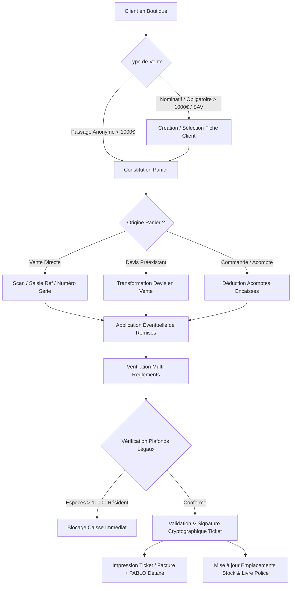
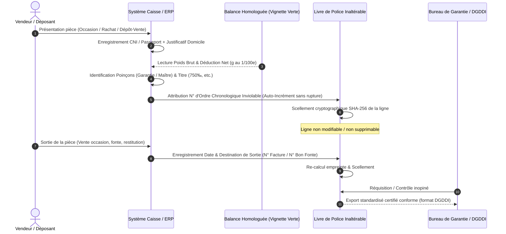
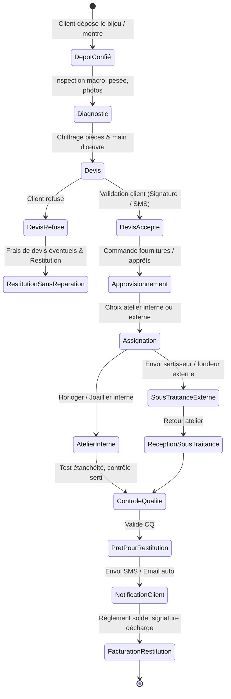
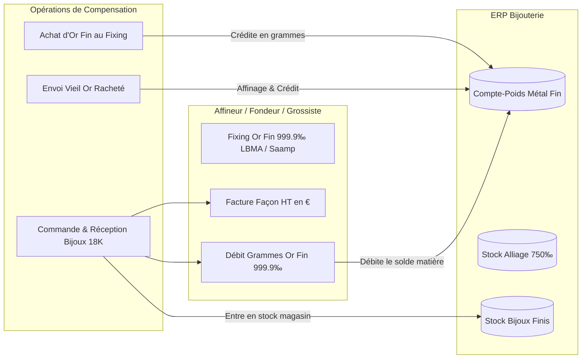
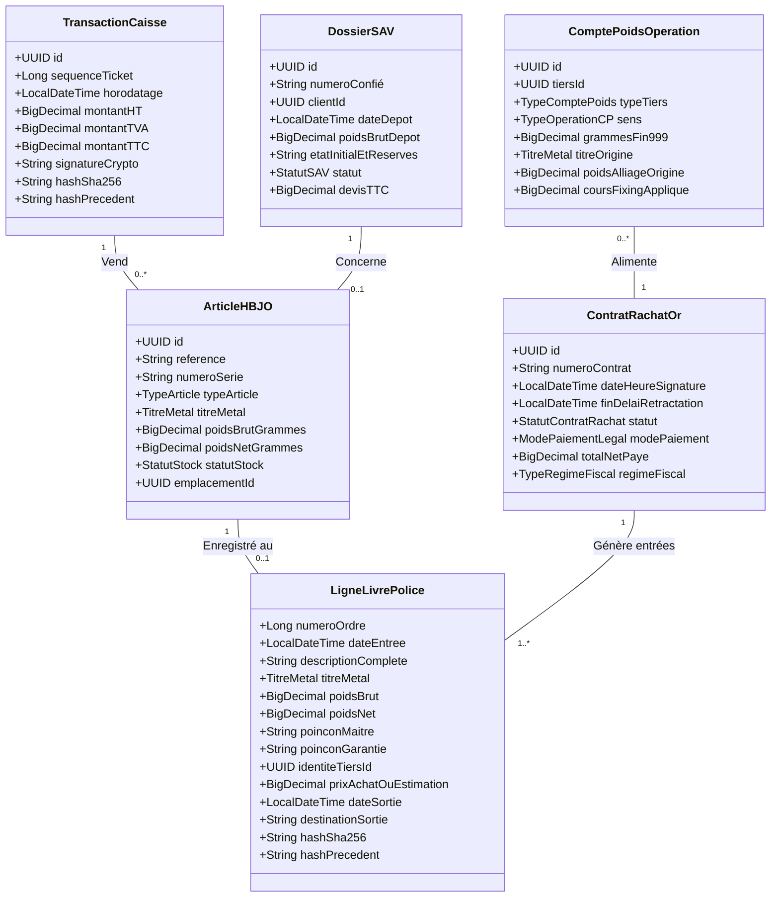
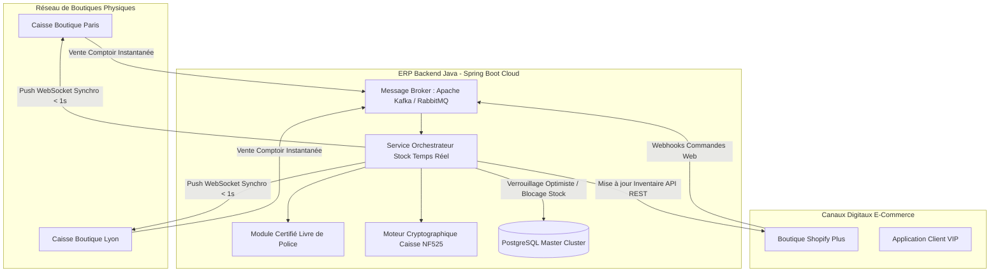

# SPÉCIFICATION FONCTIONNELLE & ANALYSE MÉTIER EXHAUSTIVE : ERP HBJO (BIJOU3)
## Réécriture Web Moderne & Préparation E-Commerce Omnicanal

---

### Introduction & Contexte du Projet

Le progiciel **Bijou3** (historiquement édité par le groupe Odeis) constitue la référence historique des logiciels de gestion pour le secteur **HBJO** (Horlogerie, Bijouterie, Joaillerie, Orfèvrerie) sur le marché français et francophone. Conçu initialement sur des architectures client lourd (bases de données relationnelles locales/client-serveur), Bijou3 embarque plus de 25 ans de règles de gestion spécifiques à un métier aux contraintes juridiques, fiscales et matérielles uniques.

Le projet de refonte consiste à développer un **ERP Web moderne**, multi-tenant ou conteneurisé, adossé à un **backend Java (Spring Boot / Jakarta EE)** robuste, découplé d'un **frontend réactif (React / TypeScript)**, tout en assurant une conformité sans faille avec le droit fiscal français (Loi Anti-Fraude TVA 2016, certification NF525/LNE, Livre de Police, CGI) et en posant les fondations d'une architecture omnicanale synchronisée avec les plateformes e-commerce (Shopify, Magento, WooCommerce, commerces headless).

---

## SOMMAIRE DÉTAILLÉ

1. [Périmètre Métier Complet de Bijou3](#1-périmètre-métier-complet-de-bijou3)
   - 1.1 [Caisse & Encaissement](#11-caisse--encaissement)
   - 1.2 [Livre de Police Informatisé](#12-livre-de-police-informatisé)
   - 1.3 [Rachat d'Or et Métaux Précieux](#13-rachat-dor-et-métaux-précieux)
   - 1.4 [Atelier, SAV & Réparations](#14-atelier-sav--réparations)
   - 1.5 [Fabrication & Sur-Mesure](#15-fabrication--sur-mesure)
   - 1.6 [Compte-Poids Métaux Précieux](#16-compte-poids-métaux-précieux)
   - 1.7 [Gestion des Stocks, Logistique & Inventaires](#17-gestion-des-stocks-logistique--inventaires)
   - 1.8 [Certification Fiscale Caisse (NF525 / LNE)](#18-certification-fiscale-caisse-nf525--lne)
2. [Règles de Gestion Critiques & Pièges Métier](#2-règles-de-gestion-critiques--pièges-métier)
3. [Matrice des Modèles de Données Clés (Java JPA / SQL)](#3-matrice-des-modèles-de-données-clés-java-jpa--sql)
4. [Architecture Recommandée pour la Synchronisation E-Commerce](#4-architecture-recommandée-pour-la-synchronisation-e-commerce)

---

# 1. PÉRIMÈTRE MÉTIER COMPLET DE BIJOU3

---

## 1.1 Caisse & Encaissement

L'encaissement en bijouterie-joaillerie est soumis à des règles rigoureuses combinant des montants de panier unitaire très élevés, une traçabilité obligatoire des acheteurs au-delà de certains seuils, et une forte diversité de moyens de paiement.



### 1.1.1 Vente de Passage vs Vente Nominative
* **Vente de passage (Client Anonyme) :**
  - Autorisée uniquement pour les montants inférieurs ou égaux à 1 000 € TTC (hors rachat d'or).
  - Interdite dès lors qu'il y a établissement d'une facture formelle, d'un certificat d'authenticité pour pierre précieuse de plus de 0.50 ct, d'une garantie horlogère de marque (ex: Rolex, Cartier, Omega imposent l'enregistrement nominatif de l'acheteur pour activer la carte de garantie électronique internationale), d'un dossier SAV, ou d'une demande de détaxe.
* **Vente nominative :**
  - Fiche client complète : Civilité, Nom, Prénom, Date de naissance (utilisée pour les programmes relationnels et vérification d'âge), Adresse postale complète, Numéro de mobile (confirmation SMS), Email, Numéro d'identité pour les montants assujettis à la lutte anti-blanchiment (LCB-FT).
  - Historique complet des achats, tailles de doigt (baguier), anniversaires, préférences de métal (Or Blanc 750‰, Or Rose, Platine).

### 1.1.2 Gestion Multi-Règlements & Plafonds Légaux
Une transaction peut combiner plusieurs modes de paiement. Le moteur d'encaissement doit valider en temps réel :
1. **Espèces (€) :**
   - **Résident fiscal français :** Plafond strict de **1 000 €** par acte d'achat (Article L112-6 du Code Monétaire et Financier). Le fractionnement artificiel d'une même vente en plusieurs factures ou tickets pour contourner le plafond est pénalement répréhensible.
   - **Non-résident fiscal (touristes étrangers) :** Plafond de **15 000 €** (Article D112-3 CMF), sous réserve de la justification d'une pièce d'identité officielle et d'une attestation de non-résidence fiscale.
   - **Rachat de métaux précieux :** Plafond d'espèces à **0,00 €** (interdiction pénale totale).
2. **Cartes Bancaires (CB, Visa, Mastercard, AMEX) :**
   - Connexion TPE via protocole concerté (Protocole IP/USB Concert ECR standard ou passerelle intégrée type Ingenico Lane/Move, Pax, Verifone).
   - Prise en charge des paiements en 3x / 4x par carte (partenaires type Alma, Oney, Floa).
3. **Chèques :**
   - Traitement des chèques de caution (dépôt SAV ou confié) sans encaissement immédiat.
   - Chèques différés avec échéancier d'encaissement planifié.
4. **Avoirs :**
   - Émis suite à un retour d'article ou geste commercial.
   - Durée de validité paramétrable (généralement 6 mois à 1 an).
   - Numéro d'avoir unique, non falsifiable, sécurisé par signature cryptographique. Interdiction de rembourser un avoir en espèces au-delà des plafonds légaux.
5. **Bons d'Achat & Cartes Cadeaux :**
   - *Cartes cadeaux à usage unique (mono-usage / SPV - Single-Purpose Voucher) :* TVA exigible dès l'émission de la carte si le lieu de livraison et le taux de TVA (ex: 20%) sont connus avec certitude.
   - *Cartes cadeaux à usages multiples (multi-usage / MPV - Multi-Purpose Voucher) :* La TVA n'est exigible qu'au moment de l'utilisation réelle du bon en caisse en contrepartie des articles délivrés.
6. **Acomptes sur commande / SAV :**
   - *Règle fiscale 2023 (Directive UE 2020/284 transposée à l'art. 269 du CGI) :* Pour les livraisons de biens, la TVA est désormais exigible au moment de l'encaissement de l'acompte (à concurrence du montant encaissé), et non plus seulement à la livraison matérielle du bien. La caisse doit générer une facture d'acompte avec TVA ventilée.

### 1.1.3 Gestion des Remises
- Remise à la ligne (sur un article spécifique) ou globale (sur le pied de ticket).
- Remise en pourcentage (%) ou en montant fixe (€).
- Matrice des droits utilisateurs :
  - Vendeur junior : max 5%.
  - Vendeur senior : max 10%.
  - Responsable de magasin / Gérant : jusqu'à 25% ou dérogation illimitée.
- Traçabilité obligatoire du collaborateur accordant la remise avec motif (Geste commercial, Client VIP, Défaut d'aspect, Vente privée).
- Impact direct sur le calcul de la TVA et de la marge brute.

### 1.1.4 Cycle Devis -> Bon de Commande -> Facture
- **Devis HBJO :** Doit comporter une date limite de validité très courte pour les pièces en or massif en raison de la volatilité du cours du métal (généralement 48h à 7 jours ouvrés).
- **Transformation :** Conversion intégrale d'un devis en bon de commande client avec versement d'acompte (généralement 30% à 50%), puis en ticket de caisse / facture finale lors de la mise à disposition.

### 1.1.5 Détaxe Touristique (PABLO)
- Édition des bordereaux de vente en détaxe électronique via l'interface certifiée **PABLO** (Douanes françaises) ou partenaires opérateurs de détaxe agréés (Global Blue, Planet Payment).
- Seuil minimum d'achat légal : 100,01 € TTC dans le même magasin sur une période de 3 jours consécutifs.
- Validation par code-barres scanné aux bornes aéroportuaires avant départ de l'Union Européenne.

---

## 1.2 Livre de Police Informatisé

Le Livre de Police (ou Registre des Objets Mobiliers et des Métaux Précieux) est le cœur réglementaire de tout établissement HBJO en France. Toute omission, rature, trou de numérotation ou déclaration inexacte relève d'infractions pénales sévèrement punies (amendes douanières, peines d'emprisonnement, fermeture administrative).



### 1.2.1 Cadre Légal Français
* **Code Général des Impôts (CGI) :** Articles 537 à 553, réglementant la garantie des métaux précieux, la déclaration d'existence auprès du Bureau de Garantie des Douanes et la tenue obligatoire du registre.
* **Code Pénal :** Article 321-7 et Décret n° 88-1040, réprimant le recel et imposant la tenue du registre d'objets mobiliers.
* **Arrêté ministériel du 29 décembre 1988 :** Fixant les mentions obligatoires et les règles de conservation du registre des objets mobiliers.
* **Dispense de paraphe physique pour logiciel informatisé :** L'article 321-7 du Code pénal autorise un registre informatisé à condition qu'il présente des garanties d'inaltérabilité, de sécurité, d'intégrité et de traçabilité équivalentes au registre papier coté et paraphé par le commissaire de police ou le maire.

### 1.2.2 Données Légales Obligatoires par Ligne de Registre
Pour chaque entrée d'un objet composé de métaux précieux (or, argent, platine) ou d'objets d'occasion :
1. **Numéro d'ordre chronologique :** Série continue sans aucune rupture, générée automatiquement par le système, ne pouvant être remise à zéro, ni modifiée rétroactivement.
2. **Date d'entrée :** Horodatage certifié de la réception physique de l'objet.
3. **Description exhaustive de l'objet :**
   - Nature (Bague solitaire, Alliance, Collier ras-de-cou, Bracelet maille forçat, Montre bracelet chronographe).
   - Métal et titre au millième : Or 750‰ (18K), Or 585‰ (14K), Or 375‰ (9K), Argent 925‰, Argent 800‰, Platine 950‰, Platine 900‰.
   - Poinçons relevés : Poinçon de Maître (forme de losange pour la fabrication française, ovale pour l'importation) et Poinçon de Garantie de l'État (Tête d'Aigle pour l'or 750‰, Coquille Saint-Jacques pour l'or 585‰, Trèfle pour l'or 375‰, Minerve pour l'argent, Tête de Chien pour le platine), ou mention expresse de dispense/absence.
   - Numéro de série gravé et marque pour l'horlogerie (ex: Rolex Submariner réf 126610LN n° série 8X4592J1).
   - Nombre, nature et estimation des pierres serties (ex: "sertie de 1 diamant taille brillant env. 0.40 ct et de 12 saphirs calibrés").
4. **Poids :**
   - **Poids brut :** Poids total pesé sur balance certifiée au centième de gramme.
   - **Poids net estimé de métal précieux :** Poids brut déduction faite des pierres, verres de montre, mécanismes, calottes de cire ou mastics (ex: manches d'argenterie fourrés de poix).
5. **Identité complète de la personne cédant l'objet (Vendeur / Déposant) :**
   - Nom de naissance, nom d'usage, prénoms.
   - Date et lieu complet de naissance.
   - Nationalité.
   - Adresse de résidence principale.
   - Type de document d'identité présenté (CNI, Passeport, Titre de séjour - permis de conduire souvent refusé par les douanes pour le rachat d'or).
   - Numéro de la pièce d'identité, autorité de délivrance et date de délivrance.
   - Si personne morale (grossiste, confrère bijoutier, commissaire-priseur) : Raison sociale, SIREN, numéro de TVA intracommunautaire, adresse du siège, numéro du bordereau d'adjudication ou de facture d'achat.
6. **Prix convenu ou Valeur estimée :** Montant financier versé ou valeur vénale d'assurance.
7. **Date de sortie et Destination :**
   - Rempli obligatoirement lors de la cession ou transformation :
     - Vente à un particulier (numéro de facture / ticket de caisse lié).
     - Envoi chez l'affineur pour fonte (numéro de bordereau d'envoi et récépissé fonderie).
     - Restitution au déposant (date et émargement de décharge).
     - Utilisation en atelier comme matière première de fabrication (numéro de fiche de fabrication).

### 1.2.3 Inaltérabilité, Sécurité & Contrôles
- **Scellement cryptographique :** Chaque écriture fait l'objet d'un calcul d'empreinte SHA-256 incluant le hash de l'écriture précédente (chaînage type blockchain interne).
- **Interdiction formelle de suppression ou modification physique (Soft/Hard Delete) :** Les erreurs matérielles ne peuvent être corrigées que par une écriture d'annulation liée, sans jamais écraser l'entrée d'origine.
- **Archivage légal obligatoire :** Conservation pendant **10 ans** minimum des données et pièces justificatives (scans des pièces d'identité, photos de l'objet sous plusieurs angles).
- **Module d'inspection et réquisition :** Exportation en un clic au format officiel réclamé par les officiers de police judiciaire ou les inspecteurs des douanes (DGDDI), avec tri par période, par nom de vendeur, par type de métal ou par numéro de série.

---

## 1.3 Rachat d'Or et Métaux Précieux

Le rachat d'or auprès des particuliers (bijoux anciens, or cassé, pièces de monnaie, lingots) est l'une des activités les plus rentables des bijouteries, mais aussi la plus encadrée juridiquement par le Code de la consommation et le Code des douanes.

### 1.3.1 Processus Légal en France
1. **Interdiction absolue du paiement en espèces :**
   - Article L112-6 du Code Monétaire et Financier et Article L224-99 du Code de la Consommation : **Le paiement en espèces est strictement interdit**, quel que soit le montant (même pour 1 €).
   - Moyens de paiement obligatoires : **Virement bancaire** sur un compte au nom exact du vendeur, ou **Chèque barré nominatif**.
2. **Droit de Rétractation de 48 Heures :**
   - Article L224-96 du Code de la Consommation : Le consommateur dispose d'un **délai de rétractation de 48 heures** à compter de la signature du contrat de rachat.
   - **Obligation de mise en quarantaine :** Le bijoutier a l'interdiction absolue de modifier l'état des objets rachetés (interdiction de fondre, casser, dessertir, polir ou revendre) pendant 48 heures calendaires.
   - Le système doit gérer un statut de stock *"En quarantaine rétractation"* avec horodatage à la seconde, bloquant toute action d'atelier ou de refonte jusqu'à échéance exacte du délai.
   - En cas d'exercice de la rétractation par le client, celui-ci restitue le prix perçu et le bijoutier lui restitue l'objet exact dans son état d'origine.
3. **Formulaire et Contrat de Rachat Obligatoire :**
   - Article L224-98 du Code de la Consommation : Contrat écrit préimprimé remis au client comportant :
     - Identité complète du professionnel et du consommateur.
     - Date et heure exacte de signature du contrat.
     - Désignation précise des objets rachetés (poids brut, poids net estimé, titre du métal en millièmes).
     - Cours de l'or appliqué au moment de la transaction (cours officiel du jour).
     - Prix d'achat au gramme par titre de métal et prix d'achat total.
     - Montant des taxes fiscales prélevées à la source.
     - Mention expresse des conditions et du formulaire détachable de rétractation.

### 1.3.2 Régimes Fiscaux Applicables au Rachat d'Or

| Régime Fiscal | CERFA | Taux Global | Assiette de Calcul | Conditions & Spécificités Métier |
| :--- | :--- | :--- | :--- | :--- |
| **Taxe Forfaitaire sur les Métaux Précieux (TMP)** | **CERFA n° 2091-SD** | **11,5 %**<br>*(11,0 % taxe État + 0,5 % CRDS)* | **Prix de cession brut total** | S'applique aux lingots, monnaies d'or post-1800, et débris/vieil or destinés à la fonte. Prélevée à la source par le bijoutier et reversée mensuellement au Trésor Public (recette des impôts). |
| **Option Taxe sur la Plus-Value Réelle (TPV)** | **CERFA n° 2092-SD** | **36,2 %**<br>*(19 % IR + 17,2 % prélèvements sociaux)* | **Plus-value nette réalisée** | Le client doit prouver par acte notarié ou facture d'achat nominative la date et le prix d'acquisition. Abattement de 5% par an dès la 3e année de détention. Exonération totale après 22 ans. |
| **Bijoux d'Occasion & Objets d'Art (< 5 000 €)** | Déclaration Livre de Police | **0,0 % (Exonéré de TMP)** | N/A | Vente de bijoux anciens complets (valeur unitaire < 5 000 €) non destinés à la refonte immédiate. Attention : si requalifié en débris par l'administration, la TMP 11,5% s'applique ! |

### 1.3.3 Constitution de Lots pour l'Affineur / Fonderie
- Regroupement des objets rachetés dont le délai de 48h est expurgé.
- Tri par titre : Or 750‰ (18K), Or 375‰ (9K), Argent 925‰, etc.
- Génération d'un **Bordereau d'Envoi Fonderie** avec scellé numéroté (ex: Sac scellé de transport de fonds avec numéro d'inviolabilité).
- Suivi du statut auprès de l'affineur (Saamp, Cookson-CLAL, Metalor) :
  - *Statut 1 : Expédié sous scellé*
  - *Statut 2 : Réceptionné au laboratoire d'analyse*
  - *Statut 3 : Fonte et prise d'échantillon (carottage)*
  - *Statut 4 : Titrage contradictoire (dosage par coupellation)*
  - *Statut 5 : Crédit sur Compte-Poids Or Fin ou Rachat au cours du fixing convenu.*

---

## 1.4 Atelier, SAV & Réparations

Le Service Après-Vente et l'atelier de réparation constituent le premier vecteur de fidélisation client et une source constante de litiges potentiels en cas de détérioration d'une pièce confiée.



### 1.4.1 Prise en Charge / Bon de Confié Client
Le bon de confié (dépôt client) engage juridiquement la responsabilité du bijoutier en tant que dépositaire salarié (Articles 1915 et suivants du Code Civil).
* **Données obligatoires de la fiche de dépôt :**
  - Numéro unique de confié (code-barres / QR code collé sur le sachet de sécurité).
  - Date et heure de réception.
  - Vendeur / Réceptionnaire ayant pris en charge la pièce.
  - Description minutieuse de la pièce :
    - Nature du bijou, couleur du métal.
    - Présence de poinçons visibles.
    - Poids brut mesuré au centième de gramme en présence du client.
    - Relevé précis de l'état initial : micro-rayures, chocs, déformation du corps de bague, griffes de sertissage tordues ou manquantes, fêlures ou égrisées sur pierres (rubis, émeraude, saphir, diamant), état du mouvement de montre (mouvement arrêté, pile ayant coulé, oxydation visible, verre rayé ou ébréché).
    - Photos haute définition (prise de vue directe via caméra tablette/webcam intégrée) rattachées au dossier.
  - Réserves écrites d'usage :
    - *"Démontage sous réserve de découverte de vices cachés ou d'oxydation interne."*
    - *"Dessertissage ou remise à taille sous réserve de casse d'une pierre comportant des inclusions préexistantes (notamment émeraudes traitées à l'huile de cèdre ou résine)."*
  - Valeur déclarée d'assurance par le client.
  - Délai estimé et signature du client (numérique sur tablette ou papier).

### 1.4.2 Workflow d'Atelier & Gestion des Tâches
- **Type d'intervention :** Mise à taille (agrandissement / rétrécissement), renfilage de collier de perles (nœud tous les grains), soudure de chaîne, rhodiage de bijou or blanc, remplacement de pile horlogère avec changement des joints et contrôle d'étanchéité à sec ou sous pression liquide, révision complète de montre automatique (démontage, nettoyage ultrasons, remontage, huilage spécifique Moebius, réglage échappement au chrono-comparateur Witschi, test de réserve de marche).
- **Gestion des Fournitures d'Atelier :**
  - Sortie de stock des apprêts nécessaires : mousqueton or 750‰, tige de boucle alpa, anneaux de saut, goupilles, piles horlogères (oxydes d'argent type 377, 364, 371).
  - Déduction du métal d'apport utilisé (or de soudure au titre légal).
- **Gestion de la Sous-Traitance (Confié Extérieur) :**
  - Génération d'un bon de confié sous-traitant (lapidaire, graveur héraldique, sertisseur, fabricant de boîtier, atelier agréé de marque horlogère).
  - Suivi des transferts de valeur hors des murs du magasin pour l'assurance (Police d'assurance bijoutier type Lloyd's ou GAN HBJO).

### 1.4.3 Contrôle Qualité, Notification & Restitution
- **Contrôle Qualité :**
  - Test d'étanchéité horlogère (norme ISO 22810 / ISO 6425 pour plongeuses) avec impression du ticket de pression (dépression et surpression en Bar / ATM).
  - Contrôle du sertissage à la binoculaire (solidité des griffes, absence de jeu des pierres).
  - Pesée finale au centième de gramme (contrôle du poids brut sortant comparé au poids entrant).
- **Notification Automatique :** Envoi d'un SMS ou email dès bascule du statut en *"Prêt pour restitution"*.
- **Restitution au Comptoir :** Émargement électronique du bon de retrait par le client, signature de décharge de bonne réception, paiement de la main-d'œuvre et clôture définitive du dossier.

---

## 1.5 Fabrication & Sur-Mesure

La fabrication joaillière (pièce unique ou petite série) requiert une traçabilité industrielle fine des composants, du métal et des pierres précieuses, couplée au calcul mathématique de la déperdition de matière.

### 1.5.1 Nomenclature Multi-Niveaux (BOM - Bill of Materials)
Une création joaillière (ex: Bague Marguerite en Or Blanc 750‰ sertie d'un saphir de Ceylan et de 10 diamants) se compose de :
1. **Corps de bague et chaton :** Métal mis en œuvre sous forme de grenaille, fil ou plané d'alliage 750‰.
2. **Apprêts :** Éventuelles pièces préformées ou systèmes de serti.
3. **Pierre centrale :** 1 Saphir taille ovale, certifié sans traitement thermique, poids exact en carats (ex: 2.35 ct).
4. **Pierres d'entourage :** 10 diamants taille brillant ronde, calibre 2.2 mm, couleur F-G, pureté VS, total 0.40 ct.
5. **Main-d'œuvre atelier (Façon) :**
   - Modélisation 3D CAO (MatrixGold / RhinoGold) et impression cire 3D résine.
   - Fonte à cire perdue.
   - Émerisage et pré-polissage.
   - Sertissage (serti grains, serti griffes ou serti clos).
   - Rhodiage au bain électrolytique (dépôt de platinoïde).
   - Polissage miroir final.

### 1.5.2 Perte au Feu & Freinte d'Atelier
- **Définition :** Lors des opérations de fonte, de limage, de fraisage, d'ajourage et de polissage, une partie du métal précieux est irrémédiablement perdue sous forme de poussières volatiles, d'oxydes ou de micro-particules incrustées dans les disques de feutre et les pâtes à polir (Dialux).
- **Formule de calcul :**
  $$\text{Freinte (g)} = \text{Poids métal brut engagé} - (\text{Poids métal sur pièce finie} + \text{Poids limailles récupérées})$$
  $$\% \text{ Perte au feu} = \frac{\text{Freinte (g)}}{\text{Poids métal brut engagé}} \times 100$$
- **Taux de perte standards admis en joaillerie :**
  - Fonte à cire perdue : 3% à 5%.
  - Fabrication main à la cheville (forgé/laminé) : 5% à 8%.
  - La récupération des balayures d'atelier, boues de bacs à ultrasons et filtres d'aspiration de polisseuse fait l'objet d'un recyclage annuel par incinération et affinage chimique chez un affineur spécialisé.

### 1.5.3 Traçabilité des Gemmes & Règle des 4C
Chaque diamant important (> 0.30 ct) et pierre de couleur précieuse (Émeraude, Rubis, Saphir) dispose d'une identité propre enregistrée dans le catalogue gemmologique de l'ERP :
- **Carat (Poids) :** 1 carat = 0,200 gramme. Mesuré au millième de carat (0,001 ct).
- **Color (Couleur) :** Échelle normalisée internationale GIA de D (Blanc exceptionnel +) à Z (Jaune teinté), ou Fancy Color (Vivid Yellow, Fancy Pink, Intense Blue).
- **Clarity (Pureté) :** FL (Flawless), IF (Internally Flawless), VVS1, VVS2, VS1, VS2, SI1, SI2, I1, I2, I3 (Piqué).
- **Cut (Taille / Proportions) :** Forme (Round Brilliant, Princess, Emerald, Oval, Cushion, Pear, Marquise) et grades de finition (Cut Grade, Polish, Symmetry, Fluorescence).
- **Certificat de Laboratoire :** Organisme certificateur indépendant (GIA, HRD Anvers, IGI, LFG Paris). Enregistrement du numéro de certificat et du lien direct vers l'API de vérification du laboratoire (GIA Report Check).
- **Gravure Laser :** Numéro de certificat gravé de manière microscopique sur le rondiste du diamant.
- **Conformité Processus de Kimberley :** Déclaration légale obligatoire sur chaque facture commerciale garantissant que les diamants proviennent de sources légitimes non impliquées dans le financement de conflits armés.

### 1.5.4 Réglementation du Décret n° 2002-65 (Pierres Synthétiques vs Naturelles)
Le décret français n° 2002-65 du 14 janvier 2002 impose une terminologie d'une sévérité absolue pour protéger le consommateur :
- Obligation stricte de qualifier toute pierre non naturelle de **"synthétique"** ou **"pierre de synthèse"** (ex: "Diamant de laboratoire", "Lab-Grown Diamond" doit légalement être désigné en France comme *"Diamant synthétique"*).
- Interdiction absolue d'employer les adjectifs *"vrai"*, *"précieux"*, *"fin"*, *"naturel"* pour désigner un diamant ou une pierre synthétique sous peine de délit pénal de tromperie sur la marchandise.
- L'ERP doit interdire tout étiquetage ou génération de facture ne respectant pas ces dénominations normalisées.

---

## 1.6 Compte-Poids Métaux Précieux

Le Compte-Poids est une spécificité financière et comptable propre au secteur HBJO : il permet de dissocier contractuellement la facturation de la valeur de la matière première (l'or ou le platine au cours de bourse) et celle du travail de manufacture (la façon).



### 1.6.1 Fonctionnement du Compte-Poids Fournisseur
1. **Séparation Façon / Métal :** Lorsqu'un joaillier achète une chaîne ou une monture à un fabricant (ex: Gay Frères, Pichard-Balme) :
   - Le fabricant émet une facture en euros correspondant uniquement à la main-d'œuvre et aux frais de fabrication (ex: 45 € la façon).
   - Le fabricant débite le **Compte-Poids** du bijoutier du nombre exact de grammes d'or fin contenu dans le bijou (ex: pour une bague de 10,00 g en or 750‰, débit de $10,00 \times 0,750 = 7,50$ g d'or fin 999.9‰).
2. **Mécanismes d'Alimentation du Compte-Poids :**
   - **Règlement en matière physique :** Le bijoutier expédie à l'affineur/fournisseur son vieil or issu du rachat client ou de ses limailles d'atelier. Après affinage, son compte-poids est crédité du poids fin net obtenu.
   - **Fixing / Achat de métal fin financier :** Le bijoutier "fixe" (achète) du métal fin au cours du jour auprès du fournisseur pour solder sa position débitrice.

### 1.6.2 Compte-Poids Client (Transformation / Façon Particulier)
- Un client apporte ses anciens bijoux de famille (ex: 3 alliances cassées en or 18 carats pour un poids de 15,00 g).
- Le bijoutier ouvre un compte-poids client :
  - Enregistrement des 15,00 g d'or 750‰ dans le Livre de Police.
  - Déduction conventionnelle d'une freinte d'affinage (ex: 3% à 5%).
  - Crédit du compte-poids client de $15,00 \times 0,750 \times (1 - 0,03) = 10,91$ g d'or fin équivalent.
- Lors de la livraison de la nouvelle bague sur-mesure (ex: 8,00 g d'or 750‰, soit 6,00 g de fin) :
  - Débit de 6,00 g de fin sur le compte-poids client.
  - Le solde restant (4,91 g de fin) reste disponible pour une création future ou fait l'objet d'un rachat formel.
  - Le client ne paye au comptoir que la façon (main-d'œuvre de création) soumise à TVA 20%.

### 1.6.3 Intégration du Cours de l'Or en Temps Réel & Fixing
- Connexion via API aux cotations internationales :
  - **LBMA (London Bullion Market Association) :** Fixing Or AM / PM en USD et EUR par once troy (31,1034768 g).
  - Cotations quotidiennes des affineurs français (Cookson-CLAL, Saamp, CPoR Devises).
- Gestion de la couverture de risque (Hedging) : Possibilité de geler le cours du métal pour une commande client confirmée afin de neutraliser le risque de variation des cours entre la signature du devis et la fabrication effective.

---

## 1.7 Gestion des Stocks, Logistique & Inventaires

Le stock d'une bijouterie se caractérise par une forte valeur financière concentrée dans un volume physique extrêmement réduit, imposant une traçabilité unitaire de chaque pièce de valeur et des protocoles de sécurité stricts.

### 1.7.1 Gestion Sérialisée vs Lots
- **Pièces Uniques / Précieuses (Gestion Sérialisée) :**
  - Bagues, colliers, boucles d'oreilles, montres de moyenne et haute horlogerie.
  - Chaque pièce physique se voit attribuer un **numéro d'inventaire unique (Tag/Serial)** dès son entrée en stock.
  - La fiche de stock conserve : date d'entrée, provenance fournisseur, poids brut exact, poids net estimé, titre du métal, détail des gemmes serties, photo contractuelle, coût d'achat détaillé (métal + façon + pierres), prix de vente TTC.
- **Articles de Série & Fournitures (Gestion par Lots / Quantité) :**
  - Écrins, pochettes suédine, piles horlogères, produits d'entretien (bains nettoyants Hagerty), fermoirs et apprêts basiques.

### 1.7.2 Emplacements Physiques Haute Sécurité & "Mise au Coffre"
L'ERP doit modéliser la topographie physique exacte du point de vente et de ses zones de sécurité :
- *Zone 1 : Vitrine extérieure n°1, Plateau n°A, Case n°03.*
- *Zone 2 : Vitrine centrale sécurisée, Présentoir rotatif.*
- *Zone 3 : Coffre-fort principal (Tiroir or 18K, Étagère montres, Coffre de nuit).*
- *Zone 4 : Tiroir Atelier SAV.*
- *Zone 5 : Coffre de quarantaine rachat d'or 48h.*
- **Procédure quotidienne de "Mise au Coffre" (In & Out) :**
  - **Fermeture du soir :** Transfert de masse des plateaux de vitrine vers le coffre-fort central. Pointage par scan code-barres ou scan RFID des plateaux pour s'assurer qu'aucun bijou n'est resté en vitrine ou en zone d'essayage.
  - **Ouverture du matin :** Déstockage sécurisé du coffre vers les vitrines d'exposition avec vérification contradictoire des manques.

### 1.7.3 Étiquetage Spécifique Bijouterie
L'étiquetage en bijouterie fait face à des contraintes physiques extrêmes : les bijoux sont exposés sous des éclairages halogènes/LED chauffants, essayés au doigt, immergés dans des cuves de nettoyage aux ultrasons et passés au nettoyeur vapeur à 4 bars.
- **Support physique :** Étiquettes synthétiques indéchirables en polypropylène ou polyester, formes spécifiques :
  - *Étiquette Haltère (ou Rat-Tail / Papillon) :* Deux zones imprimables reliées par un fil central non adhésif qui entoure le corps de la bague ou la maille du bracelet sans coller sur le métal ni laisser de résidus de colle.
  - *Étiquette Filot :* Étiquette à œillet traversée par un fil nylon scellé par un plomb plastique inviolable.
- **Mentions légales obligatoires sur l'étiquette :**
  - Titre légal du métal en millièmes (ex: 750‰).
  - Désignation précise de la gemme principale (ex: Diamant, Émeraude).
  - Poids net de métal précieux (pour les articles vendus au poids ou de plus de 10 g).
  - Code-barres haute densité (Code 128, DataMatrix ou QR Code miniaturisé lisible par lecteur optique 2D).
  - Prix de vente public TTC.

### 1.7.4 Inventaires : Inventaire Fiscal Annuel & Tournants
1. **Inventaire Fiscal Annuel Obligatoire :**
   - **Double comptage :**
     1. Comptage quantitatif unitaire pièce par pièce.
     2. **Pesée globale par titre de métal :** Pesée cumulative de tous les articles Or 750‰, Or 375‰, Argent 925‰ pour comparer le poids théorique en base de données au poids réel pesé sur la balance fiscale.
2. **Inventaires Tournants :**
   - Inventaire journalier ou hebdomadaire d'un plateau ou d'une famille d'articles (ex: contrôle quotidien des plateaux d'alliances ou des vitrines de montres de luxe).
   - Analyse immédiate des écarts de stock : identification des démarques inconnues (vols à l'étalage, erreurs de rangement, oublis de saisie en confié SAV).

---

## 1.8 Certification Fiscale Caisse (NF525 / LNE)

Depuis le 1er janvier 2018 (Article 88 de la Loi de Finances n° 2015-1785 pour 2016, codifié à l'article 286, I-3° bis du CGI), tout logiciel de caisse enregistreuse utilisé par un assujetti à la TVA en France doit satisfaire aux exigences d'inaltérabilité, de sécurisation, de conservation et d'archivage des données de règlement.

```mermaid
graph TD
    subgraph Transaction [Enregistrement Transaction Caisse]
        T_Courant[Ticket N° T1000]
        T_Precedent[Hash Ticket N° T999 : H_prev]
        DonneesTicket[Articles, Montants HT/TVA/TTC, Règlements, Date/Heure]
    end

    subgraph ChaineCrypto [Moteur Cryptographique SHA-256]
        Concat[Concaténation : H_prev + DonneesTicket + Horodatage]
        HashCalc[Calcul Hash SHA-256 : H_courant]
        SignatureRSA[Signature Numérique : Clé Privée Système]
    end

    subgraph StockageInalterable [Journal Cryptographique & Clôtures]
        BDD[(Base de Données Immuable)]
        JET[(Journal des Événements Techniques - JET)]
        ClotureZ[Clôture Z Journalière / Grand Total Perpétuel]
    end

    T_Courant --> DonneesTicket
    T_Precedent --> Concat
    DonneesTicket --> Concat
    Concat --> HashCalc
    HashCalc --> SignatureRSA
    HashCalc --> BDD
    SignatureRSA --> BDD
    T_Courant -.->|Événement Technique (ex: modif prix, annulation)| JET
    BDD --> ClotureZ
```

### 1.8.1 Les 4 Piliers Fondamentaux de la Loi Anti-Fraude TVA

#### 1. Inaltérabilité
- Toute validation de ticket de caisse, facture comptoir, acompte ou avoir est définitive et irréversible.
- Chaînage cryptographique : Chaque enregistrement calcule un hash cryptographique (SHA-256) combinant les données de la transaction courante et le hash de la transaction immédiatement précédente.
- Toute tentative d'insertion, d'altération en base ou de suppression de ligne brise la chaîne d'intégrité et est immédiatement détectée lors des contrôles fiscaux.
- Les corrections d'erreurs s'effectuent exclusivement par émission d'un avoir ou d'une écriture en négatif dûment justifiée et chaînée.

#### 2. Sécurisation
- Scellement des enregistrements et des journaux par signature électronique asymétrique (clé privée interne sécurisée dans un coffre de clés / HSM / Keystore protégé).
- Empreinte numérique imprimée en bas de chaque ticket sous forme de chaîne hexadécimale ou QR Code certifié.

#### 3. Conservation
- Toutes les données de caisse détaillées (lignes de vente, remises, moyens de paiement, modifications d'articles) doivent être conservées en ligne et instantanément consultables pendant une durée minimale de **6 ans** (délai de reprise de l'administration fiscale - article L102 B du Livre des Procédures Fiscales).

#### 4. Archivage
- Procédures automatisées d'archivage périodique (au minimum annuel et lors de la clôture d'exercice).
- L'archive fiscale doit être figée, compressée, datée de façon certaine (horodatage externe sécurisé) et scellée avec une empreinte globale enregistrée dans un journal d'archive inviolable.

### 1.8.2 Clôtures Z Périodiques & Compteurs Cumulatifs
- **Z de Caisse Journalier :**
  - Déclenché chaque soir lors de la fin de journée.
  - Calcule le chiffre d'affaires journalier ventilé par taux de TVA (20%, 10%, 5.5%, 0%, TVA sur marge).
  - Calcule la ventilation exacte par mode de règlement (Espèces, CB, Chèque, Avoir, Virement).
  - Met à jour le **Grand Total Perpétuel (GT)** : Compteur cumulatif perpétuel non réinitialisable, qui s'incrémente continuellement depuis le premier jour de mise en service du logiciel.
- **Z Mensuel & Z Annuel :** Consolidation périodique chaînée des totaux journaliers et mensuels.

### 1.8.3 Journal des Événements Techniques (JET)
Le JET est une boîte noire informatique enregistrant tous les événements susceptibles d'impacter l'intégrité du système de vente :
- Ouverture et fermeture du logiciel / de la session caisse.
- Création, modification ou suppression d'un utilisateur et de ses privilèges.
- Ouverture manuelle du tiroir-caisse sans transaction de vente (avec motif obligatoire).
- Annulation de ligne avant validation de ticket, abandon complet de panier en cours.
- Réimpression d'un ticket de caisse ou facture (mention obligatoire *"DUPLICATA"* en filigrane indélébile avec compteur d'impressions).
- Déconnexion ou défaillance de périphériques (TPE, imprimante ticket, balance).
- Modifications des paramètres de taux de taxe ou changement d'horloge système (détection des reculs d'heure frauduleux).

---

# 2. RÈGLES DE GESTION CRITIQUES & PIÈGES MÉTIER

Cette section recense les spécificités et chausse-trappes du métier HBJO que les développeurs d'ERP généralistes ignorent systématiquement, entraînant des failles comptables, fiscales ou matérielles majeures.

---

### Piège n°1 : Confusion entre Poids Brut et Poids Net de Métal Précieux
* **Erreur classique du développeur :** Créer un champ unique `poids: BigDecimal` sur la table article.
* **Réalité métier :**
  - **Poids Brut (Gross Weight) :** Poids total affiché par la balance de précision (ex: une bague en or 18K ornée d'un gros quartz pèse 18,45 g bruts).
  - **Poids Net (Net Metal Weight) :** Poids réel du métal précieux composant la structure (dans l'exemple, le quartz pèse 4,20 g, le poids net d'or 750‰ est de 14,25 g).
* **Conséquences :**
  - Le calcul du compte-poids et de la perte au feu ne s'applique **QUE** sur le poids net.
  - La valeur patrimoniale et la conformité au Livre de Police imposent d'enregistrer les deux grandeurs distinctes.

---

### Piège n°2 : Gestion des Types Numériques & Métrologie Légale
* **Erreur classique du développeur :** Utiliser des types primitifs `double` ou `float` en Java, provoquant des erreurs d'arrondi binaire en virgule flottante (ex: `0.1 + 0.2 = 0.30000000000000004`).
* **Réalité métier :**
  - Métrologie des balances :
    - Balances pour métaux précieux : **Classe II**, homologuées par la DREETS (Direction régionale de l'économie, de l'emploi, du travail et des solidarités), précises au **centième de gramme (0,01 g)**, portant la vignette verte de vérification annuelle.
    - Balances pour diamants et pierres précieuses : **Classe I**, précises au **milligramme (0,001 g ou 0,005 ct)**.
* **Règle d'implémentation Java/SQL :**
  - Type Java obligatoire : `BigDecimal` avec échelle explicite :
    - Grammes métaux : `scale = 2` ou `scale = 3` (ex: `NUMERIC(10, 3)`).
    - Carats gemmes : `scale = 3` ou `scale = 4` (ex: `NUMERIC(10, 4)`).
  - Mode d'arrondi légal : `RoundingMode.HALF_UP` (arrondi arithmétique standard au plus proche).

---

### Piège n°3 : Régime de la TVA sur la Marge (Article 297 A du CGI)
* **Erreur classique du développeur :** Appliquer une TVA standard de 20% sur le prix de vente TTC des bijoux anciens ou d'occasion.
* **Réalité métier :**
  - Lorsqu'un bijoutier achète un bijou d'occasion à un particulier (non assujetti), il ne récupère aucune TVA à l'achat.
  - Lors de la revente du bijou en l'état, il applique le régime dérogatoire de la **TVA sur la marge bénéficiaire** :
    $$\text{Marge Brute TTC} = \text{Prix de Vente TTC} - \text{Prix d'Achat Réel}$$
    $$\text{TVA Collectée} = \text{Marge Brute TTC} - \left( \frac{\text{Marge Brute TTC}}{1 + \text{Taux TVA}} \right)$$
  - *Exemple :* Bijou acheté 1 000 € à un particulier, revendu 1 600 € TTC.
    - Marge TTC = 600 €.
    - Marge HT = $600 / 1,20 = 500$ €.
    - TVA à reverser = 100 €. (Et non pas $1600 \times 20/120 = 266,67$ €).
* **Interdiction légale sur la facture :**
  - **La facture remise au client final ne doit JAMAIS mentionner le montant ni le taux de la TVA !** (Mentionner la TVA révélerait la marge commerciale exacte du bijoutier au client).
  - Mention légale obligatoire imprimée sur la facture : *"Régime particulier - Biens d'occasion - Application de l'article 297 A du CGI et de la directive européenne 2006/112/CE"*.
* **Perte du régime en cas de refonte :** Si le bijou d'occasion est démonté ou fondu pour créer une nouvelle pièce, la TVA sur la marge devient immédiatement inapplicable. Le nouveau bijou créé est soumis à la TVA de droit commun de 20% sur l'intégralité de son prix de vente !

---

### Piège n°4 : Pierres Non Desserties lors d'un Dépôt ou Rachat
* **Erreur classique du développeur :** Exiger la pesée séparée de chaque pierre au moment de la réception d'un bijou confié ou racheté.
* **Réalité métier :**
  - On ne peut pas dessertir une pierre sans endommager le sertissage (griffes usées, risque d'ébrécher la culasse ou le feuilletis).
  - Les experts bijoutiers utilisent des **formules gemmologiques d'estimation volumétrique** (mesure au calibre Leveridge ou pied à coulisse digital au centième de millimètre) :
    $$\text{Poids estimé diamant brillant (ct)} = \text{Diamètre moyen}^2 \times \text{Hauteur} \times 0,0061 \times (1 + \text{Correction rondiste})$$
  - Le système doit permettre la saisie des dimensions physiques (diamètre, hauteur) pour calculer une estimation automatique du poids de la pierre en carats, puis déduire ce poids du poids brut total pour obtenir le poids net théorique du métal.

---

### Piège n°5 : Réglementation des Poinçons & Dispenses Légales
* **Erreur classique du développeur :** Rendre obligatoire la présence d'un poinçon de garantie officiel de l'État sur tout article en or ou argent.
* **Réalité légale française (Article 524 du CGI) :**
  - **Dispense du Poinçon de Garantie de l'État :**
    - Articles en or ou en platine d'un poids inférieur à **3 grammes**.
    - Articles en argent d'un poids inférieur à **30 grammes**.
  - **Maintien obligatoire du Poinçon de Maître (Fabricant) ou de Responsabilité (Importateur) :** Même pour les pièces dispensées du poinçon de garantie, le poinçon de maître demeure légalement obligatoire (sauf pour les pièces trop fragiles ne pouvant supporter la frappe mécanique ou laser sans déformation).

---

### Piège n°6 : Interdiction Pénale des Espèces pour le Rachat d'Or
* **Erreur classique du développeur :** Autoriser le mode de règlement "Espèces" dans le module de rachat d'or si le montant est inférieur à 1 000 €.
* **Réalité juridique :** L'article L112-6 du Code Monétaire et Financier et l'article L224-99 du Code de la Consommation excluent totalement les espèces pour l'achat de métaux précieux sous toutes leurs formes. **Même pour 5 euros, le paiement en espèces est un délit pénal.** Le système doit désactiver et masquer irrévocablement l'option espèces lors de tout contrat de rachat d'or.

---

# 3. MATRICE DES MODÈLES DE DONNÉES CLÉS (JAVA JPA / SQL)

Cette section fournit aux architectes backend la modélisation structurelle des principales entités du domaine HBJO sous forme de classes Java Jakarta Persistence (JPA).



---

### 3.1 Entité Article HBJO (Gestion du Métal, Poids et Sérialisation)

```java
package com.bijoux.domain.stock;

import jakarta.persistence.*;
import jakarta.validation.constraints.NotNull;
import java.math.BigDecimal;
import java.util.UUID;

@Entity
@Table(name = "article_hbjo", indexes = {
    @Index(name = "idx_art_ref", columnList = "reference", unique = true),
    @Index(name = "idx_art_num_serie", columnList = "numero_serie"),
    @Index(name = "idx_art_statut", columnList = "statut_stock")
})
public class ArticleHBJO {

    @Id
    @GeneratedValue(strategy = GenerationType.UUID)
    private UUID id;

    @NotNull
    @Column(name = "reference", nullable = false, unique = true, length = 50)
    private String reference;

    @Column(name = "numero_serie", length = 100)
    private String numeroSerie; // Obligatoire pour montres de luxe et pièces sérialisées

    @NotNull
    @Enumerated(EnumType.STRING)
    @Column(name = "type_article", nullable = false)
    private TypeArticle typeArticle; // BIJOU_OR, BIJOU_ARGENT, MONTRE, PIERRE_ISOLEE, APPRET

    @Enumerated(EnumType.STRING)
    @Column(name = "titre_metal")
    private TitreMetal titreMetal; // OR_750, OR_585, OR_375, ARGENT_925, PLATINE_950

    /**
     * Poids total affiché par la balance de précision (pierres et mécanismes inclus).
     */
    @NotNull
    @Column(name = "poids_brut_grammes", nullable = false, precision = 10, scale = 3)
    private BigDecimal poidsBrutGrammes;

    /**
     * Poids net réel de métal précieux déduction faite des corps étrangers.
     */
    @Column(name = "poids_net_grammes", precision = 10, scale = 3)
    private BigDecimal poidsNetGrammes;

    @NotNull
    @Enumerated(EnumType.STRING)
    @Column(name = "statut_stock", nullable = false)
    private StatutStock statutStock; // EN_STOCK, EN_VITRINE, EN_COFFRE, EN_SAV, VENDU, EN_QUARANTAINE_RETRACTATION

    @Column(name = "taille_doigt")
    private Integer tailleDoigt; // Ex: 52, 54

    @Column(name = "est_occasion", nullable = false)
    private Boolean estOccasion = false; // Conditionne la TVA sur la marge

    @Column(name = "prix_achat_ht", precision = 12, scale = 2)
    private BigDecimal prixAchatHT;

    @Column(name = "prix_vente_ttc", precision = 12, scale = 2)
    private BigDecimal prixVenteTTC;

    @ManyToOne(fetch = FetchType.LAZY)
    @JoinColumn(name = "emplacement_id")
    private EmplacementPhysique emplacement;

    // Getters, Setters, Equals, HashCode...
}
```

---

### 3.2 Entité Livre de Police (Ligne Inaltérable Inviolable)

```java
package com.bijoux.domain.police;

import jakarta.persistence.*;
import jakarta.validation.constraints.NotNull;
import java.math.BigDecimal;
import java.time.LocalDateTime;
import java.util.UUID;

@Entity
@Table(name = "livre_police_ligne", indexes = {
    @Index(name = "idx_lp_num_ordre", columnList = "numero_ordre", unique = true),
    @Index(name = "idx_lp_date_entree", columnList = "date_entree")
})
public class LigneLivrePolice {

    @Id
    @GeneratedValue(strategy = GenerationType.IDENTITY)
    private Long id;

    /**
     * Numéro chronologique continu sans aucune rupture ni possibilité de modification.
     */
    @NotNull
    @Column(name = "numero_ordre", nullable = false, unique = true, updatable = false)
    private Long numeroOrdre;

    @NotNull
    @Column(name = "date_entree", nullable = false, updatable = false)
    private LocalDateTime dateEntree;

    @NotNull
    @Column(name = "description_complete", nullable = false, length = 1000, updatable = false)
    private String descriptionComplete;

    @Enumerated(EnumType.STRING)
    @Column(name = "titre_metal", updatable = false)
    private TitreMetal titreMetal;

    @NotNull
    @Column(name = "poids_brut", nullable = false, precision = 10, scale = 3, updatable = false)
    private BigDecimal poidsBrut;

    @Column(name = "poids_net", precision = 10, scale = 3, updatable = false)
    private BigDecimal poidsNet;

    @Column(name = "poincon_maitre", length = 100, updatable = false)
    private String poinconMaitre;

    @Column(name = "poincon_garantie", length = 100, updatable = false)
    private String poinconGarantie;

    /**
     * Identité complète du vendeur ou provenance (particulier, confrère, succession).
     */
    @NotNull
    @ManyToOne(fetch = FetchType.LAZY, optional = false)
    @JoinColumn(name = "tiers_identite_id", nullable = false, updatable = false)
    private TiersIdentite tiersIdentite;

    @Column(name = "prix_achat_ou_estimation", precision = 12, scale = 2, updatable = false)
    private BigDecimal prixAchatOuEstimation;

    /**
     * Données de sortie (complétées au moment de la cession, restitution ou fonte).
     */
    @Column(name = "date_sortie")
    private LocalDateTime dateSortie;

    @Column(name = "destination_sortie", length = 255)
    private String destinationSortie; // Ex: "Facture F2026-0894" ou "Bordereau Fonte Saamp n° 4512"

    /**
     * Chaînage cryptographique NF525 / Livre de Police.
     */
    @NotNull
    @Column(name = "hash_sha256", nullable = false, length = 64, updatable = false)
    private String hashSha256;

    @NotNull
    @Column(name = "hash_precedent", nullable = false, length = 64, updatable = false)
    private String hashPrecedent;

    // Getters, Setters protégés...
}
```

---

### 3.3 Entité Rachat d'Or (Contrat, Fiscalité & Rétractation 48h)

```java
package com.bijoux.domain.rachat;

import jakarta.persistence.*;
import jakarta.validation.constraints.NotNull;
import java.math.BigDecimal;
import java.time.LocalDateTime;
import java.util.UUID;

@Entity
@Table(name = "contrat_rachat_or")
public class ContratRachatOr {

    @Id
    @GeneratedValue(strategy = GenerationType.UUID)
    private UUID id;

    @NotNull
    @Column(name = "numero_contrat", nullable = false, unique = true, length = 50)
    private String numeroContrat;

    @NotNull
    @Column(name = "date_heure_signature", nullable = false)
    private LocalDateTime dateHeureSignature;

    /**
     * Date et heure exacte d'expiration du délai légal de rétractation (H + 48h calendaires).
     */
    @NotNull
    @Column(name = "fin_delai_retractation", nullable = false)
    private LocalDateTime finDelaiRetractation;

    @NotNull
    @Enumerated(EnumType.STRING)
    @Column(name = "statut", nullable = false)
    private StatutContratRachat statut; // EN_COURS_48H, RETRACTE, VALIDE_DEFINITIF, EXPEDIE_FONTE

    @NotNull
    @Enumerated(EnumType.STRING)
    @Column(name = "mode_paiement_legal", nullable = false)
    private ModePaiementLegal modePaiementLegal; // VIREMENT_BANCAIRE, CHEQUE_BARRE (ESPÈCES INTERDITES)

    @NotNull
    @Enumerated(EnumType.STRING)
    @Column(name = "regime_fiscal", nullable = false)
    private RegimeFiscalRachat regimeFiscal; // TMP_11_5, PLUS_VALUE_REELLE_CERFA_2092, EXONERE_BIJOU_OCCASION

    @Column(name = "total_brut_estime", precision = 12, scale = 2)
    private BigDecimal totalBrutEstime;

    @Column(name = "montant_taxe_prelevee", precision = 12, scale = 2)
    private BigDecimal montantTaxePrelevee;

    @NotNull
    @Column(name = "total_net_paye", nullable = false, precision = 12, scale = 2)
    private BigDecimal totalNetPaye;

    // Getters, Setters...
}
```

---

### 3.4 Entité Compte-Poids (Gestion Matière en Or Fin 999.9‰)

```java
package com.bijoux.domain.comptepoids;

import jakarta.persistence.*;
import jakarta.validation.constraints.NotNull;
import java.math.BigDecimal;
import java.time.LocalDateTime;
import java.util.UUID;

@Entity
@Table(name = "compte_poids_operation")
public class ComptePoidsOperation {

    @Id
    @GeneratedValue(strategy = GenerationType.UUID)
    private UUID id;

    @NotNull
    @Column(name = "tiers_id", nullable = false)
    private UUID tiersId; // ID Fournisseur (Saamp/Cookson) ou ID Client Joaillerie

    @NotNull
    @Enumerated(EnumType.STRING)
    @Column(name = "type_tiers", nullable = false)
    private TypeTiersCP typeTiers; // FOURNISSEUR, CLIENT

    @NotNull
    @Enumerated(EnumType.STRING)
    @Column(name = "sens_operation", nullable = false)
    private SensOperationCP sensOperation; // DEBIT (Sortie matière), CREDIT (Entrée matière)

    /**
     * Quantité de métal fin exprimée rigoureusement en Or Fin 999.9‰.
     */
    @NotNull
    @Column(name = "grammes_fin_999", nullable = false, precision = 12, scale = 3)
    private BigDecimal grammesFin999;

    @Enumerated(EnumType.STRING)
    @Column(name = "titre_origine")
    private TitreMetal titreOrigine; // Ex: OR_750

    @Column(name = "poids_alliage_origine", precision = 12, scale = 3)
    private BigDecimal poidsAlliageOrigine;

    @Column(name = "cours_fixing_applique", precision = 10, scale = 2)
    private BigDecimal coursFixingApplique; // Cours en € / gramme fin au moment de la transaction

    @NotNull
    @Column(name = "date_operation", nullable = false)
    private LocalDateTime dateOperation;

    @Column(name = "reference_piece_jointe", length = 100)
    private String referencePieceJointe; // N° Facture façon, N° Bon d'envoi fonte

    // Getters, Setters...
}
```

---

# 4. ARCHITECTURE RECOMMANDÉE POUR LA SYNCHRONISATION E-COMMERCE

Le futur e-commerce omnicanal présente des défis redoutables en bijouterie : si un client achète en ligne une bague unique en taille 54 qui vient d'être essayée et vendue en boutique 3 minutes plus tôt, le risque de rupture et de mécontentement est critique.



### 4.1 Principes Directeurs de l'Architecture Technique
1. **Événements Asynchrones Haute Performance (EDA - Event-Driven Architecture) :**
   - Utilisation d'un courtier d'événements (Apache Kafka ou RabbitMQ) pour publier les événements d'inventaire (`ArticleReservedEvent`, `ArticleSoldEvent`, `StockTransferredEvent`).
   - Tout article à pièce unique (sérialisé) vendu en magasin physique déclenche immédiatement un webhook vers la plateforme e-commerce pour le retirer du catalogue en ligne en **moins d'une seconde**.
2. **Gestion des Réservations E-Commerce & Conflits de Concurrence :**
   - Mécanisme de verrouillage temporaire (*Soft Hold*) : Lorsqu'un internaute ajoute un bijou unique dans son tunnel d'achat en ligne, l'ERP pose une réservation de 15 minutes. Si la commande n'est pas payée, le stock est libéré.
   - En boutique physique, l'écran de caisse avertit le vendeur : *"Attention, cet article est actuellement en cours de paiement sur le site web"*.
3. **Mise à Taille & Précommandes E-Commerce :**
   - La plupart des bagues en stock sont présentées en taille standard (souvent 52 ou 54 pour femme).
   - Le module e-commerce doit permettre de commander la bague dans une autre taille (ex: 58) : l'ERP génère alors automatiquement une commande atelier de mise à taille liée, ou une fiche de fabrication sur-mesure avec réapprovisionnement métal et gemmes.

---

### Résumé de Synthèse à Destination des Équipes de Développement

1. **Priorité absolue n°1 (Légal & Fiscal) :** L'intégrité du **Livre de Police** et la conformité **NF525 / Anti-fraude TVA 2016** doivent être intégrées dès la conception du modèle relationnel (immutabilité, chaînage de hash SHA-256, absence de suppression logique/physique).
2. **Priorité absolue n°2 (Précision Numérique) :** Bannir tout type flottant. Travailler exclusivement avec `BigDecimal` au centième de gramme pour les métaux et au dix-millième pour les gemmes.
3. **Priorité absolue n°3 (Processus Rachat d'Or) :** Coder en dur l'interdiction des espèces et le sas de quarantaine obligatoire de 48 heures avant toute manipulation de matière rachetée.
4. **Priorité absolue n°4 (Compte-Poids & Fixing) :** Modéliser la séparation native entre la valeur matière (or fin 999.9‰) et la façon monétaire.
