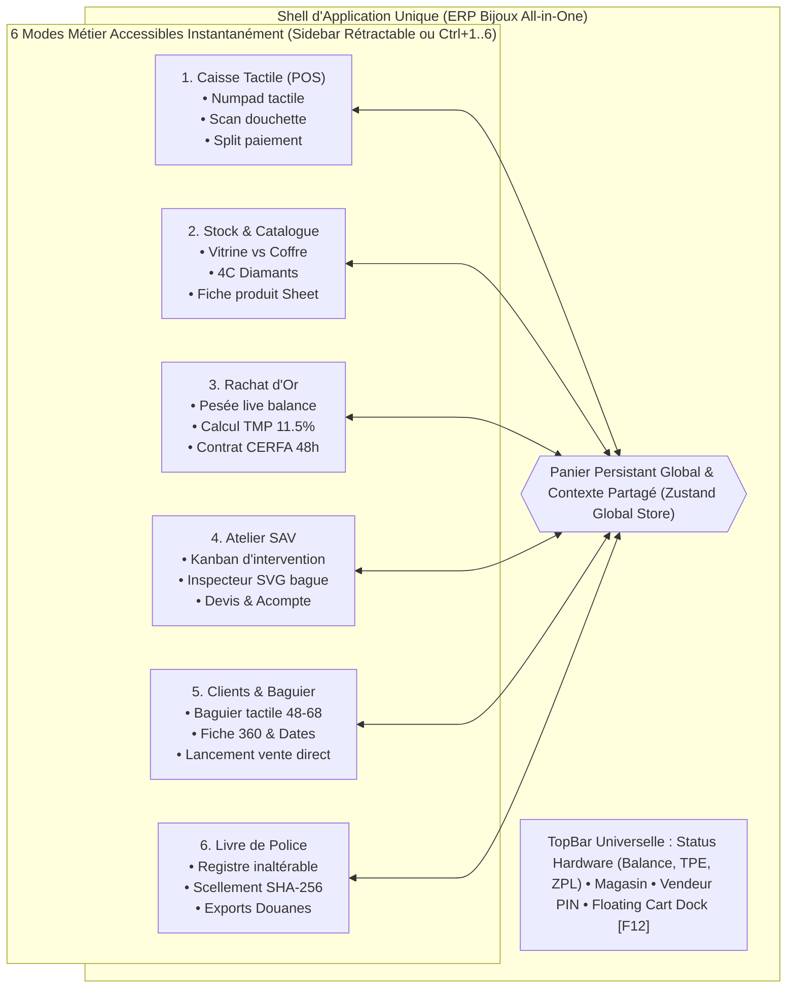
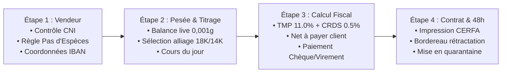

# 💎 ERP BIJOUX — SPÉCIFICATION D'ARCHITECTURE UX & DESIGN SYSTEM UNIFIÉ
## Plateforme Unique "All-in-One", Ergonomie Tactile & Thème Clair Joaillerie

**Auteur :** Senior HBJO UX Architect  
**Destinataires :** Lead UI Engineers, Développeurs Frontend React 19, Direction Produit HBJO  
**Version :** 2.0.0 — Unified Architecture Edition  
**Statut :** Spécification Maître Validée & Prête pour Implémentation  

---

## SOMMAIRE EXÉCUTIF

1. [Vision Produit : Le Paradigme "All-in-One" Joaillerie](#1-vision-produit--le-paradigme-all-in-one-joaillerie)
   - 1.1 [Fin de la fracture Caisse vs Back-Office](#11-fin-de-la-fracture-caisse-vs-back-office)
   - 1.2 [Le Choix Stratégique du Thème Clair Premium](#12-le-choix-stratégique-du-thème-clair-premium)
   - 1.3 [Les 4 Piliers UX Inaltérables](#13-les-4-piliers-ux-inaltérables)
2. [Design System "Atelier Lumière & Or Doux" (Inspiré Shadcn/UI)](#2-design-system-atelier-lumière--or-doux-inspiré-shadcnui)
   - 2.1 [Palette Chromatique Thème Clair](#21-palette-chromatique-thème-clair)
   - 2.2 [Hiérarchie Typographique & Formatage de Précision](#22-hiérarchie-typographique--formatage-de-précision)
   - 2.3 [Catalogue des Composants Primitifs Shadcn Joaillerie](#23-catalogue-des-composants-primitifs-shadcn-joaillerie)
3. [Navigation Globale & Architecture Shell de l'Application](#3-navigation-globale--architecture-shell-de-lapplication)
   - 3.1 [TopBar Universelle & Hub Périphériques Hardware](#31-topbar-universelle--hub-périphériques-hardware)
   - 3.2 [Sidebar Rétractable des 6 Modules Métier](#32-sidebar-rétractable-des-6-modules-métier)
   - 3.3 [Command Palette Globale (Cmd+K / Ctrl+K)](#33-command-palette-globale-cmdk--ctrlk)
4. [Le Concept Majeur : "Panier Persistant Global"](#4-le-concept-majeur--panier-persistant-global)
   - 4.1 [Scénario d'Usage Réel en Boutique](#41-scénario-dusage-réel-en-boutique)
   - 4.2 [Anatomie du Floating Cart Dock & Sheet Latérale](#42-anatomie-du-floating-cart-dock--sheet-latérale)
   - 4.3 [Architecture d'État Zustand Découplée](#43-architecture-détat-zustand-découplée)
5. [Spécifications Détaillées des 6 Modules Métier](#5-spécifications-détaillées-des-6-modules-métier)
   - 5.1 [Module 1 : Caisse Tactile (POS Ultra-Rapide)](#51-module-1--caisse-tactile-pos-ultra-rapide)
   - 5.2 [Module 2 : Gestion de Stock & Catalogue (Vitrine vs Coffre & 4C)](#52-module-2--gestion-de-stock--catalogue-vitrine-vs-coffre--4c)
   - 5.3 [Module 3 : Rachat d'Or & Métaux Précieux (Pesée, TMP 11.5%, CERFA)](#53-module-3--rachat-dor--métaux-précieux-pesée-tmp-115-cerfa)
   - 5.4 [Module 4 : Atelier SAV & Réparations (Kanban & Inspecteur SVG)](#54-module-4--atelier-sav--réparations-kanban--inspecteur-svg)
   - 5.5 [Module 5 : Clients 360° & Baguier Numérique CRM](#55-module-5--clients-360--baguier-numérique-crm)
   - 5.6 [Module 6 : Livre de Police Informatisé (CGI 537 & Scellement)](#56-module-6--livre-de-police-informatisé-cgi-537--scellement)
6. [Ergonomie Matérielle, Clavier F1-F12 & Scan Douchette](#6-ergonomie-matérielle-clavier-f1-f12--scan-douchette)
   - 6.1 [Matrice des Raccourcis Clavier Universels](#61-matrice-des-raccourcis-clavier-universels)
   - 6.2 [Écouteur Douchette HID Sans Focus Obligatoire](#62-écouteur-douchette-hid-sans-focus-obligatoire)
   - 6.3 [Affichage Balance Homologuée & Directives LNE](#63-affichage-balance-homologuée--directives-lne)
7. [Feuille de Route & Directives d'Implémentation UI](#7-feuille-de-route--directives-dimplémentation-ui)

---

## 1. VISION PRODUIT : LE PARADIGME "ALL-IN-ONE" JOAILLERIE

### 1.1 Fin de la fracture Caisse vs Back-Office

Dans l'ancien monde logiciel (Bijou3, Odeis, WinBijoux), l'opérateur en bijouterie devait naviguer entre deux exécutables distincts ou subir des fenêtres modales bloquantes :
* D'un côté, une interface caisse "cadenassée", où toute consultation du stock physique ou de l'historique client imposait d'annuler ou de suspendre péniblement la vente.
* De l'autre, un progiciel de gestion administrative lourd, lent, inaccessible sur écran tactile et incapable d'interagir en direct avec les périphériques comptoir (balance fiscale, TPE, douchette).

L'exigence utilisateur est sans équivoque :
> *"Je veux une app qui fait tout, un endroit pour passer en mode caisse, un autre pour gérer le stock etc. Là on veut bosser l'UX et faire un truc bien épuré et simple en thème clair."*

L'architecture UX unifiée répond à cette attente en créant une **Single Application Shell**. L'utilisateur change de perspective métier en 1 clic ou en un raccourci clavier (`Ctrl+1` à `Ctrl+6`), tout en conservant une mémoire vive continue :
* Le panier initié en caisse reste actif et synchronisé partout.
* Le client sélectionné dans le CRM reste attaché à la session.
* La balance de pesée diffuse son flux de poids en continu dans la barre universelle.



---

### 1.2 Le Choix Stratégique du Thème Clair Premium

Les bijouteries et joailleries contemporaines (boutiques de centre-ville, corners de grands magasins, salons privés Place Vendôme) baignent sous des **éclairages intenses** : spots LED directionnels haute restitution (CRI > 95) calibrés entre 4000K et 5000K pour faire scintiller les facettes des diamants et révéler l'éclat des métaux précieux.

Dans un tel environnement lumineux :
* Les interfaces sombres ("dark mode") souffrent de reflets parasites intenses sur les écrans tactiles et fatiguent la vue des conseillers de vente passant sans cesse du plateau de bijoux à l'écran.
* Le **thème clair joaillerie** procure une immersion naturelle : les bijoux photographiés sur fond blanc ou ivoire se fondent parfaitement dans l'interface, les contrastes de lecture sont maximaux, et l'esthétique générale reflète le raffinement, la pureté et la transparence du luxe.

#### Directives Esthétiques Clés :
* **Surfaces Lumineuses :** Blanc absolu (`#FFFFFF`) pour les cartes et tables, fond de toile ivoire très pâle (`#F8FAFC` / `#FAF9F6`) pour souligner la profondeur sans éblouir.
* **Bordures Subtiles :** Des lignes délicates en `border-slate-200/80` ou `border-amber-100`, bannissant tout trait noir lourd.
* **Touches Métalliques Chaleureuses :** Déclinaisons d'or doux (`#D97706`, `#B45309`, `#FEF3C7`), d'or blanc (`#64748B`) et de saphir (`#2563EB`) servant d'accents fonctionnels discrets et valorisants.
* **Zéro Clutter :** Espacements généreux (système 8pt), hiérarchie visuelle stricte, suppression des fioritures graphiques pour centrer l'attention sur la pièce d'orfèvrerie et le client.

---

### 1.3 Les 4 Piliers UX Inaltérables

| Pilier | Définition & Règle UX Joaillerie |
| :--- | :--- |
| **1. Zéro Perte de Contexte** | Un conseiller interrompu par un client ne doit **jamais** perdre sa saisie. Le panier en cours, la fiche client ouverte ou la pesée initiée restent actifs en arrière-plan avec un indicateur visuel flottant. |
| **2. Dualité Tactile & Raccourcis Clavier** | L'ensemble des fonctionnalités critiques est opérable aussi bien au doigt sur un écran POS tactile (cibles minimum 44–48 px) qu'au clavier standard pour les opérateurs aguerris (`F1` à `F12`, `Cmd+K`, pavé numérique). |
| **3. Précision Métrologique & Fiscale** | Les poids s'affichent obligatoirement à **3 décimales** (`0,001 g`), les montants monétaires au centime près avec séparateur de milliers et symbole € non détachable. Tout scellement légal (NF525, Livre de Police) est explicité visuellement par des badges de statut inaltérables. |
| **4. Modaux Non Bloquants & Sheets Shadcn** | Remplacement des anciennes popups Windows modales bloquantes par des **Sheets latérales coulissantes** (slide-over drawers) permettant d'examiner une bague, consulter un tour de doigt ou vérifier un stock sans quitter la vue active. |

---

## 2. DESIGN SYSTEM "ATELIER LUMIÈRE & OR DOUX" (INSPIRÉ SHADCN/UI)

L'architecture s'appuie sur la philosophie moderne des composants **Shadcn/UI** (primitives Radix UI / Tailwind CSS), garantissant accessibilité native (WAI-ARIA), modularité, légèreté et personnalisation sans concession.

### 2.1 Palette Chromatique Thème Clair

```
┌─────────────────────────────────────────────────────────────────────────────┐
│                       PALETTE THÈME CLAIR JOAILLERIE                         │
├─────────────────┬─────────────────┬──────────────────┬──────────────────────┤
│ Surface & Fond  │ Typo & Niveaux  │ Accents Joaillier│ Métrologie & Statut  │
├─────────────────┼─────────────────┼──────────────────┼──────────────────────┤
│ Pure White      │ Slate-900 (Titres) Or Doux Foncé   │ Emeraude (Conforme)  │
│ #FFFFFF         │ #0F172A         │ #B45309          │ #059669              │
├─────────────────┼─────────────────┼──────────────────┼──────────────────────┤
│ Canvas Ivoire   │ Slate-700 (Body)│ Or Ambré CTA     │ Saphir (Information) │
│ #F8FAFC / #FBFBFA│ #334155        │ #D97706          │ #2563EB              │
├─────────────────┼─────────────────┼──────────────────┼──────────────────────┤
│ Border Délicate │ Slate-500 (Muted│ Or Doré Hover    │ Ambre (Attente/Avis) │
│ #E2E8F0 (80%)   │ #64748B         │ #F59E0B          │ #D97706              │
├─────────────────┼─────────────────┼──────────────────┼──────────────────────┤
│ Surface Active  │ Slate-400 (Ghost│ Fond Or Doux     │ Rubis (Litige/Alerte)│
│ #F1F5F9         │ #94A3B8         │ #FEF3C7          │ #DC2626              │
└─────────────────┴─────────────────┴──────────────────┴──────────────────────┘
```

#### Tokens Tailwind CSS Étendus :

```javascript
// tailwind.config.js - Extrait de configuration Thème Clair Joaillerie
module.exports = {
  theme: {
    extend: {
      colors: {
        canvas: {
          light: '#F8FAFC',
          ivory: '#FBFBFA',
        },
        surface: {
          DEFAULT: '#FFFFFF',
          subtle: '#F8FAFC',
          hover: '#F1F5F9',
        },
        border: {
          light: 'rgba(226, 232, 240, 0.8)',
          warm: 'rgba(254, 243, 199, 0.6)',
        },
        gold: {
          50: '#FFFDF5',
          100: '#FEF9E7',
          200: '#FDEFC2',
          300: '#FBDF8D',
          400: '#F7C948',
          500: '#F0B429',
          600: '#D97706', // Accent Joaillerie Principal
          700: '#B45309', // Texte or foncé contrasté
          800: '#8E4B10',
          900: '#69380E',
        },
        metal: {
          platine: '#E2E8F0',
          argent: '#CBD5E1',
          or_rose: '#FFE4E6',
          or_rose_text: '#BE123C',
        }
      },
      boxShadow: {
        'soft-xs': '0 1px 2px rgba(15, 23, 42, 0.04)',
        'soft-sm': '0 1px 3px rgba(15, 23, 42, 0.06), 0 1px 2px rgba(15, 23, 42, 0.04)',
        'soft-md': '0 4px 6px -1px rgba(15, 23, 42, 0.07), 0 2px 4px -2px rgba(15, 23, 42, 0.05)',
        'soft-lg': '0 10px 15px -3px rgba(15, 23, 42, 0.08), 0 4px 6px -4px rgba(15, 23, 42, 0.04)',
        'gold-glow': '0 0 15px rgba(217, 119, 6, 0.18)',
      }
    }
  }
}
```

---

### 2.2 Hiérarchie Typographique & Formatage de Précision

La typographie doit marier l'élégance éditoriale d'une maison de haute joaillerie avec la rigueur métrologique d'un laboratoire de gemmologie.

1. **Police d'Interface :** `Inter` ou `Geist Sans` pour une lisibilité parfaite des petits textes sur étiquettes et bordereaux.
2. **Police Métrologique & Chiffres :** `JetBrains Mono` ou `ui-monospace` avec la classe Tailwind `tabular-nums` afin que les chiffres restent parfaitement alignés verticalement lors des pesées et calculs de caisse.
3. **Formatage Monétaire :**
   - Espace insécable obligatoire entre le montant et la devise : `2 450,00 €`.
   - Les montants totaux doivent utiliser un poids typographique marqué : `text-2xl font-black tracking-tight text-slate-900`.
4. **Formatage des Poids :**
   - Règle LNE / DRIRE : Le poids de métaux précieux doit être formatté à 3 décimales : `14,250 g` ou `0,845 g`.
   - La mention de tare et de stabilité de balance est obligatoire : pastille verte `● STABLE (±0,001 g)`.
5. **Formatage des Pierres (4C) :**
   - Carat à 2 décimales : `0.70 ct` ou `1.25 ct`.
   - Chaîne normalisée : `0.75 ct • D • VVS1 • Triple EX`.

---

### 2.3 Catalogue des Composants Primitifs Shadcn Joaillerie

Pour bâtir rapidement l'interface en thème clair sans réinventer la roue, l'application intègre les composants standard Shadcn avec des variantes dédiées au luxe :

| Composant Shadcn | Rôle dans ERP Bijoux | Stylisation Thème Clair |
| :--- | :--- | :--- |
| **`Card`** | Tuile produit, aperçu panier, fiche client, balance | Fond blanc pur, bordure `border-slate-200/80`, ombre `shadow-soft-sm`, angles adoucis `rounded-xl`. |
| **`Sheet` (Slide-over)** | Inspection rapide d'une bague, consultation du baguier, panier flottant | Tiroir coulissant depuis la droite, fond blanc, backdrop flouté `backdrop-blur-sm bg-slate-900/20`. Évite toute perte de contexte. |
| **`Command` (Cmd+K)** | Recherche universelle omnicanale (article, client, SAV, police) | Boîte de recherche flottante, raccourci clavier global, surbrillance or ambré `bg-amber-50 text-amber-900`. |
| **`Tabs`** | Catégories vitrine vs coffre, onglets caisse | Piste d'onglets fond ivoire `bg-slate-100 p-1 rounded-xl`, onglet actif blanc `bg-white shadow-soft-xs text-slate-900 font-semibold`. |
| **`Badge`** | Titre du métal (18K Or 750), pureté diamant, statut Kanban | Pilles arrondies fines : `bg-amber-50 text-amber-800 border border-amber-200/60 font-mono text-xs`. |
| **`Dialog`** | Encaissement split, signature contrat rachat, clôture Z | Modale centrée, titrage épuré, boutons d'action larges (min 44px) pour le tactile. |
| **`Toast` (Sonner)** | Feedback scan douchette, capture balance, validation | Notifications toast en bas à droite, icônes colorées, micro-animation sans blocage de l'écran. |

---

## 3. NAVIGATION GLOBALE & ARCHITECTURE SHELL DE L'APPLICATION

L'application repose sur un canevas tripartite :
1. **La TopBar Universelle :** Permanente, elle regroupe les indicateurs d'état matériel, l'identification du magasin et du vendeur, ainsi que le **Floating Cart Dock**.
2. **La Sidebar Rétractable Métier :** Donnant accès aux 6 modes métier majeurs avec raccourcis directs.
3. **La Zone de Travail Principale (Viewport) :** Affichant le mode sélectionné en plein écran avec scroll localisé et zéro scrolling de page externe.

```
┌────────────────────────────────────────────────────────────────────────────────────────────────────────────────┐
│ TOPBAR UNIVERSELLE                                                                                             │
│ [💎 ERP Bijoux] [Place Vendôme #01 ▼]   [⚖ 14.250g STABLE] [💳 TPE Prêt] [🖨 ZPL OK]    [👤 Sarah M. ▾] [🛒 3 art. 2 450€ (F12)]│
├─────────┬──────────────────────────────────────────────────────────────────────────────────────────────────────┤
│ SIDEBAR │ ZONE PRINCIPALE (VIEWPORT DU MODULE SÉLECTIONNÉ)                                                     │
│         │                                                                                                      │
│ [F12]   │ Exemple : Mode Gestion de Stock & Catalogue                                                          │
│ Caisse  │                                                                                                      │
│         │ [Vitrine (142)] [Coffre (89)] [Atelier/SAV (12)]                 [🔍 Cmd+K Rechercher bague, 4C...]  │
│ [Ctrl+2]│ ───────────────────────────────────────────────────────────────────────────────────────────────────  │
│ Stock   │ Filtres Facettés : [Métal: Or 750 ▼] [Type: Bague ▼] [Tour doigt: 52-54 ▼] [Prix: 500€-3000€ ▼]      │
│ (Actif) │                                                                                                      │
│ [Ctrl+3]│ ┌──────────────────┐ ┌──────────────────┐ ┌──────────────────┐ ┌──────────────────┐                  │
│ Rachat  │ │ Solitaire Diamant│ │ Alliance Or 750  │ │ Pendentif Saphir │ │ Bracelet Tennis  │                  │
│         │ │ 0.70ct D-VVS1    │ │ Ruban 3mm Or J.  │ │ Ovale Ceylan     │ │ Diamants 2.50ct  │                  │
│ [Ctrl+4]│ │ REF: BAG-00921   │ │ REF: ALL-00412   │ │ REF: PEN-00812   │ │ REF: BRA-00344   │                  │
│ Atelier │ │ 2 450,00 €       │ │ 680,00 €         │ │ 1 890,00 €       │ │ 4 100,00 €       │                  │
│         │ │ Vitrine (Case A3)│ │ Vitrine (Case B1)│ │ Coffre Sécurisé  │ │ Coffre Sécurisé  │                  │
│ [Ctrl+5]│ │ [Détail] [+Panier]│ │ [Détail] [+Panier]│ │ [Détail] [+Panier]│ │ [Détail] [+Panier]│                  │
│ Clients │ └──────────────────┘ └──────────────────┘ └──────────────────┘ └──────────────────┘                  │
│         │                                                                                                      │
│ [Ctrl+6]│                                                                                                      │
│ Police  │                                                                                                      │
├─────────┴──────────────────────────────────────────────────────────────────────────────────────────────────────┤
│ FOOTER STATUS : NF525 Conforme • Hash Chained SHA-256 • Base Locale Dexie Synchronisée • Latence Hardware : 4ms│
└────────────────────────────────────────────────────────────────────────────────────────────────────────────────┘
```

---

### 3.1 TopBar Universelle & Hub Périphériques Hardware

La TopBar assure la confiance opérationnelle du personnel en affichant en permanence l'état des liaisons matérielles critiques :

1. **Brand & Sélecteur de Boutique :**
   - Logo ERP Bijoux avec facette dorée.
   - Menu déroulant Shadcn (`DropdownMenu`) pour basculer rapidement d'un point de vente à un autre (ex: *Boutique Rivoli*, *Salon Vendôme*, *Corner Printemps*).
2. **Hardware Status Pills (Périphériques Comptoir) :**
   - **Balance de précision :** Badge dynamique vert `⚖ 14.250 g` dès qu'un poids est stabilisé, clignotant ambre lors de la stabilisation, ou gris `⚖ Déconnectée` si le port série WebUSB/WebSerial est inactif. Bouton Tare express en 1 clic.
   - **TPE Bancaire (CB) :** Badge `💳 TPE Prêt` (vert) ou `💳 En attente paiement 250 €` (bleu pulsant).
   - **Imprimante Étiquettes ZPL :** Badge `🏷 ZPL Prête` (contrôle direct de la tête thermique Zebra).
   - **Tiroir-Caisse :** Bouton tactile d'ouverture manuelle avec traçabilité vendeur (`F9`).
3. **Session Vendeur & PIN Rapide :**
   - Avatar du conseiller connecté avec initiales (ex: *SM - Sarah Martin*).
   - Un clic ouvre la modale de changement rapide d'opérateur par code PIN à 4 chiffres (idéal pour le relais entre collègues au comptoir en quelques secondes sans déconnexion complète).
4. **Dock Panier Persistant (F12) :**
   - Badge tactile proéminent affichant le nombre d'articles et le total en temps réel.
   - Clic ou frappe sur `F12` ramène instantanément au module Caisse ou déploie le tiroir latéral du panier.

---

### 3.2 Sidebar Rétractable des 6 Modules Métier

La barre latérale est optimisée pour minimiser l'encombrement tout en offrant une clarté immédiate :

* **Mode Déplié (Largeur 240px) :** Icône Lucide + Libellé complet + Badge de raccourci clavier (`Ctrl+1` à `Ctrl+6` ou `F12`).
* **Mode Réduit Iconique (Largeur 72px) :** Icône seule avec infobulle Shadcn (`Tooltip`) pour maximiser l'espace d'affichage sur les tablettes tactiles 10–12 pouces.
* **Comportement Actif :** Le module actif est mis en exergue par un fond blanc pur, une bordure gauche or ambré de 3px (`border-l-amber-600`), un texte `text-slate-900 font-bold` et une ombre légère `shadow-soft-xs`.

```typescript
// Définition canonique des 6 Modules Métier
export const APP_MODULES = [
  {
    id: "POS",
    label: "Caisse Tactile",
    icon: "ShoppingBag",
    shortcut: "F12",
    ctrlKey: "Ctrl+1",
    description: "Encaissement rapide, split paiement, NF525",
  },
  {
    id: "STOCK",
    label: "Stock & Catalogue",
    icon: "Boxes",
    shortcut: "Ctrl+2",
    ctrlKey: "Ctrl+2",
    description: "Vitrine vs Coffre, recherche facettée 4C, étiquettes ZPL",
  },
  {
    id: "GOLD",
    label: "Rachat d'Or",
    icon: "Scale",
    shortcut: "Ctrl+3",
    ctrlKey: "Ctrl+3",
    description: "Pesée balance, calcul TMP 11.5%, contrat CERFA 48h",
  },
  {
    id: "WORKSHOP",
    label: "Atelier & SAV",
    icon: "Wrench",
    shortcut: "Ctrl+4",
    ctrlKey: "Ctrl+4",
    description: "Kanban réparations, schéma SVG interactif, devis",
  },
  {
    id: "CRM",
    label: "Clients & Baguier",
    icon: "Users",
    shortcut: "Ctrl+5",
    ctrlKey: "Ctrl+5",
    description: "Fiches 360°, baguier tailles 48-68, préférences",
  },
  {
    id: "POLICE",
    label: "Livre de Police",
    icon: "BookOpen",
    shortcut: "Ctrl+6",
    ctrlKey: "Ctrl+6",
    description: "Registre inaltérable CGI 537, scellement SHA-256",
  },
] as const;
```

---

### 3.3 Command Palette Globale (Cmd+K / Ctrl+K)

Inspirée du composant Shadcn `Command`, la palette universelle est invocable à tout instant, quel que soit l'écran affiché :

* **Frappe de `Cmd+K` ou `Ctrl+K` :** Ouvre une fenêtre épurée au centre de l'écran avec champ de recherche à autofocus immédiat.
* **Recherche Polyvalente Instantanée :**
  - **Par référence ou code-barres :** Tapez `SOL-01` pour voir immédiatement le solitaire, son emplacement (Vitrine case 3) et un bouton `[+ Ajouter au Panier]`.
  - **Par nom de client :** Tapez `Dupont` pour voir Mme Dupont, sa taille de doigt (52) et ses dernières commandes.
  - **Par action rapide :** Tapez `Tare` pour tarer la balance, `Z` pour ouvrir la clôture journalière, ou `Nouveau Rachat` pour lancer le stepper.
* **Zéro rupture de flux :** L'action choisie s'exécute sans recharger l'application.

---

## 4. LE CONCEPT MAJEUR : "PANIER PERSISTANT GLOBAL"

### 4.1 Scénario d'Usage Réel en Boutique

Dans une bijouterie, le parcours client n'est jamais linéaire :

> **Scénario typique :**  
> 1. Madame Laurent se présente au comptoir pour acheter un collier en or jaune (1 200 €). Le vendeur scanne l'article, qui s'ajoute au panier de caisse.  
> 2. Elle demande s'il existe une bague assortie en taille 52. Le vendeur doit vérifier le stock dans le coffre-fort arrière sans perdre le panier entamé.  
> 3. En consultant la fiche de Mme Laurent dans le CRM, il s'aperçoit que son tour de doigt enregistré est en fait un 54.  
> 4. Il sélectionne la bonne bague en taille 54 dans le catalogue du coffre, clique sur `[Ajouter au panier]`, puis appuie sur `F12` pour revenir instantanément en Caisse.  
> 5. Le panier contient désormais les 2 articles (Collier + Bague), le client est pré-assigné, et le vendeur procède au paiement par carte bancaire.

**Aucune saisie n'a été perdue, aucun aller-retour pénible n'a été imposé.**

---

### 4.2 Anatomie du Floating Cart Dock & Sheet Latérale

Le Panier Persistant est matérialisé par deux éléments d'interface complémentaires :

#### 1. Le Floating Cart Dock (TopBar / Coin Supérieur Droit)
* **État Vide :** Badge discret en gris ardoise : `🛒 Panier vide (F12)`.
* **État Actif (Articles présents) :** Badge or ambré lumineux avec micro-animation d'impulsion lors de chaque ajout :  
  `🛒 2 articles • 2 650,00 € • Mme Laurent [F12]`.
* **Micro-interactions :**
  - Clic principal ou touche `F12` : Navigation directe vers le grand écran de Caisse Tactile.
  - Clic sur l'icône chevron `▼` : Déploiement instantané de la **Sheet Latérale du Panier**.

#### 2. La Sheet Latérale Shadcn (Tiroir Coulissant de Droite)
Lorsque la vendeuse est sur l'écran Stock ou CRM et veut ajuster le panier sans quitter sa page :
* La Sheet coulisse depuis la droite (largeur 400px), laissant la page principale visible en semi-transparence.
* Elle affiche :
  - La liste détaillée des lignes d'articles avec photo miniature, référence, taille de doigt et prix TTC.
  - La possibilité de modifier les quantités, appliquer une remise en % ou supprimer une ligne.
  - Le récapitulatif HT, TVA et TTC.
  - Un bouton principal CTA : `[Finaliser l'Encaissement (F12) →]`.
  - Un bouton secondaire : `[Mettre en Attente (Panier 2)]`.

```
┌────────────────────────────────────────────────────────┐
│  PANIER EN COURS (2 ARTICLES)                      [✕] │
│  Client : Mme Claire Laurent • Compte Privilège        │
├────────────────────────────────────────────────────────┤
│  ┌───┐  Bague Solitaire Or Blanc 750‰                  │
│  │📷 │  Diamant 0.70 ct • Taille 54                    │
│  └───┘  REF: BAG-00921 • Case Vitrine A3               │
│         Qté: [ - ] 1 [ + ]          1 850,00 €   [🗑]  │
│                                                        │
│  ┌───┐  Collier Maille Forçat Or Jaune                 │
│  │📷 │  Longueur 45cm • Poids: 6.250g                  │
│  └───┘  REF: COL-00104 • Vitrine B2                    │
│         Qté: [ - ] 1 [ + ]            800,00 €   [🗑]  │
├────────────────────────────────────────────────────────┤
│  Sous-total HT :                             2 208,33 €│
│  TVA (20.0%) :                                 441,67 €│
│  TOTAL TTC :                                 2 650,00 €│
├────────────────────────────────────────────────────────┤
│  [  Mettre en Attente  ]    [  Aller en Caisse (F12) → ]│
└────────────────────────────────────────────────────────┘
```

---

### 4.3 Architecture d'État Zustand Découplée

Pour assurer cette persistance sans aucun bug de synchronisation ni perte de données au rechargement :

```typescript
// Architecture du Store Global Unifié ERP Bijoux (usePosStore.ts)
export interface GlobalPosCartState {
  // Liste des paniers en mémoire (support multi-paniers de Noël)
  activeCartId: string;
  carts: Array<{
    id: string;
    label: string; // "Panier 1 (Mme Laurent)", "Panier 2 (Comptoir)"
    items: SaleItem[];
    customer: CustomerProfile | null;
    createdAt: string;
  }>;

  // Actions d'ajout cross-modules
  addItemToActiveCart: (product: ProductItem, quantity?: number) => void;
  removeItem: (productId: string) => void;
  updateQuantity: (productId: string, qty: number) => void;
  updateDiscount: (productId: string, discountPercent: number) => void;
  setCustomer: (customer: CustomerProfile | null) => void;
  
  // Gestion multi-panier
  createNewCart: (label?: string) => void;
  switchCart: (cartId: string) => void;
  clearActiveCart: () => void;
  
  // Navigation
  isCartSheetOpen: boolean;
  setCartSheetOpen: (open: boolean) => void;
}
```

---

## 5. SPÉCIFICATIONS DÉTAILLÉES DES 6 MODULES MÉTIER

---

### 5.1 Module 1 : Caisse Tactile (POS Ultra-Rapide)

Le mode Caisse est la tour de contrôle de la vente. Conçu pour les pics d'affluence (fêtes de fin d'année, Saint-Valentin, fête des mères), il garantit une vitesse d'encaissement record.

#### Disposition Ergonomique Thème Clair :
* **Colonne Gauche (60% de largeur) :**
  - **Barre supérieure :** Sélecteur d'onglets de catégories rapides Shadcn `Tabs` (*Tous*, *Bagues*, *Colliers*, *Bracelets*, *Boucles*, *Montres*, *Services Atelier*).
  - **Grille de tuiles produits tactiles :** Grandes tuiles carrées blanches (`bg-white border-slate-200/80 shadow-soft-sm hover:border-amber-400`), affichant la photo du bijou, son titre, son prix en gros caractères gras, son emplacement (*Vitrine* vs *Coffre*) et son stock disponible.
  - **Zone de saisie code-barres directe :** Champ d'écoute rapide avec bouton scan caméra pour tablettes.
* **Colonne Droite (40% de largeur) :**
  - **Fiche Client Attachée :** Encart clair permettant d'associer un client en 1 clic ou de saisir une vente anonyme si < 1 000 €.
  - **Lignes du Panier Actif :** Défilement fluide, modification de quantité en 1 tap, indication de remise.
  - **Pavé Numérique Rapide & Raccourcis Remises :** Pavé tactile 12 touches pour saisie manuelle de montants ou de remises directes (`-5%`, `-10%`, `-20%`, `Offert`).
  - **Total TTC & Bouton d'Encaissement Géant (F12) :** Grand bouton or ambré `bg-amber-600 hover:bg-amber-700 text-white font-black text-xl py-4 rounded-xl shadow-gold-glow`.

```
┌────────────────────────────────────────────────────────┬──────────────────────────────────────────┐
│ GRILLE PRODUITS TACTILE & SERVICES RAPIDES             │ PANIER EN COURS & ENCAISSEMENT           │
│                                                        │                                          │
│ [Tous] [Bagues] [Colliers] [Bracelets] [Services]      │ Client : [👤 Jean Dupont - VIP (52)  [✕]] │
│                                                        │ ──────────────────────────────────────── │
│ ┌──────────────┐ ┌──────────────┐ ┌──────────────┐     │ 1x Bague Or 750 Solitaire      1 850,00 €│
│ │ 💍           │ │ 📿           │ │ ⏱            │     │    Remise 5% (-92,50 €)       [Remise %] │
│ │ Solitaire Or │ │ Chaîne Forçat│ │ Montre Auto  │     │ 1x Bain Nettoyant Hagerty        15,00 €│
│ │ 1 850,00 €   │ │ 420,00 €     │ │ 2 100,00 €   │     │                                          │
│ │ Vitrine A1   │ │ Vitrine B3   │ │ Coffre       │     │ ──────────────────────────────────────── │
│ └──────────────┘ └──────────────┘ └──────────────┘     │ Sous-total HT :                1 477,08 €│
│ ┌──────────────┐ ┌──────────────┐ ┌──────────────┐     │ Total TVA (20%) :                295,42 €│
│ │ 🔧           │ │ 💎           │ │ 📦           │     │ TOTAL TTC :                    1 772,50 €│
│ │ Mise à taille│ │ Remplacement │ │ Écrin Luxe   │     │ ──────────────────────────────────────── │
│ │ 45,00 €      │ │ Griffe       │ │ Offert       │     │ [  7  ] [  8  ] [  9  ]   [ -5% ] [ -10% ]│
│ │ Service IMM  │ │ 80,00 €      │ │ 0,00 €       │     │ [  4  ] [  5  ] [  6  ]   [ -20%] [Offert]│
│ └──────────────┘ └──────────────┘ └──────────────┘     │ [  1  ] [  2  ] [  3  ]   [  C  ] [ ⌫  ] │
│                                                        │ [  0  ] [  .  ] [ 00  ]   [  Espèces     ]│
│                                                        │ ──────────────────────────────────────── │
│                                                        │ [     F12 - ENCAISSER (1 772,50 €)     ] │
└────────────────────────────────────────────────────────┴──────────────────────────────────────────┘
```

#### Modal de Split-Paiement (Multi-Règlements) :
En bijouterie, plus de 40% des achats supérieurs à 1 000 € font l'objet d'un **règlement fractionné** (ex: 1 000 € en CB + 500 € en espèces + 272,50 € en chèque ou avoir).
* Interface claire visualisant le montant restant à régler sous forme de jauge dynamique.
* Calculatrice automatique du rendu de monnaie sur espèces.
* Validation instantanée et déclenchement de l'impression du ticket certifié NF525 avec signature numérique chaînée.

---

### 5.2 Module 2 : Gestion de Stock & Catalogue (Vitrine vs Coffre & 4C)

Ce module permet de piloter la valeur de stock du magasin avec un niveau de précision joaillière incomparable.

#### 1. Dualité Géographique Vitrine vs Coffre-Fort
L'ERP distingue en permanence :
* **Stock Vitrine :** Pièces actuellement exposées aux yeux du public dans les vitrines de la boutique (avec repérage précis : *Vitrine n°1, Plateau A, Case 12*).
* **Stock Coffre :** Pièces de haute valeur conservées dans le coffre blindé ou tiroir sécurisé de nuit.
* **Bouton d'Action Express :** Transfert unitaire ou par lot d'une pièce entre Vitrine et Coffre (procédure de "Mise au Coffre" du soir).

#### 2. Moteur de Recherche Facettée Gemmologie (4C) & Métaux
Filtres interactifs inspirés des meilleurs catalogues e-commerce de luxe :
* **Carat :** Curseur double plage de 0.10 ct à 5.00+ ct.
* **Couleur :** Sélecteur visuel de D (Blanc exceptionnel +) à Z (Jaune teinté).
* **Clarté :** De FL/IF (Pur à la loupe) à I1-I3 (Piqué).
* **Taille (Cut) :** Excellent, Very Good, Good, Fair.
* **Titre du Métal :** Or 750 (18K Jaune, Blanc, Rose), Or 375 (9K), Platine 950, Argent 925.
* **Tour de Doigt :** Tailles 48 à 68 avec filtre direct.

#### 3. Fiche Produit en Sheet Coulissante Shadcn
Un clic sur une pièce n'ouvre pas une page lourde, mais une **Sheet latérale** complète :
* Carrousel photo haute définition sous lumière du jour.
* Décomposition du coût : Poids métal brut/net, Façon (main-d'œuvre artisanale), Poids des gemmes.
* Historique des mouvements (Entrée fournisseur, transferts coffre, essayages).
* Bouton `[🖨 Imprimer Étiquette Haltère ZPL]` pour réimprimer immédiatement une étiquette bijou indéchirable.
* Bouton `[🛒 Ajouter au Panier Caisse]` qui incrémente le panier global sans fermer la recherche.

---

### 5.3 Module 3 : Rachat d'Or & Métaux Précieux (Pesée, TMP 11.5%, CERFA)

Le rachat d'or aux particuliers est encadré par des règles pénales et fiscales strictes en France. L'UX propose un **Stepper Guidé en 4 Étapes** infaillible :



#### Éléments UX Clés du Rachat d'Or :
1. **Sécurité Juridique Absolue :** Rappel permanent en en-tête rouge clair de l'article L. 112-6 du Code Monétaire et Financier : *Interdiction formelle de payer le rachat d'or en espèces* (Chèque barré ou virement bancaire uniquement).
2. **Capture Balance Instantanée :** Un bouton tactile `[⚖ Capturer Poids Balance]` interroge la balance connectée et injecte automatiquement le poids net à 3 décimales, éliminant toute erreur de frappe humaine.
3. **Calculateur Fiscal TMP Intégré :**
   - Montant Brut basé sur le cours du jour.
   - Déduction automatique de la **Taxe sur les Métaux Précieux (11,5%)** : 11,0% TMP + 0,5% CRDS.
   - Affichage en grand du Montant Net à Verser.
4. **Quarantaine Légale de 48 Heures :**
   - Génération du formulaire de rétractation légale de 48h.
   - Les bijoux rachetés sont étiquetés avec statut *"Quarantaine Rachat"* et ne peuvent être envoyés à la fonte avant expiration du délai.

---

### 5.4 Module 4 : Atelier SAV & Réparations (Kanban & Inspecteur SVG)

L'atelier d'horlogerie et joaillerie gère des réparations à haute valeur sentimentale et financière (mises à taille, renfilage de colliers de perles, changement de pile étanche, sertissage de griffes).

#### 1. Vue Kanban Métier en 6 Colonnes Fluides
Chaque réparation est représentée par une carte claire se déplaçant par glisser-déposer tactile :
1. **Déposé au Comptoir** (Nouveau dossier, client identifié).
2. **Diagnostic & Établissement Devis** (Démontage, examen gemmes).
3. **En Attente Accord Client** (Devis transmis par SMS/Email).
4. **À l'Établi (En cours d'intervention)** (Attribué à l'artisan joaillier).
5. **Terminé & Mis au Coffre** (Pièce réparée, nettoyée aux ultrasons, prête en boutique).
6. **Livré & Encaissé** (Restitué au client, acompte déduit).

#### 2. L'Inspecteur SVG Interactif (`JewelryInspectionCanvas`)
Au moment du dépôt, l'enjeu juridique majeur est de constater contradictoirement l'état initial du bijou afin d'éviter tout litige ultérieur :
* L'écran présente un schéma vectoriel SVG interactif (vue de dessus et vue de profil d'une bague à chaton, d'un bracelet ou d'un boîtier de montre).
* L'opérateur ou le client tape au doigt sur le schéma pour poser des pastilles de constat :
  - Pastille Rouge : *Manque pierre / griffe cassée*.
  - Pastille Orange : *Rayure profonde / choc sur corps*.
  - Pastille Bleue : *Gravure existante*.
* Le schéma annoté est imprimé sur le récépissé de dépôt client et archivé numériquement avec signature tactile sur tablette.

```
┌────────────────────────────────────────────────────────────────────────┐
│ ATELIER SAV : INSPECTEUR SCHÉMATIQUE DE DÉPÔT                          │
│ Client : Mme Émilie V. • Bague Or Blanc Solitaire • Devis estimé : 95 €│
├───────────────────────────────────┬────────────────────────────────────┤
│ CANEVAS SVG INTERACTIF            │ LÉGENDE & ANNOTATIONS CONTRADICTOIRES│
│                                   │                                    │
│             ╭─────╮               │ [●] Griffe 1 : Usée, risque perte  │
│          ╭──┤  💎 ├──╮            │ [●] Corps gauche : Rayure profonde │
│          │  ╰─────╯  │            │ [●] Gravure intérieure : "A & E"   │
│          │    [●]    │            │                                    │
│         (             )           │ Type de dommage à ajouter :        │
│          │   [●]     │            │ [🔴 Griffe] [🟠 Choc] [🔵 Gravure] │
│          ╰───────────╯            │                                    │
│             [●]                   │ Photo complémentaire :             │
│                                   │ [ 📷 Prendre photo macro ]         │
├───────────────────────────────────┴────────────────────────────────────┤
│ [  Générer Devis Atelier  ]    [  Signer & Imprimer Récépissé Client  ]│
└────────────────────────────────────────────────────────────────────────┘
```

---

### 5.5 Module 5 : Clients 360° & Baguier Numérique CRM

En haute joaillerie, la relation client est ultra-personnalisée et s'étale sur des décennies (fiançailles, mariages, naissances, anniversaires de mariage).

#### 1. Fiche Client 360° Épurée Thème Clair
* Identité complète, coordonnées vérifiées, statut VIP / Fidélité.
* **Historique Consolidé :** Liste chronologique de tous les achats en caisse, des rachats d'or effectués et des réparations d'atelier avec liens directs.
* **Calendrier Événements & Affinités :** Date d'anniversaire, date de mariage, métaux préférés (ex: *ne porte que de l'or rose*), gemmes favorites.

#### 2. Le Baguier Numérique Joaillerie (Tailles 48 à 68)
Mesurer et mémoriser le tour de doigt est une spécificité absolue du métier :
* Représentation visuelle interactive des deux mains (Main gauche / Main droite) avec les 5 doigts.
* Pour chaque doigt, affichage du tour de doigt officiel français (de 48 à 68) avec équivalence du diamètre intérieur en millimètres.
* Historique des mises à taille antérieures.
* **Bouton Vente Directe :** `[Lancer une Vente pour ce Client]` pré-charge instantanément la fiche dans le panier global et bascule sur le catalogue ou la caisse.

```
┌────────────────────────────────────────────────────────────────────────┐
│ FICHE CLIENT 360° : MADAME CLAIRE LAURENT                [VIP Diamant] │
│ Email : c.laurent@paris.fr • Tél : 06 12 34 56 78 • CA Cumulé : 14 200 €│
├───────────────────────────────────┬────────────────────────────────────┤
│ BAGUIER NUMÉRIQUE INTERACTIF      │ DATES CLÉS & PRÉFÉRENCES CADEAUX   │
│                                   │                                    │
│ Main Gauche :                     │ • Anniversaire : 14 Octobre        │
│ • Pouce : T56                     │ • Mariage : 22 Juin (Noces d'Or)   │
│ • Index : T54                     │ • Métal préféré : Or Blanc 750‰    │
│ • Majeur : T53                    │ • Gemme fétiche : Saphir de Ceylan │
│ • Annulaire (Alliance) : T52 ★    │                                    │
│ • Auriculaire : T48               │ DERNIERS ACHATS & SAV :            │
│                                   │ • 14/02/2026 : Solitaire 0.70ct    │
│ Main Droite :                     │ • 10/11/2025 : Renfilage Collier   │
│ • Annulaire : T53                 │                                    │
├───────────────────────────────────┴────────────────────────────────────┤
│ [  Modifier Baguier  ]       [  🛒 Démarrer un Panier avec ce Client  ]│
└────────────────────────────────────────────────────────────────────────┘
```

---

### 5.6 Module 6 : Livre de Police Informatisé (CGI 537 & Scellement)

Le Livre de Police (registre des objets mobiliers précieux) est une obligation légale française séculaire, contrôlée inopinément par les Douanes et la Brigade de Répression du Banditisme (BRB).

#### Spécifications UX d'Inaltérabilité & Clarté :
1. **Numérotation Séquentielle Continue :** Aucune suppression, modification ou rupture de séquence n'est permise dans l'interface. Chaque ligne possède un numéro d'ordre incrémental strict.
2. **Scellement Cryptographique Visible :** Chaque entrée affiche son empreinte SHA-256 tronquée avec infobulle certifiant la signature chained hash.
3. **Filtres de Contrôle Douanier :**
   - Par type de mouvement : Achats, Ventes, Dépôts SAV, Rachats d'Or.
   - Par titre de métal : Or 750, Argent 925, Platine.
   - Recherche full-text immédiate par nom de tiers, référence facture ou numéro d'identification individuel.
4. **Bouton d'Export Officiel :** Génération en 1 clic de l'export réglementaire au format PDF officiel A4 paysage ou CSV tabulé conforme pour les autorités de contrôle.

---

## 6. ERGONOMIE MATÉRIELLE, CLAVIER F1-F12 & SCAN DOUCHETTE

L'ERP Bijoux garantit une fluidité totale au comptoir grâce à une prise en charge matérielle de premier plan.

### 6.1 Matrice des Raccourcis Clavier Universels

| Touche / Raccourci | Action Universelle | Portée |
| :--- | :--- | :--- |
| **`F1`** | Ouvrir la recherche rapide / Focus champ de saisie | Tous modules |
| **`F2`** | Sélectionner ou créer une Fiche Client | Caisse & CRM |
| **`F3`** | Basculer vue Vitrine ↔ Coffre | Stock |
| **`F4`** | Filtrer par métaux précieux (Or 750, 375, Platine) | Stock & Rachat |
| **`F8`** | Tarer la balance de précision connectée | Tous modules |
| **`F9`** | Déclencher l'ouverture physique du tiroir-caisse | Caisse |
| **`F10`** | Mettre le panier courant en attente (Panier 2) | Caisse |
| **`F12`** | **Accès direct Caisse / Finaliser Encaissement** | **Universel (Partout)** |
| **`Cmd+K` / `Ctrl+K`** | Ouvrir la Command Palette Shadcn universelle | Tous modules |
| **`Ctrl+1` à `Ctrl+6`** | Basculer instantanément entre les 6 modules | Tous modules |
| **`Esc`** | Fermer la Sheet ou la modale ouverte | Tous modules |

---

### 6.2 Écouteur Douchette HID Sans Focus Obligatoire

En boutique, un conseiller ne doit pas avoir à cliquer préalablement dans un champ texte avec sa souris avant de pouvoir scanner une étiquette bijou :
* Un **écouteur global d'événements clavier** (`useBarcodeScanner.ts`) analyse le flux d'entrée à l'échelle du document (`window.addEventListener('keydown')`).
* Détection de la signature matérielle de la douchette : réception d'une chaîne de plus de 4 caractères consécutifs séparés par un intervalle de frappe inférieur à **35 millisecondes**, suivie du caractère `Enter`.
* **Routage intelligent du code scanné :**
  - Si le code correspond à une référence produit existante : ajout immédiat de l'article au panier global actif avec notification sonore discrète ("bip" joaillier) et impulsion visuelle sur le badge panier.
  - Si le code commence par `SAV-` : ouverture instantanée de la fiche de réparation atelier correspondante.
  - Si le code correspond à une carte client : association automatique du client à la session.

---

### 6.3 Affichage Balance Homologuée & Directives LNE

Conformément à la réglementation sur les instruments de pesage à fonctionnement non automatique (IPFNA) utilisés dans les transactions commerciales de métaux précieux :
* L'interface affiche l'indicateur de masse brute et nette en temps réel via WebSerial / WebSocket (`usePrecisionScale.ts`).
* **Voyant de Stabilité Métrologique :** Le poids ne peut être validé pour un rachat d'or ou un inventaire que lorsque la balance émet l'octet de stabilité validé (signal `ST`). Si le plateau vibre ou bouge, le bouton de capture reste grisé avec la mention `En stabilisation...`.
* **Précision Légale :** Affichage strict à **0,001 g** pour les métaux précieux et **0,01 ct** pour les gemmes.

---

## 7. FEUILLE DE ROUTE & DIRECTIVES D'IMPLÉMENTATION UI

Pour l'agent UI et les développeurs frontend en charge de la concrétisation dans le code source :

### Phase 1 : Modernisation du Shell Unifié & Thème Clair
1. Transformer `frontend/pos-app/src/App.tsx` en intégrant le thème clair lumineux :
   - Remplacer `bg-slate-950 text-slate-100` par `bg-slate-50 text-slate-900`.
   - Intégrer la TopBar universelle avec le sélecteur de magasin, les pills de statut matériel et le **Floating Cart Dock (F12)**.
   - Intégrer la Sidebar rétractable pour naviguer entre les **6 modules métier** (`POS`, `STOCK`, `GOLD`, `WORKSHOP`, `CRM`, `POLICE`).

### Phase 2 : Enrichissement du Store Global & Persistance Panier
2. Mettre à niveau `usePosStore.ts` pour supporter la persistance globale du panier lors de la navigation entre modules.
3. Implémenter la **Sheet Latérale de Panier** (`CartDrawerSheet.tsx`) permettant de visualiser ou modifier le panier depuis l'écran de Stock ou du CRM.

### Phase 3 : Création des Modules Manquants
4. Développer l'écran **Stock & Catalogue** (`StockCatalogScreen.tsx`) :
   - Vue scindée Vitrine vs Coffre.
   - Filtres facettés 4C et métaux.
   - Boutons "Ajouter au Panier" et "Imprimer ZPL".
5. Développer l'écran **Clients & Baguier CRM** (`CrmBaguierScreen.tsx`) :
   - Fiches clients avec historique d'achats et réparations.
   - Baguier interactif tailles 48 à 68 pour les deux mains.

### Phase 4 : Harmonisation Thème Clair sur les Écrans Existants
6. Refactoriser les écrans `PosScreen.tsx`, `GoldBuybackScreen.tsx`, `WorkshopScreen.tsx` et `PoliceBookScreen.tsx` vers les classes claires `bg-white`, `border-slate-200/80`, `text-slate-900` et touches `gold-600`.

---
*Fin du document maître de spécification UX ERP Bijoux.*
