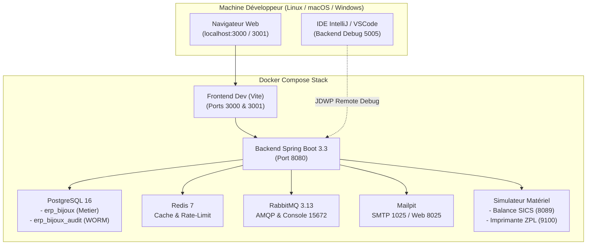

# 2. Environnement Docker Local & Infrastructure d'Exécution

## 2.1 Architecture de l'Environnement Local

L'environnement de développement local est conçu pour être lancé en **une seule commande** via Docker Compose tout en fournissant une fidélité maximale avec la production, y compris pour les périphériques spécifiques au secteur de la joaillerie.



---

## 2.2 Détail des Services Conteneurisés

### 1. PostgreSQL 16 (Base Métier & Base Audit Séparée)
- **Image** : `postgres:16-alpine`
- **Volume persistant** : `postgres_data`
- **Script d'initialisation** : `./deploy/compose/init-db.sql`
  - Crée la base `erp_bijoux` pour l'ensemble des données opérationnelles de gestion.
  - Crée la base `erp_bijoux_audit` dédiée exclusivement aux journaux de sécurité, à la traçabilité du Livre de Police et aux signatures de caisse NF525.
  - Active les extensions cryptographiques `uuid-ossp` et `pgcrypto`.

### 2. Redis 7 (Cache & Rate Limiting)
- **Image** : `redis:7-alpine`
- **Fonctionnalités** :
  - Mise en cache du cours de l'or en temps réel (cours spot LBMA / Euronext rafraîchi toutes les 60 secondes).
  - Rate limiting sur les endpoints d'authentification et les webhooks de paiement.
  - Stockage des sessions de caisse actives.

### 3. RabbitMQ 3.13 (Message Broker avec Console Management)
- **Image** : `rabbitmq:3.13-management-alpine`
- **Ports exposés** :
  - `5672` : Protocole AMQP utilisé par Spring AMQP pour publier les événements métier asynchrones (`SaleCompletedEvent`, `GoldPurchasedEvent`, `PoliceBookEntryCreatedEvent`).
  - `15672` : Interface Web d'administration (identifiants par défaut: `guest` / `guest`).

### 4. Mailpit (Mock SMTP & Visualiseur d'Emails)
- **Image** : `axllent/mailpit:latest`
- **Ports exposés** :
  - `1025` : Port SMTP pour recevoir les e-mails émis par le backend Spring Boot.
  - `8025` : Interface Web interactive permettant aux développeurs d'inspecter visuellement les factures PDF, les tickets de caisse dématérialisés, les fiches SAV d'atelier et les devis envoyés aux clients.

### 5. Simulateur Matériel de Caisse & Atelier (`mock-hardware`)
Développer un ERP bijouterie sans accès à une balance carats ni à une imprimante thermique à étiquettes "haltères" (dumbbell tags) est un goulot d'étranglement majeur. Le conteneur `mock-hardware` comble ce manque :
- **Socket RAW TCP (Port 9100)** :
  - Écoute les flux d'impression bruts (ZPL II / EPL).
  - Intercepte et décode les étiquettes de bijoux (référence, désignation, poids brut, titre 750, code-barres Datamatrix ou Code128).
  - Mémorise les 50 dernières impressions dans un buffer consultable par API.
- **Serveur HTTP & WebSocket (Port 8089)** :
  - **Flux WebSocket (`/ws/scale`)** : Transmet en continu (toutes les 200 ms) le poids de la balance avec état de stabilité (`stable: true/false`).
  - **Endpoint REST (`GET /scale/weight`)** : Répond au format standardisé Mettler Toledo SICS (`S S 14.852 g`).
  - **Endpoint de simulation (`POST /scale/weight`)** : Permet aux tests automatisés de forcer un poids (ex: poser un lingotin de 50.000 g ou une bague de 3.250 g) pour tester les règles de validation du Livre de Police.
  - **Endpoint TPE (`POST /tpe/pay`)** : Simule une transaction carte bancaire avec code d'autorisation.

---

## 2.3 Guide de Démarrage Développeur

### Prérequis
- Docker Engine >= 24.0 & Docker Compose V2
- Java JDK 21 (Temurin recommandé)
- Node.js >= 20.x & pnpm >= 9.x

### Commandes Usuelles

```bash
# 1. Cloner et préparer les variables d'environnement
cd /home/jonas/Documents/ERPBijoux
cp .env.example .env

# 2. Démarrer l'ensemble de l'infrastructure de support
docker compose up -d postgres redis rabbitmq mailpit mock-hardware

# 3. Vérifier la santé des conteneurs
docker compose ps

# 4. Lancer le backend en mode développement (depuis l'hôte avec rechargement à chaud)
./gradlew :backend:api-public:bootRun

# 5. Lancer les applications frontends (Caisse POS sur port 3000, Backoffice sur port 3001)
pnpm install
pnpm dev
```

### URLs d'Accès Local

| Service | URL / Port | Rôle |
| :--- | :--- | :--- |
| Caisse POS Tactile | `http://localhost:3000` | Interface magasin / vente |
| Backoffice ERP | `http://localhost:3001` | Administration / Stocks / Police |
| API Swagger / OpenAPI | `http://localhost:8080/swagger-ui.html` | Documentation des endpoints REST |
| RabbitMQ Management | `http://localhost:15672` | Surveillance des files et messages |
| Mailpit Email Inspector | `http://localhost:8025` | Contrôle visuel des emails générés |
| Mock Hardware Simulator | `http://localhost:8089/scale/weight` | Diagnostic balance et imprimante |
