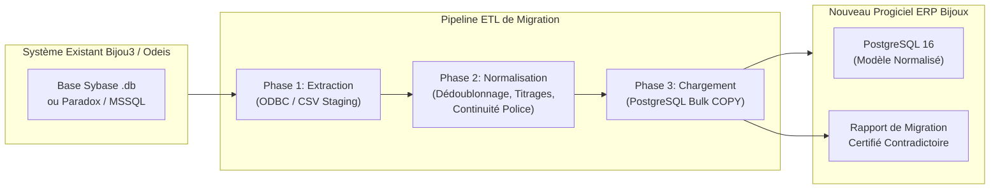
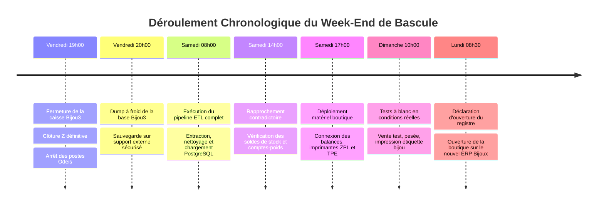

# 3. Stratégie de Migration depuis l'Ancien Bijou3 (Odeis)

## 3.1 Analyse des Systèmes et Formats Legacy Odeis Bijou3

Le logiciel **Bijou3** (édité historiquement par la société **Odeis**) est le progiciel dominant du secteur de la bijouterie-horlogerie en France depuis plus de deux décennies. Selon l'ancienneté du parc installé, les données sources se présentent sous trois formes architecturales principales :

1. **Sybase SQL Anywhere (Watcom SQL v11 / v12 / v16 / v17)** : Le cas le plus fréquent. Base relationnelle mono-fichier (ex: `bijou3.db` ou `odeis.db`) avec journal de transactions (`bijou3.log`). Accessible via pilote ODBC SQL Anywhere ou export direct en mode déconnecté.
2. **Fichiers Paradox / dBase (BDE - Borland Database Engine)** : Rencontré sur les très anciennes installations de Bijou3 (années 2000-2010). Tables stockées sous forme de fichiers `.db`, `.px`, `.mb` dans un répertoire réseau partagé.
3. **Microsoft SQL Server (2008 / 2014 / 2019 Express)** : Déployé sur les versions plus récentes multi-magasins.

---

## 3.2 Pipeline ETL en 3 Phases

### Phase 1 : Extraction & Dump des Tables Legacy (Staging)

L'extraction s'effectue sans impacter la base de production du magasin, soit par snapshot à froid de la base de données, soit par connecteur ODBC dédié :

1. **Extraction brute dans le schéma de staging PostgreSQL (`legacy_odeis`)** :
   - `ARTICLE` : Références, familles, codes-barres, prix d'achat, prix de vente, poids brut, poids fin théorique, titrage, façonnier d'origine.
   - `TIERS` (Clients & Fournisseurs) : Coordonnées, civilités, date et lieu de naissance, numéro de pièce d'identité (indispensable pour les acheteurs d'or).
   - `LIVRE_POLICE` : Registre historique obligatoire depuis l'ouverture du magasin (numéro d'ordre, date d'entrée, désignation précise, poids, matière, vendeur/fournisseur, date et motif de sortie).
   - `COMPTE_POIDS` : Historique des écritures de métal fin chez les affineurs (Saamp, Cookson-CLAL, Heimerle) et façonniers.
   - `SAV` / `REPARATION` : Fiches d'atelier en cours, bijoux confiés, descriptions des gemmes et réparations demandées.
   - `VENTES` & `REGLEMENTS` : Historique des tickets, ventilations de TVA (normale 20%, marge bijouterie occasion art. 297 A du CGI).

---

### Phase 2 : Nettoyage, Standardisation & Transformation Métier

Cette phase résout les incohérences accumulées au fil des années dans l'ancien système :

#### 1. Dédoublonnage et Fiabilisation des Clients (CRM & KYC)
- **Problématique** : L'ancien Bijou3 tolère la création de plusieurs fiches pour un même client (ex: "DUPONT Jean", "DU PONT J.", "M. DUPONT").
- **Solution** :
  - Algorithme de rapprochement flou (Fuzzy Match / Levenshtein) combinant `Nom phonétique` + `Prénom` + `Code postal` + `Téléphone / Email`.
  - Fusion automatique des doublons certains et génération d'une table de correspondances `mapping_tiers_id` pour préserver l'historique des ventes et réparations.
  - Alerte sur les pièces d'identité expirées ou incomplètes sur les dossiers de rachat d'or.

#### 2. Standardisation des Métaux Précieux et Titrages d'Alliages
- **Problématique** : Dans Bijou3, les champs titrages sont souvent saisis en texte libre ("18K", "750", "OR 18 CARATS", "9 CARATS", "ARGENT MASSIF", "AG925").
- **Solution** :
  - Normalisation selon l'énumération officielle de la garantie des métaux précieux :
    * `GOLD_750` : 750‰ (18 carats - Or traditionnel de joaillerie)
    * `GOLD_375` : 375‰ (9 carats)
    * `GOLD_585` : 585‰ (14 carats)
    * `GOLD_999` : 999.9‰ (Or fin d'affinerie / lingots)
    * `SILVER_925` : 925‰ (Argent 1er titre)
    * `PLATINUM_950` : 950‰ (Platine)
  - Calcul systématique du **poids fin théorique** : $\text{Poids Fin} = \text{Poids Brut} \times \frac{\text{Titre Millième}}{1000}$.

#### 3. Contrôle Strict de Continuité du Livre de Police Dématérialisé
- **Exigence Légale (Art. 537 & 538 du CGI)** :
  - Le registre de police des matières précieuses ne doit comporter **aucun trou de numérotation séquentielle**.
  - Si des numéros manquent dans l'export Odeis (suppressions accidentelles ou anomalies historiques), le script `validate_police_continuity.py` identifie précisément chaque intervalle manquant.
  - **Décision administrative** : Soit les numéros manquants sont actés dans le procès-verbal d'audit de migration, soit la bascule sur le nouveau logiciel s'effectue avec **clôture officielle de l'ancien livre** et ouverture d'un nouveau registre démarrant au numéro 1 après déclaration écrite aux Douanes (DGDDI).

---

### Phase 3 : Chargement & Rapprochement Comptable Contradictoire

1. **Chargement Haute Performance** :
   - Insertion dans les tables relationnelles PostgreSQL du nouvel ERP via l'outil Spring Batch (`migration/etl-runner`) ou commandes `COPY` avec validation des contraintes d'intégrité référentielle.
2. **Reprise des Soldes de Comptes-Poids** :
   - Rapprochement des soldes d'or fin théoriques avec les relevés contradictoires officiels des fondeurs (Saamp, Cookson) à la date de coupure.
   - Enregistrement des soldes d'ouverture dans le module `:backend:weight-account`.
3. **Bilan de Migration Certifié** :
   - Génération d'un rapport de synthèse contradictoire signé conjointement par la direction du magasin et l'équipe technique, consignant :
     * Nombre d'articles migrés et valeur totale du stock (Prix Achat HT et Prix Vente TTC).
     * Poids total d'or 750, or 375 et argent présent en stock.
     * Nombre d'enregistrements du Livre de Police réintégrés.
     * Nombre de fiches SAV actives transférées dans le nouvel atelier.

---

## 3.3 Procédure de Bascule en Production (Go-Live Week-End)

Pour éviter toute interruption de l'activité commerciale en boutique, la bascule s'organise sur un week-end selon le planning strict ci-dessous :

### Plan de Rollback (Retour Arrière Immédiat)
Si un écart bloquant non résolu est constaté le dimanche soir avant 18h00 :
1. Les terminaux physiques sont reconnectés à l'ancien serveur Odeis Bijou3 laissé intact.
2. Aucun ticket n'ayant été validé définitivement sur le nouveau système, l'ancien progiciel reprend son exploitation sans aucune perte de données.
3. Analyse post-mortem et replanification de la bascule à 2 semaines.
