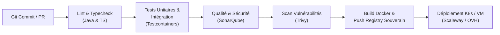
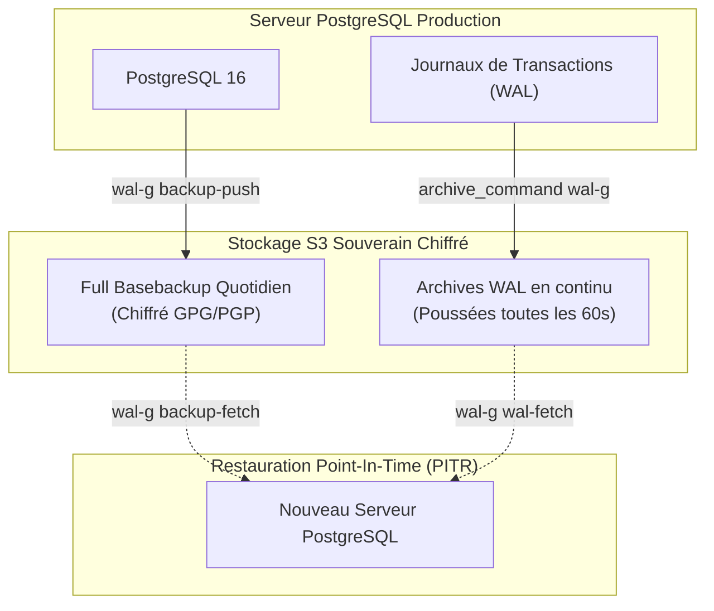

# 4. CI/CD, Déploiement en Cloud Souverain & Sécurité

## 4.1 Pipeline CI/CD Industriel

Le pipeline d'intégration et de déploiement continus (CI/CD) est structuré pour garantir une qualité de code irréprochable et prévenir toute régression sur les calculs fiscaux ou le Livre de Police.

### Détail des Échelons de Validation

1. **Compilation & Linting Déclaratif** :
   - Backend : Checkstyle et compilation stricte Java 21 (`-Werror`).
   - Frontend : ESLint, Prettier et vérification des types TypeScript (`tsc --noEmit`).
2. **Tests d'Intégration Réalistes avec Testcontainers** :
   - Évite les mocks fragiles de base de données (H2).
   - Lance à la volée un conteneur PostgreSQL 16 éphémère pour exécuter les migrations Flyway réelles et tester les contraintes d'unicité, les transactions financières et les hashs SHA-256 de police.
   - Rapport de couverture JaCoCo (seuil minimal exigé : 80% sur le domaine métier).
3. **Analyse Statique et Portes de Qualité (SonarQube)** :
   - Détection des dettes techniques, bugs potentiels et vulnérabilités OWASP Top 10.
   - Surveillance rigoureuse des injections SQL et de la gestion sécurisée des secrets.
4. **Audit de Sécurité Conteneurs (Trivy)** :
   - Analyse automatisée des images Docker et de l'arbre des dépendances (`pom.xml` / `pnpm-lock.yaml`) à la recherche de CVE connues.
   - Blocage immédiat du pipeline si une vulnérabilité critique ou élevée non corrigée est détectée.

---

## 4.2 Stratégie d'Hébergement en Cloud Souverain Français

### Contexte Réglementaire et Souveraineté des Données
Le secteur de la bijouterie-joaillerie est soumis en France à une double contrainte juridique forte :
1. **Livre de Police Dématérialisé (Art. 537 & 538 du CGI)** : Registre public soumis aux contrôles inopinés de la Direction Générale des Douanes et Droits Indirects (DGDDI) et de la Police Judiciaire.
2. **Conformité Anti-Fraude TVA (Loi de Finances / Logiciel de Caisse Inaltérable)** : Les données d'encaissement et de clôture ne doivent pouvoir faire l'objet d'aucune altération ni interception étrangère.

Pour immuniser les données sensibles contre les lois extraterritoriales (notamment le **US Cloud Act** et la section 702 du FISA), l'ensemble de l'infrastructure de production est obligatoirement hébergé sur des **infrastructures souveraines françaises** :
- **Fournisseur Recommandé 1 : Scaleway** (Datacenters certifiés DC3/DC4 à Paris, Saint-Ouen-l'Aumône)
  - Orchestration : Cluster Kubernetes Managé **Kapsule**
  - Base de données : Instance Managée PostgreSQL 16 Haute Disponibilité (Multi-AZ)
  - Stockage Objet : **Scaleway Object Storage (S3 standard)** avec chiffrement SSE-S3
- **Fournisseur Recommandé 2 : OVHcloud** (Datacenters Roubaix / Gravelines / Strasbourg)
  - Managed Kubernetes Service (MKS) et bases de données managées certifiées SecNumCloud.

---

## 4.3 Stratégie de Sauvegarde, RPO, RTO et Haute Disponibilité

### Engagements de Service (SLA)
- **RPO (Recovery Point Objective)** : **< 15 minutes**. En cas de sinistre total (incendie d'un datacenter ou attaque ransomware), la perte maximale de données tolérée est de 15 minutes.
- **RTO (Recovery Time Objective)** : **< 1 heure**. Le temps nécessaire pour remonter un cluster opérationnel complet à partir des sauvegardes chiffrées est inférieur à 60 minutes.

### Architecture de Sauvegarde Continue avec WAL-G

### Mécanisme de Sauvegarde Immutée
1. **Archivage Continu des WAL** : Dès qu'un segment de journal WAL (16 Mo ou timeout de 60 secondes) est clôturé par PostgreSQL, il est compressé (LZ4) et chiffré côté client avant d'être expédié vers le bucket S3 souverain via l'utilitaire performant **WAL-G**.
2. **Sauvegarde Complète (Full Basebackup)** : Déclenchée automatiquement chaque nuit à 02h00 (`deploy/backup/wal-g-backup.sh`).
3. **Rétention et Immutabilité WORM** :
   - Rétention glissante sur 14 jours des sauvegardes quotidiennes.
   - Sauvegarde mensuelle d'archivage fiscal scellée conservée pendant **10 ans** sur un bucket avec verrouillage d'objet (Object Lock / WORM) conformément aux exigences fiscales françaises.
4. **Procédure de Restauration Point-In-Time (PITR)** :
   - En cas d'anomalie ou de corruption humaine à 14h25, l'administrateur exécute `restore-pitr.sh "2026-11-04 14:24:00"`.
   - Le script télécharge le dernier basebackup, rejoue les journaux de transactions jusqu'à la seconde exacte spécifiée et promeut la base restaurée en moins de 40 minutes.
