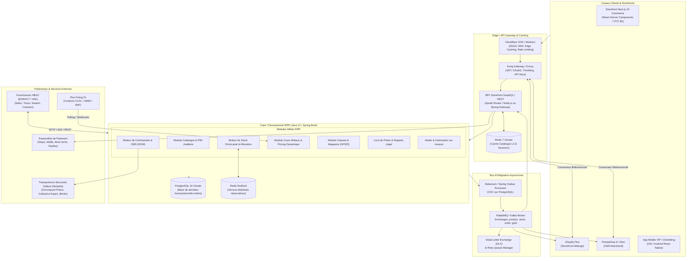
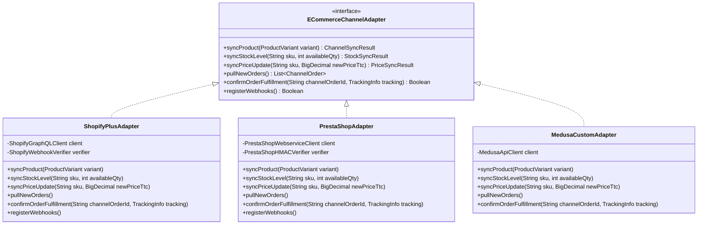
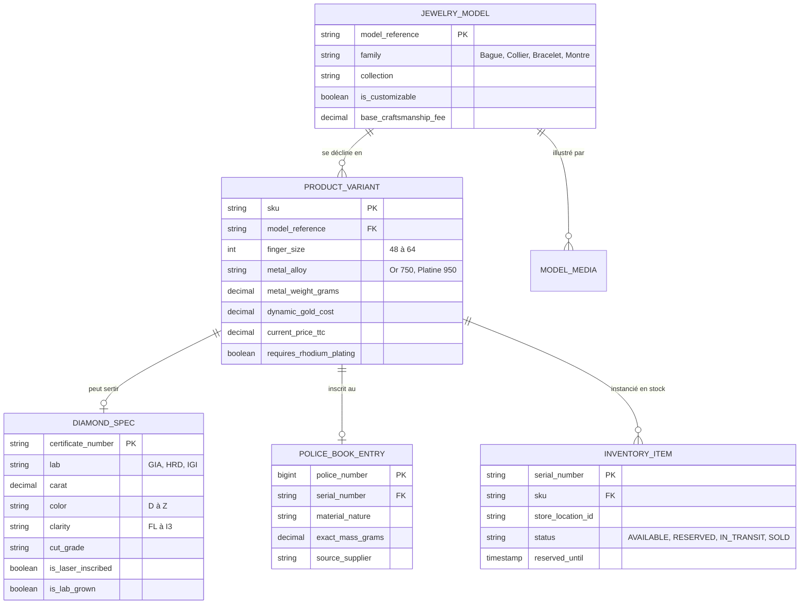
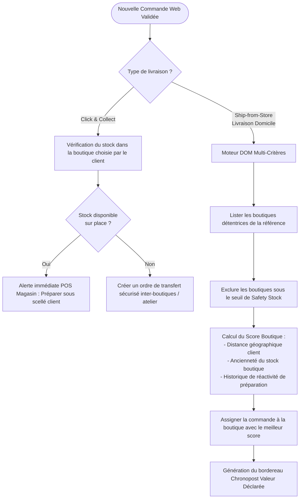
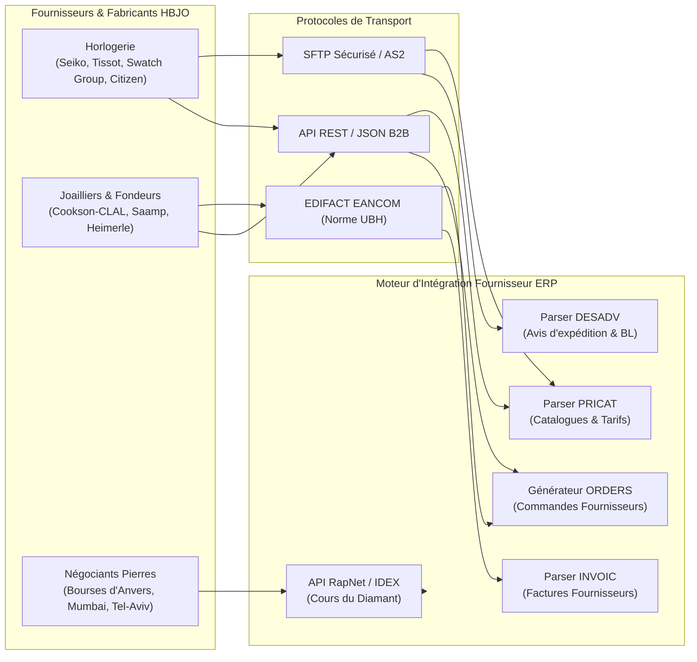
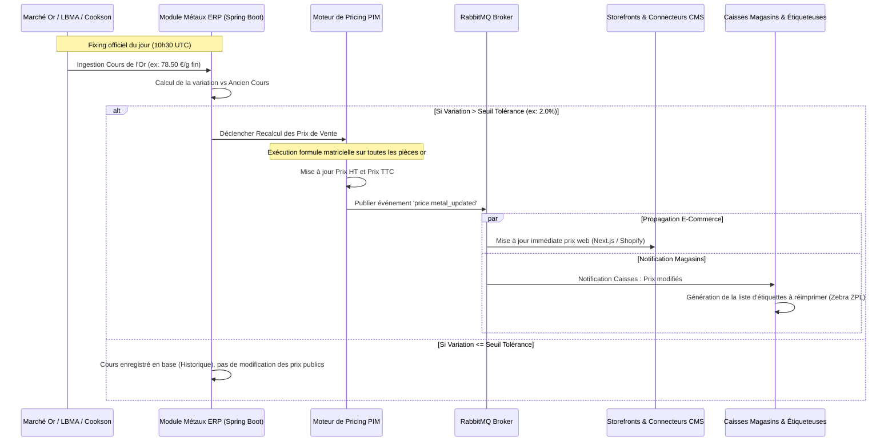

# Architecture d'Intégration E-Commerce & Moteur Omnicanal HBJO
## Modernisation de l'ERP Bijou3 vers un Écosystème Découplé, Headless et Temps Réel

---

## 1. VISION STRATÉGIQUE & ARCHITECTURE GLOBALE

### 1.1 Contexte et Objectifs
L'ancien système **Bijou3** (logiciel traditionnel desktop édité par Odeis / Vega Informatique) était historiquement centré sur le magasin physique individuel, avec un modèle de données monolithique et des synchronisations batch journalières peu adaptées aux exigences modernes du commerce joaillier.

La modernisation vers un ERP Web moderne (backend Java 21 / Spring Boot 3.3+, frontend React) impose de penser nativement l'**omnicanalité** et l'**intégration e-commerce** :
- **Découplage strict** : Le cœur de l'ERP (gestion financière, comptabilité NF525, livre de police, fabrication atelier) ne doit jamais être exposé directement à l'exposition internet publique du web marchand.
- **Storefront API Headless** : Capacité d'alimenter soit une boutique e-commerce sur-mesure ultra-rapide (Next.js Commerce / Medusa.js), soit les CMS e-commerce les plus répandus sur le marché (Shopify Plus, PrestaShop 8, WooCommerce).
- **Consistance de stock temps réel** : Tolérance zéro pour le sur-stockage ou l'overselling de pièces uniques de joaillerie (haute valeur, diamant certifié unique).
- **Spécificités métiers HBJO** : Prise en compte dans le parcours d'achat numérique des déclinaisons de tours de doigt avec ajustement de poids de métal, des pierres 4C (GIA/HRD), de la personnalisation gravure, et de la tarification dynamique basée sur le fixing de l'or.

---

### 1.2 Schéma d'Architecture Globale Découplée



---

## 2. COUCHE D'API HEADLESS & COUPLAGE AVEC L'ERP

### 2.1 Stratégie d'Exposition : Découplage Transactionnel
Pour protéger l'ERP central de la charge web (pics de trafic lors du Black Friday, de la Saint-Valentin ou de la Fête des Mères) et garantir la sécurité des données légales (Livre de Police, chiffrement NF525), l'ERP n'est **jamais interrogé en direct par le navigateur du client final**.

1. **Exposition via Storefront Gateway (BFF)** :
   - Un Backend-for-Frontend (BFF) dédié au commerce fournit une API unifiée GraphQL et REST OpenAPI 3.1.
   - Les requêtes de lecture catalogue (`getProduct`, `listCategories`, `getAvailability`) sont servies à 95% par le cache Edge Cloudflare et Redis L2, sans toucher la base de données SQL de l'ERP.
   - Les requêtes d'écriture (`createCartReservation`, `submitOrder`) sont validées par le BFF puis transmises au moteur transactionnel de l'ERP via gRPC / REST interne sécurisé (mTLS).

2. **Garantie de non-blocage & Fiabilité (Transactional Outbox Pattern)** :
   - Tout changement d'état dans l'ERP (création produit, mise à jour stock magasin, changement de prix métal) est enregistré de manière atomique dans la table `outbox_events` de PostgreSQL dans la même transaction que l'entité métier.
   - Un processeur de relais (Spring Scheduled ou Debezium CDC) dépile les événements et les publie dans l'échange RabbitMQ dédié (`erp.events`).
   - Cela supprime tout risque d'incohérence entre la base ERP et les canaux e-commerce (zéro perte d'événement en cas de coupure réseau).

---

### 2.2 Schéma GraphQL de la Storefront API

Le schéma ci-dessous modélise fidèlement les exigences complexes du secteur joaillier (tours de doigt, alliages, diamants 4C, gravure, disponibilité multi-magasins) :

```graphql
"""
Spécification GraphQL Storefront API - Modernisation ERP Bijoux
"""

enum MetalType {
  YELLOW_GOLD_18K    # Or Jaune 750‰
  WHITE_GOLD_18K     # Or Blanc rhodié 750‰
  ROSE_GOLD_18K      # Or Rose 750‰
  PLATINUM_950       # Platine 950‰
  SILVER_925         # Argent 925‰
}

enum DiamondColor {
  D
  E
  F
  G
  H
  I
  J
}

enum DiamondClarity {
  FL
  IF
  VVS1
  VVS2
  VS1
  VS2
  SI1
  SI2
}

enum DiamondCutGrade {
  EXCELLENT
  VERY_GOOD
  GOOD
  FAIR
}

enum CertificationLab {
  GIA
  HRD
  IGI
  LFG
}

type DiamondAttributes {
  caratWeight: Float!
  color: DiamondColor!
  clarity: DiamondClarity!
  cut: DiamondCutGrade!
  polish: DiamondCutGrade!
  symmetry: DiamondCutGrade!
  fluorescence: String!
  certificateLab: CertificationLab!
  certificateNumber: String!
  certificatePdfUrl: String
  laserInscriptionVerified: Boolean!
  isLabGrown: Boolean!
}

type EngravingOption {
  maxCharacters: Int!
  allowedFonts: [String!]!
  allowedSymbols: [String!]!
  priceVatIncluded: Float!
}

type ProductVariant {
  id: ID!
  sku: String!
  barcode: String!
  fingerSize: Int                  # De 48 à 64 (pour bagues)
  metal: MetalType!
  estimatedGoldWeightGrams: Float!
  diamondCenter: DiamondAttributes
  priceVatExcluded: Float!
  priceVatIncluded: Float!
  isUniquePiece: Boolean!
  serialNumber: String             # Numéro de série unique (haute joaillerie / horlogerie)
  availability: StockAvailability!
}

type StockAvailability {
  isAvailableOnline: Boolean!
  quantityAvailablePromise: Int!
  storesStock: [StoreStockLevel!]!
}

type StoreStockLevel {
  storeId: ID!
  storeName: String!
  city: String!
  postalCode: String!
  quantity: Int!
  isEligibleClickAndCollect: Boolean!
  clickAndCollectDelayHours: Int!
}

type ProductMedia {
  packshotHdUrls: [String!]!
  rotation360FramesUrls: [String!]
  model3dGltfUrl: String
  model3dUsdzIosUrl: String
  vtoEnabled: Boolean!
}

type JewelryProduct {
  id: ID!
  modelReference: String!
  title: String!
  description: String!
  collection: String!
  category: String!
  variants: [ProductVariant!]!
  engravingConfig: EngravingOption
  media: ProductMedia!
}

type CartReservationResult {
  reservationToken: String!
  expiresAt: String!              # ISO-8601 Timestamp (TTL 15 min)
  isLockAcquired: Boolean!
  variantId: ID!
}

input CreateEngravingInput {
  text: String!
  font: String!
  symbolCode: String
}

input ReserveCartItemInput {
  variantId: ID!
  quantity: Int!
  clientSessionId: String!
  engraving: CreateEngravingInput
}

type Query {
  productByReference(reference: String!): JewelryProduct
  productVariantBySku(sku: String!): ProductVariant
  searchJewelry(query: String!, metal: MetalType, maxPrice: Float): [JewelryProduct!]!
  checkStoreStock(sku: String!, latitude: Float, longitude: Float): [StoreStockLevel!]!
}

type Mutation {
  reserveItemForCheckout(input: ReserveCartItemInput!): CartReservationResult!
  releaseCartReservation(reservationToken: String!): Boolean!
}
```

---

### 2.3 Connecteurs CMS E-Commerce Bidirectionnels

Pour les clients désirant conserver ou déployer un CMS tiers (**Shopify Plus**, **PrestaShop 8**, **WooCommerce**), l'ERP propose un module d'abstraction standardisé : `ECommerceChannelAdapter`.



#### Stratégie de Résilience des Connecteurs :
1. **Idempotence stricte** : Chaque mise à jour de stock ou de prix transporte un numéro de version d'événement (`version: 1729831920000`). Si un webhook arrive désordonné, le connecteur rejette l'écriture obsolète.
2. **Circuit Breaker (Resilience4j)** : Si l'API de Shopify ou PrestaShop subit un ralentissement ou un rate-limiting HTTP 429 (`Too Many Requests`), le circuit breaker s'ouvre, place les requêtes en file d'attente RabbitMQ et active un retry exponentiel avec jitter.
3. **Réconciliation nocturne** : Un batch de comparaison automatique tourne chaque nuit à 03h00 pour vérifier la parfaite parité des stocks et des prix entre l'ERP et les catalogues distants.

---

### 2.4 Architecture des Événements Asynchrones (Payloads JSON)

Tous les échanges asynchrones transitent par RabbitMQ sous le format JSON CloudEvents v1.0.

#### A. Événement `product.updated` (Ajustement Métal & Joaillerie)
```json
{
  "specversion": "1.0",
  "type": "erp.bijoux.product.updated",
  "source": "/erp/catalog/pim",
  "id": "evt-prod-98451-20261104",
  "time": "2026-11-04T15:30:00Z",
  "datacontenttype": "application/json",
  "data": {
    "productId": "MOD-SOLITAIRE-EMERAUDE-01",
    "sku": "BAG-SOL-ORB-52-DIA070",
    "title": "Solitaire Diamant Émeraude 0.70ct Or Blanc 18k",
    "fingerSize": 52,
    "metal": {
      "alloy": "WHITE_GOLD_18K",
      "purityPermille": 750,
      "rhodiumPlated": true,
      "netMetalWeightGrams": 4.12
    },
    "stone": {
      "type": "NATURAL_DIAMOND",
      "shape": "EMERALD_CUT",
      "carat": 0.70,
      "color": "E",
      "clarity": "VVS1",
      "certificate": {
        "lab": "GIA",
        "number": "2185490214",
        "laserInscribed": true,
        "verificationUrl": "https://www.gia.edu/report-check?reportno=2185490214"
      }
    },
    "pricing": {
      "goldFixingAppliedEurPerGram": 78.45,
      "laborCostEur": 320.00,
      "stoneCostEur": 2150.00,
      "wholesaleCostHtEur": 2793.21,
      "retailPriceHtEur": 5586.42,
      "retailPriceTtcEur": 6703.70,
      "taxRate": 0.20
    },
    "updatedAt": "2026-11-04T15:30:00Z"
  }
}
```

#### B. Événement `stock.changed` (Mise à jour Temps Réel)
```json
{
  "specversion": "1.0",
  "type": "erp.bijoux.stock.changed",
  "source": "/erp/inventory/oms",
  "id": "evt-stk-44910-20261104",
  "time": "2026-11-04T15:32:10Z",
  "datacontenttype": "application/json",
  "data": {
    "sku": "BAG-SOL-ORB-52-DIA070",
    "serialNumber": "SN-2026-004921",
    "isUniquePiece": true,
    "changeReason": "WEB_CART_LOCK_ACQUIRED",
    "totalOnHand": 1,
    "totalReserved": 1,
    "availableToPromise": 0,
    "storeBreakdown": [
      {
        "storeCode": "MAG-PARIS-VENDOME",
        "storeName": "Boutique Vendôme Paris",
        "onHand": 1,
        "reserved": 1,
        "atp": 0
      },
      {
        "storeCode": "MAG-LYON-HERRIOT",
        "storeName": "Boutique Lyon Edouard Herriot",
        "onHand": 0,
        "reserved": 0,
        "atp": 0
      }
    ],
    "expiresAt": "2026-11-04T15:47:10Z"
  }
}
```

#### C. Événement `order.created` (Commande Omnicanale)
```json
{
  "specversion": "1.0",
  "type": "erp.bijoux.order.created",
  "source": "/ecommerce/checkout",
  "id": "evt-ord-77821-20261104",
  "time": "2026-11-04T15:35:42Z",
  "datacontenttype": "application/json",
  "data": {
    "orderId": "CMD-2026-11-00892",
    "channel": "STOREFRONT_WEB",
    "fulfillmentType": "CLICK_AND_COLLECT",
    "pickupStoreCode": "MAG-PARIS-VENDOME",
    "customer": {
      "erpCustomerId": "CUST-88192",
      "firstName": "Claire",
      "lastName": "Delacroix",
      "email": "claire.delacroix@example.com",
      "phone": "+33612345678"
    },
    "items": [
      {
        "sku": "BAG-SOL-ORB-52-DIA070",
        "serialNumber": "SN-2026-004921",
        "quantity": 1,
        "unitPriceTtc": 6703.70,
        "engraving": {
          "text": "A & C 14.07.2026",
          "font": "ENGLISH_SCRIPT",
          "symbol": "INFINITY"
        }
      }
    ],
    "payment": {
      "gateway": "STRIPE",
      "transactionId": "pi_3N4yXZ2eZvKYlo2C0nLkq87v",
      "amountTtc": 6703.70,
      "status": "CAPTURED",
      "threeDSecureAuthenticated": true
    },
    "createdAt": "2026-11-04T15:35:42Z"
  }
}
```

---

## 3. PIM SPÉCIALISÉ JOAILLERIE & GESTION DES VARIANTES

Le modèle de données d'un catalogue joaillier dépasse largement les capacités d'un e-commerce conventionnel de prêt-à-porter :



### 3.1 Déclinaison Tours de Doigt & Surcoûts Métal
- **Taille Pivot Standard** : En joaillerie féminine française, la taille de référence standard de fabrication et de présentation en vitrine est la taille **54** (ou 52 selon les collections).
- **Ajustement de Poids de Métal** :
  $$\Delta Poids = (Tour\_Choisi - Tour\_Pivot) \times Facteur\_Section$$
  Pour un anneau de section standard (fil demi-jonc 2.0 mm), chaque taille de doigt supplémentaire représente un accroissement de circonférence intérieure de $1\,\text{mm}$, soit un volume de métal additionnel générant environ **$+0.08\,\text{g}$ à $+0.15\,\text{g}$ d'or 18k par taille**.
- **Règle Tarifaire Automatique** :
  - Du tour 48 au 54 : Prix catalogue standard maintenu (absorbé par la tolérance d'atelier).
  - Du tour 55 au 64 : Application d'un supplément automatique calculé dynamiquement :
    $$Supplément = \Delta Masse(g) \times Cours\_Or\_Jour \times Coeff\_Fonderie + Frais\_Mise\_A\_Taille$$
  - Cette règle est calculée à la volée par le configurateur du panier e-commerce et validée par l'ERP lors de la création de commande.

---

### 3.2 Modélisation des Métaux Précieux & Alliages
L'ERP gère pour chaque variante la traçabilité des métaux :
1. **Or Jaune 750‰ (18k)** : Alliage 75% or pur, 12.5% argent, 12.5% cuivre. Poinçon d'État : Tête d'Aigle.
2. **Or Blanc Rhodié 750‰ (18k)** : Alliage or pur et palladium/argent. Nécessite un traitement de surface au rhodium pour un éclat miroir. L'ERP intègre le rappel automatique d'entretien (rhodiage préconisé tous les 18 à 24 mois).
3. **Or Rose 750‰ (18k)** : Alliage or pur à plus forte proportion de cuivre.
4. **Platine 950‰** : Densité élevée (21.45 g/cm³ contre 15.5 g/cm³ pour l'or 18k), très haute résistance mécanique. Poinçon d'État : Tête de Chien / Tête de Manchot.
5. **Argent 925‰ (Massif)** : Poinçon d'État : Minerve 2e titre.

---

### 3.3 Critères 4C des Pierres & Certificats GIA
Chaque pierre de centre d'exception ($> 0.30\,\text{carat}$) possède une fiche d'identité unique :
- **Carat** : Pesée au 1/100e de carat ($1\,\text{ct} = 0.20\,\text{g}$).
- **Color** : Échelle normalisée de D (blanc exceptionnel +) à Z (teinté).
- **Clarity** : Pureté sous loupe 10x (FL/IF sans inclusion, VVS, VS, SI, Piqué).
- **Cut** : Qualité de la taille (proportions de la table, hauteur de calotte, profondeur de culasse).
- **Vérification Laser Rondiste** : Le numéro de certificat officiel (ex: GIA) est gravé au laser microscopique sur le rondiste du diamant. Le PIM ERP fournit au site e-commerce le lien direct vers l'API de vérification de l'organisme certificateur pour rassurer le client final.
- **Réglementation Décret 2002-65** : Mention obligatoire et non ambiguë dans le panier e-commerce de la distinction entre **Diamant Naturel** et **Diamant Synthétique / Laboratoire (Lab-Grown)**.

---

### 3.4 Module de Personnalisation & Gravure Numérique
- **Typographies autorisées** : Anglaise / Script, Bâton Classique, Italique Romaine.
- **Symboles acceptés** : Code normalisé (`&`, `♥`, `∞`, `★`, `✝`, `✡`).
- **Calcul de Capacité Linéaire de Gravure** :
  Le nombre maximum de caractères autorisés dépend mathématiquement du tour de doigt et de la monture :
  $$Caractères\_Max = \left\lfloor \frac{\pi \times Diamètre\_Intérieur(mm) - Largeur\_Serti(mm)}{Largeur\_Caractère\_Moyen(mm)} \right\rfloor$$
  *Exemple : Un tour de doigt 50 (diamètre 15.92 mm) avec solitaire 4 griffes (largeur serti 6 mm) accepte au maximum 22 caractères en police Script.*
- **Prévisualisation interactive** : Le module Storefront génère un rendu vectoriel SVG/Canvas dynamique simulant le texte gravé à l'intérieur ou à l'extérieur de l'anneau. Le fichier vectoriel généré est transmis à l'ERP et rattaché directement au bon de fabrication pour la machine à graver laser de l'atelier (gravure M20 / Roland / Gravotech).

---

### 3.5 Gestion des Médias Riches & VTO (Virtual Try-On)
Le PIM joaillier stocke et orchestre les assets multimédias haute fidélité :
- **Packshots Studio Multi-angles** : Format WebP / AVIF avec résolutions multiples (responsive srcset 1x, 2x, Retina).
- **Vidéos Rotatives 360°** : Séquences de 36 ou 72 clichés photographiques indexés, consultables via slider tactile circulaire.
- **Modèles 3D GLTF / USDZ** :
  - Format `.gltf` / `.glb` optimisé avec compression Draco pour WebGL (Three.js / Babylon.js).
  - Format `.usdz` pour la réalité augmentée native Apple QuickLook sur iPhone/iPad.
  - Compatibilité avec les moteurs de **Virtual Try-On (VTO)** (tangiblee, Wanna Rings, MediaPipe Hand Tracking) : détection en direct de la main via la caméra, calage de la bague sur la phalange proximale avec gestion du masquage et du reflet d'or réaliste (PBR - Physically Based Rendering).
- **Documents PDF sécurisés** : Certificats d'authenticité et notices d'entretien chiffrés et signés électroniquement par l'ERP.

---

## 4. MOTEUR DE STOCK OMNICANAL & RÉSERVATION TEMPS RÉEL (OMS)

### 4.1 Modélisation Mathématique des États de Stock (ATP)

```
[ Stock Physique Magasin (On-Hand) ] 
       │
       ├── Moins : [ Réservations Web en cours (Cart Locks - TTL 15min) ]
       ├── Moins : [ Commandes Validées en préparation (Committed Orders) ]
       ├── Moins : [ Safety Stock Buffer (Pièces uniques / vitrine) ]
       │
       ▼
[ Available To Promise (ATP) = Stock Réellement Vendable en Ligne ]
```

$$ATP = Stock_{Physique} - Stock_{Réservé\_Checkout} - Stock_{Commandes\_Prépa} - SafetyBuffer$$

---

### 4.2 Gestion des Pièces Uniques & Algorithme Anti-Overselling
En joaillerie et haute horlogerie, la majorité des pièces à haute valeur ($> 3\,000\,\text{€}$) sont **uniques** (un seul exemplaire physique en vitrine dans l'une des boutiques, associé à un numéro de série unique).

#### Protocole de Verrou Distribué (Redis Redlock) :
Lorsqu'un client e-commerce ajoute une pièce unique à son panier et entre dans le tunnel de paiement :
1. Le BFF sollicite un verrou distribué sur Redis : `SET lock:inventory:SN-2026-004921 client_session_token PX 900000 NX` (TTL de 15 minutes).
2. L'ATP de cette référence tombe immédiatement à **0** pour tous les autres clients web.
3. Si le client finalise le paiement 3D-Secure : l'ERP convertit le verrou temporaire en **réservation ferme**, décrémente le stock disponible et assigne la commande à la boutique détentrice.
4. Si le paiement est abandonné ou échoue : le verrou expire automatiquement au bout de 15 minutes via `Redis Key Expired Listener`, et la pièce redevient instantanément visible et achetable sur le web.
5. **Prévention du Conflit en Magasin Physique (POS)** :
   Si un vendeur en boutique scanne le bijou à sa caisse tactile pendant que la pièce est verrouillée en ligne :
   - L'écran de caisse affiche une alerte prioritaire : *"Pièce actuellement engagée dans un panier web sécurisé (reste 6 min de session). Voulez-vous forcer la priorité boutique physique ?"*
   - Si le vendeur en magasin physique confirme la vente (le client est physiquement présent avec sa carte bancaire en main), la caisse priorise la vente physique, notifie immédiatement le client web par une notification élégante d'indisponibilité et libère le panier en ligne avec proposition d'une alternative atelier.

---

### 4.3 Moteur d'Orchestration des Commandes Distribuées (DOM)

Lorsqu'une commande e-commerce est validée, l'algorithme d'attribution sélectionne le point d'expédition ou de retrait optimal selon les priorités suivantes :



---

### 4.4 Scénarios Omnicanaux Détaillés

#### A. Click & Collect & E-Réservation (2h)
- **E-Réservation gratuite (sans paiement préalable)** :
  1. Le client réserve un bijou depuis son smartphone pour l'essayer en boutique.
  2. Le magasin sélectionné reçoit une notification sonore et visuelle prioritaire sur le terminal de caisse POS.
  3. Le conseiller de vente dispose de 45 minutes pour localiser la pièce en vitrine, vérifier son parfait état et la placer dans un écrin sous scellé nominatif.
  4. Le vendeur clique sur "Confirmer la mise de côté" sur le POS -> un SMS/WhatsApp automatisé est envoyé au client avec le QR Code de retrait et le plan d'accès de la boutique.
  5. La pièce est bloquée pendant 48 heures.
- **Click & Collect payé en ligne** :
  1. Commande déjà encaissée par carte bancaire.
  2. Retrait sécurisé en boutique : présentation obligatoire d'une pièce d'identité officielle et du QR Code unique reçu par e-mail.
  3. Le vendeur scanne le QR code sur l'application de caisse : signature sur tablette tactile, validation de la délivrance et émission de la facture légale certifiée NF525.

#### B. Ship-from-Store (Expédition Sécurisée depuis la Boutique)
- Les boutiques physiques deviennent des micro-hubs logistiques.
- **Protocole Valeur Déclarée (VD)** :
  - Pour les bijoux dont la valeur dépasse $1\,000\,\text{€}$, le transport standard est proscrit.
  - L'ERP est interconnecté avec les API des transporteurs spécialisés : **Colissimo Expert Valeur Déclarée** (assuré jusqu'à $5\,000\,\text{€}$) et **Chronopost Précio / Malca-Amit / Brinks** (assuré jusqu'à $50\,000\,\text{€}$ et plus).
  - Génération automatique des bordereaux et manifestes de transport avec code scellé de sécurité à numéro unique.
  - **Règle de Sécurité Anti-Vol** : L'emballage extérieur doit être totalement neutre et opaque, sans aucune mention du mot "Bijouterie", "Joaillerie", "Or" ou du nom de la marque sur l'étiquette d'expédition afin d'éviter les vols en chaîne logistique.

#### C. Retour Web en Boutique (Unified Return & Exchange)
- Le client ayant acheté en ligne peut se présenter dans n'importe quel magasin du réseau pour un échange, un avoir ou un remboursement sous 14 jours.
- **Protocole Gemmologique Obligatoire de Réception** :
  Avant toute validation d'avoir ou de remboursement, le conseiller de vente suit une check-list obligatoire sur l'écran POS :
  1. *Contrôle visuel à la loupe x10* : intégrité des griffes de sertissage, absence de chocs.
  2. *Contrôle de conductivité de la pierre* : utilisation du testeur électronique (distinction diamant / moissanite / zircone).
  3. *Pesée métrologique légale* : pesée du bijou sur la balance de précision homologuée connectée au POS. La masse doit correspondre exactement (à $+/- 0.02\,\text{g}$) au poids enregistré sur la fiche technique de vente initiale.
  4. *Numéro de rondiste* : vérification du numéro laser sous microscope de table pour les diamants certifiés.
  5. Une fois le contrôle validé par le responsable : l'ERP déclenche le remboursement via l'API de paiement web (Stripe/Mollie) et réintègre l'article au stock de la boutique accueillante ou génère un bon d'expédition vers l'atelier de polissage/rhodiage.

---

## 5. LIAISONS FOURNISSEURS & ÉCHANGES DE DONNÉES (EDI & FIXING DE L'OR)

### 5.1 Intégration des Catalogues Fournisseurs HBJO (EDI & Flux)

L'écosystème HBJO utilise des formats d'échanges normalisés pour relier les marques, fabricants et détaillants :



1. **Normes EDIFACT EANCOM HBJO** :
   - `PRICAT` (Price Catalogue) : Réception automatisée des nouveautés, caractéristiques techniques des montres (calibre, réserve de marche, étanchéité) et mises à jour de tarifs conseillés.
   - `ORDERS` / `ORDCHG` : Transmission des réapprovisionnements ou commandes spéciales clients depuis l'ERP vers les fabricants.
   - `DESADV` (Dispatch Advice) : Préavis d'expédition intégrant les numéros de série et de garantie des montres expédiées, pré-remplissant la réception en stock.
   - `INVOIC` : Facturation électronique fournisseur rapprochée automatiquement avec le bon de réception.
2. **Fournisseurs d'Apprêts et Fonderie (ex: Cookson-CLAL)** :
   - Import automatisé des composants : fermoirs mousquetons, corps de bagues bruts, montures à sertir, fils d'or, soudure.
   - Facturation sur "Compte Poids" : distinction entre le coût de la façon (main-d'œuvre de fonderie) et le débit du métal précieux sur le compte poids or de la bijouterie.

---

### 5.2 Tarification Dynamique Liée au Fixing de l'Or

Le cours des métaux précieux subissant une volatilité quotidienne sur les marchés financiers (LBMA - London Bullion Market Association), les prix de vente publics des bijoux en or massif ne peuvent rester figés.



#### Formule Mathématique de Calcul du Prix Joaillier :

$$Prix\_Vente\_TTC = \left[ \left( Masse\_Or \times Titre \times (1 + Perte\_Fonderie) \times Cours\_Fixing \right) + Co\hat{u}t\_Fa\text{ç}on + Co\hat{u}t\_Pierres + Co\hat{u}t\_Serti + Frais\_Rhodiage \right] \times Coeff\_Marge \times (1 + TVA)$$

- **Paramètres Métier :**
  - $Masse\_Or$ : Poids brut de la monture en grammes.
  - $Titre$ : Titre au millième ($0.750$ pour l'or 18 carats, $0.950$ pour le platine, $0.925$ pour l'argent).
  - $Perte\_Fonderie$ : Taux de perte au feu lors de la fonte et du polissage (généralement $3\%$ à $5\%$).
  - $Cours\_Fixing$ : Cours officiel du gramme d'or fin en euros (ex: $78.50\,\text{€/g}$).
  - $Co\hat{u}t\_Fa\text{ç}on$ : Coût d'usinage, fonte et travail de l'artisan joaillier.
  - $Co\hat{u}t\_Pierres$ : Coût d'achat gemmologique des pierres de centre et du pavage.
  - $Co\hat{u}t\_Serti$ : Coût de l'artisan sertisseur (facturé par grain ou par pierre).
  - $Coeff\_Marge$ : Coefficient multiplicateur commercial de la bijouterie (typiquement entre $2.2$ et $3.5$ selon la collection).
  - $TVA$ : Taxe sur la valeur ajoutée ($20\%$ en France).

#### Politique de Tolérance et Lissage (Hysteresis Filter) :
Pour éviter des modifications incessantes déstabilisant l'expérience client et nécessitant des ré-étiquetages physiques quotidiens en magasin, l'ERP applique un **filtre de bande passante** :
- Le recalcul des prix publics n'est déclenché que si le cours de l'or s'écarte de plus de **$\pm 2.0\%$** par rapport au cours ayant servi au dernier calcul des prix de vente.
- Une option permet de planifier la répercussion de manière hebdomadaire (chaque lundi matin) ou mensuelle pour les collections permanentes, tout en gardant une répercussion temps réel pour les pièces de très fort poids ($> 20\,\text{g}$ d'or, lingots, pièces de monnaie d'investissement).

---

## 6. SPÉCIFICATIONS DES CONTRATS D'API (OPENAPI 3.1 & REST PAYLOADS)

### 6.1 OpenAPI 3.1 : Extrait des Endpoints Omnicanaux Majeurs

```yaml
openapi: 3.1.0
info:
  title: API Intégration Omnicanale & Storefront ERP Bijoux
  version: 1.0.0
  description: Contrat d'exposition pour Storefront Headless, Connecteurs CMS et Partenaires.
paths:
  /api/v1/storefront/inventory/reservations:
    post:
      summary: Poser un verrou temporaire (15 min) sur un article pour le tunnel d'achat
      operationId: createCartReservation
      requestBody:
        required: true
        content:
          application/json:
            schema:
              type: object
              required: [sku, clientSessionId]
              properties:
                sku:
                  type: string
                  example: "BAG-SOL-ORB-52-DIA070"
                serialNumber:
                  type: string
                  example: "SN-2026-004921"
                clientSessionId:
                  type: string
                  example: "sess_web_88f91a2e7c"
                ttlSeconds:
                  type: integer
                  default: 900
      responses:
        '201':
          description: Réservation acquise avec succès
          content:
            application/json:
              schema:
                type: object
                properties:
                  reservationToken:
                    type: string
                    example: "res_tok_99182aef4"
                  expiresAt:
                    type: string
                    format: date-time
                    example: "2026-11-04T15:45:00Z"
                  status:
                    type: string
                    enum: [LOCKED, UNAVAILABLE]
        '409':
          description: Conflit - Pièce déjà engagée dans un autre panier ou vendue

  /api/v1/storefront/orders/ship-from-store/dispatch:
    post:
      summary: Ordonnancer l'expédition Ship-from-Store avec bordereau sécurisé
      operationId: dispatchShipFromStore
      requestBody:
        required: true
        content:
          application/json:
            schema:
              type: object
              required: [orderId, storeCode, carrierCode]
              properties:
                orderId:
                  type: string
                  example: "CMD-2026-11-00892"
                storeCode:
                  type: string
                  example: "MAG-PARIS-VENDOME"
                carrierCode:
                  type: string
                  enum: [CHRONOPOST_VALEUR_DECLAREE, COLISSIMO_EXPERT_VD, BRINKS]
                declaredValueEur:
                  type: number
                  example: 6703.70
      responses:
        '200':
          description: Expédition ordonnancée et étiquette sécurisée générée
          content:
            application/json:
              schema:
                type: object
                properties:
                  trackingNumber:
                    type: string
                    example: "VD889210928FR"
                  securitySealNumber:
                    type: string
                    example: "SEAL-2026-9912"
                  labelPdfBase64:
                    type: string
                  pickupScheduledTime:
                    type: string
                    format: date-time

  /api/v1/integrations/pricing/gold-fixing:
    post:
      summary: Webhook d'ingestion du fixing quotidien de l'or
      operationId: ingestGoldFixing
      requestBody:
        required: true
        content:
          application/json:
            schema:
              type: object
              required: [metal, fixingPriceEurPerGram, fixingSource]
              properties:
                metal:
                  type: string
                  enum: [GOLD_999, PLATINUM_999, SILVER_999]
                fixingPriceEurPerGram:
                  type: number
                  example: 78.45
                fixingSource:
                  type: string
                  example: "COOKSON_CLAL"
                fixingTimestamp:
                  type: string
                  format: date-time
      responses:
        '200':
          description: Fixing enregistré et recalcul des catalogues planifié
```

---

## 7. STRATÉGIE DE DÉPLOIEMENT PROGRESSIF & TRANSITION

Pour réussir la modernisation sans interrompre l'activité commerciale des bijouteries existantes, le déploiement s'articule en **3 phases jalonnées** :

```mermaid
gantt
    title Déploiement Progressif Modernisation E-Commerce & Omnicanal
    dateFormat  YYYY-MM
    section Phase 1 : Socle API & PIM
    Modélisation PIM Joaillerie & 4C       :2026-11, 2026-12
    Storefront Gateway & GraphQL BFF       :2026-12, 2027-01
    Bus RabbitMQ & Outbox Pattern          :2027-01, 2027-02
    
    section Phase 2 : Omnicanal & CMS
    Verrous de Stock Redis & ATP           :2027-02, 2027-03
    Connecteurs Shopify & PrestaShop       :2027-03, 2027-04
    Click & Collect & Ship-from-Store      :2027-04, 2027-05
    
    section Phase 3 : EDI & Tarification
    Flux Fixing Or & Algorithme Pricing    :2027-05, 2027-06
    Connecteurs EDI Fournisseurs (PRICAT)  :2027-06, 2027-07
    VTO 3D & Module Gravure Laser          :2027-07, 2027-08
```

### Jalons Clés :
1. **Jalon 1 (Mois 3) : "Catalogue Numérique Unifié"**
   - Mise en service du PIM joaillier dans le nouvel ERP.
   - Centralisation des fiches produits, attributs métaux, certificats diamants GIA et médias 3D.
   - Exposition en lecture via l'API Storefront GraphQL.

2. **Jalon 2 (Mois 6) : "Stock Omnicanal & Vente Connectée"**
   - Activation des connecteurs Shopify / PrestaShop et de la boutique headless.
   - Activation du moteur de réservation temps réel (anti-overselling sur pièces uniques).
   - Déploiement du Click & Collect 2h et du retour web en magasin sur le réseau de boutiques pilotes.

3. **Jalon 3 (Mois 9) : "Automatisation B2B & Or Dynamique"**
   - Activation de l'ingestion quotidienne du fixing de l'or et du recalcul matriciel automatique des prix de vente.
   - Intégration EDI complète avec les fabricants horlogers et fondeurs d'apprêts.
   - Raccordement du module de gravure interactive avec les machines d'atelier.
