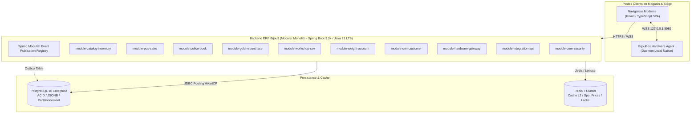
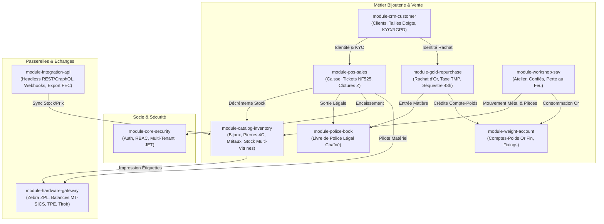
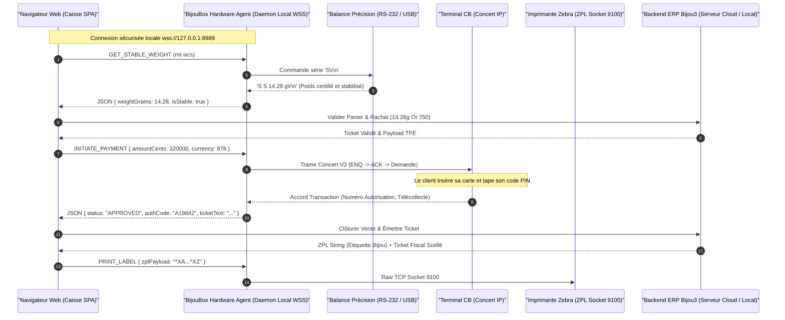
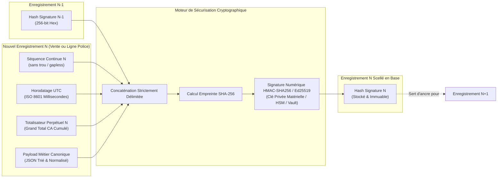

# Dossier d'Architecture Technique Backend — Refonte ERP Bijou3
**Auteur :** Lead Architecte Backend Java & Systèmes Distribués  
**Date :** Novembre 2026  
**Version :** 1.0.0-RELEASE  
**Statut :** Validé pour implémentation  

---

## Table des Matières
1. [Choix Technologiques & Justifications Stratégiques](#1-choix-technologiques--justifications-stratégiques)
   - 1.1 Java 21 LTS : Virtual Threads, Pattern Matching & Records
   - 1.2 Spring Boot 3.3+ & Stack Applicative
   - 1.3 PostgreSQL 16 : ACID, JSONB Gemmologique & Partitionnement
   - 1.4 Dualité d'Accès aux Données : Spring Data JPA vs jOOQ
   - 1.5 Migrations de Base de Données : Stratégie Flyway
   - 1.6 Cache & Événements : Redis & Outbox Pattern
2. [Paradigme Architectural : Monolithe Modulaire & Architecture Hexagonale](#2-paradigme-architectural--monolithe-modulaire--architecture-hexagonale)
   - 2.1 Pourquoi le Monolithe Modulaire surpasse les Microservices en Bijouterie
   - 2.2 Découpage des Bounded Contexts (10 Modules Métier)
   - 2.3 Architecture Hexagonale Interne (Ports & Adapters)
   - 2.4 Vérification d'Architecture avec Spring Modulith & ArchUnit
3. [Intégration Matériel du Magasin (Hardware Gateway)](#3-intégration-matériel-du-magasin-hardware-gateway)
   - 3.1 Problématique Web vs Matériel Physique
   - 3.2 Architecture Préconisée : BijouBox Hardware Agent (Daemon Local)
   - 3.3 Protocoles & Spécifications Périphériques (Zebra ZPL, Balances MT-SICS, TPE Concert, ESC/POS)
4. [Sécurité Fiscale & Intégrité des Données (NF525 & Livre de Police)](#4-sécurité-fiscale--intégrité-des-données-nf525--livre-de-police)
   - 4.1 Cadre Réglementaire (NF525, Art. 88 LPF, Art. 537 CGI)
   - 4.2 Chaînage Cryptographique (Blockchain Locale SHA-256 + HMAC / Ed25519)
   - 4.3 Séquences Strictes sans Rupture (Gapless Sequences)
   - 4.4 Journal des Événements Techniques (JET) & Immuabilité
5. [Modèle de Données Relationnel Cible (DDL & Code Java 21)](#5-modèle-de-données-relationnel-cible-ddl--code-java-21)
   - 5.1 Schémas DDL PostgreSQL 16
   - 5.2 Modélisation Domaine Java 21 (Records, Sealed Interfaces)
   - 5.3 Moteur de Scellement Cryptographique
   - 5.4 Extraction Analytique & Clôture Fiscale avec jOOQ
   - 5.5 Orchestration Événementielle Spring Modulith

---

## 1. Choix Technologiques & Justifications Stratégiques



### 1.1 Java 21 LTS : Virtual Threads, Pattern Matching & Records

Le choix de **Java 21 LTS** s'impose comme le socle d'ingénierie pour les 10 prochaines années d'exploitation de l'ERP Bijou3.

#### A. Virtual Threads (Project Loom)
Dans un ERP de gestion de bijouterie, plus de 85 % des opérations sont bloquées par des I/O (requêtes relationnelles PostgreSQL, lectures du cache Redis, synchronisations SOAP/REST avec les affineurs d'or, impression de documents fiscaux).
* **Abandon du modèle réactif complexe (WebFlux)** : Les modèles réactifs (Reactor/RxJava) introduisent une surcharge cognitive massive, brisent les traces de pile (`ThreadLocal` perdu, debugging cauchemardesque) et s'accordent très mal avec les transactions déclaratives ACID `@Transactional` de JDBC/JPA.
* **Le modèle "Thread-per-request" réhabilité** : Grâce aux *Virtual Threads*, Spring MVC peut traiter des dizaines de milliers de requêtes concurrentes sans risque de saturation du pool d'OS threads. Une requête de clôture fiscale de 800 ms n'impacte en rien les requêtes d'encaissement temps réel.
* **Configuration unifiée** :
  ```properties
  spring.threads.virtual.enabled=true
  ```

#### B. Pattern Matching & Sealed Interfaces
La bijouterie manipule un polymorphisme métier strict. Une pièce de stock est soit un *Bijou Fini*, soit un *Composant/Apprêt*, soit une *Pierre Isolé/Gemme*, soit de l'*Or de Rachat (Matière)*. Les `sealed interfaces` combinées au `switch pattern matching` offrent une complétude garantie dès la compilation :
```java
public sealed interface ValuableAsset permits FinishedJewelry, LooseGemstone, RawGoldScrap, WorkshopPart {}
```
Si un développeur oublie de traiter le cas `RawGoldScrap` dans le calcul de la TVA sur marge ou de la taxe TMP, le compilateur refuse de builder.

#### C. Records & Immuabilité
Les objets de valeurs (Value Objects gemmologiques, montants monétaires, cotations au gramme, empreintes cryptographiques) sont implémentés sous forme de `records`. L'immuabilité native protège les structures de données fiscales contre toute altération accidentelle en mémoire.

---

### 1.2 Spring Boot 3.3+ & Stack Applicative

* **Spring Modulith 1.2+** : Pilier central de l'architecture. Permet de maintenir un monolythe logique découpé en modules autonomes, d'appliquer une encapsulation stricte entre packages et de tracer les événements métier.
* **Spring Security 6.3+** :
  * Découplage strict de l'authentification (support OIDC / OAuth2 Resource Server avec tokens JWT scellés).
  * RBAC fin (`@PreAuthorize`) avec contextes multi-magasins : un gérant de succursale ne peut visualiser que les écritures de sa boutique, alors que le commissaire aux comptes / auditeur a un accès en lecture seule global.
* **Spring MVC avec Virtual Threads** : Préféré à Spring WebFlux car l'ensemble des drivers relationnels (JDBC, HikariCP, PostgreSQL) et les moteurs d'assertion fiscale reposent sur des sémantiques bloquantes transactionnelles.

---

### 1.3 PostgreSQL 16 : ACID, JSONB Gemmologique & Partitionnement

PostgreSQL 16 est la seule base open source répondant cumulativement aux impératifs d'un ERP de bijouterie haut de gamme :

1. **Isolation Transactionnelle Stricte** : Support natif du niveau `REPEATABLE READ` et `SERIALIZABLE` nécessaire pour garantir qu'aucune séquence de ticket de caisse ou de Livre de Police ne puisse être dupliquée ni comporter de trou.
2. **Type `JSONB` pour la Gemmologie Variable** :
   Chaque pierre précieuse (diamant, rubis birman, saphir de Ceylan, émeraude de Colombie) possède des métadonnées gemmologiques uniques issues de laboratoires (GIA, HRD, LFG) :
   * Diamant : 4C (Carat, Color, Clarity, Cut), table %, profondeur %, fluorescence, numéro de gravure laser sur rondiste.
   * Perle : diamètre, lustre, orient, forme, provenance (Tahiti, Akoya, Mers du Sud).
   Plutôt que d'utiliser un modèle anti-pattern EAV (*Entity-Attribute-Value*) détruisant les performances, les attributs polymorphes sont stockés dans un champ `gemmological_properties JSONB` indexé par un index GIN (`CREATE INDEX idx_gem_props ON inventory_item USING gin (gemmological_properties);`).
3. **Partitionnement Déclaratif par Intervalle Temporel** :
   Les tables d'audit et de journalisation légale (`pos_ticket`, `police_book_entry`, `jet_audit_log`) sont partitionnées par année et par magasin :
   ```sql
   CREATE TABLE pos_ticket (
       id UUID NOT NULL,
       store_id UUID NOT NULL,
       ticket_number VARCHAR(64) NOT NULL,
       created_at TIMESTAMPTZ NOT NULL,
       ...
       PRIMARY KEY (id, created_at)
   ) PARTITION BY RANGE (created_at);
   ```
4. **Advisory Locks PosgreSQL (`pg_advisory_xact_lock`)** :
   Utilisés pour sérialiser l'émission des numéros sans trou par caisse sans verrouiller l'ensemble de la table de tickets.

---

### 1.4 Dualité d'Accès aux Données : Spring Data JPA vs jOOQ

L'erreur classique des ERP est de vouloir tout traiter avec un ORM (Hibernate). Pour Bijou3, nous mettons en place une **dualité d'accès aux données rigoureusement segmentée** :

```
                  ┌────────────────────────────────────────┐
                  │            BACKEND DOMAIN              │
                  └──────────────┬──────────────────┬──────┘
                                 │                  │
                Commandes OLTP   │                  │ Requêtes Analytiques & Fiscale
             (Cycles de vie,     │                  │ (Clôtures Z, Inventaires,
              Création, MAJ)     │                  │  Livre de Police, Rapports)
                                 ▼                  ▼
                  ┌──────────────────────┐  ┌──────────────────────┐
                  │   Spring Data JPA    │  │        jOOQ          │
                  │   (Hibernate 6)      │  │ (Typesafe SQL Engine)│
                  └──────────┬───────────┘  └──────────┬───────────┘
                             │                         │
                             ▼                         ▼
                  ┌────────────────────────────────────────────────┐
                  │            PostgreSQL 16 Database              │
                  └────────────────────────────────────────────────┘
```

| Critère | Spring Data JPA (Hibernate 6) | jOOQ 3.19+ |
| :--- | :--- | :--- |
| **Périmètre d'utilisation** | Écritures unitaires, agrégats du domaine, validation métier (`@Valid`), cycles de vie avec dirty-checking. | Lectures massives, requêtes d'inventaire, valorisation du stock au cours de l'or, clôtures fiscales journalières (Z), extraction du Livre de Police. |
| **Gestion mémoire** | Cache L1 de session, risque de fuite mémoire sur requêtes volumineuses. | Zéro surcoût d'hydratation d'entités, streaming direct des `Record` typesafe. |
| **Expressivité SQL** | JPQL limité ; fonctions de fenêtrage et CTE récursives inadaptées. | Support natif intégral des CTE PostgreSQL (`WITH RECURSIVE`), fenêtrage (`OVER (PARTITION BY ...)`), agrégations JSONB directes. |
| **Sécurité fiscale** | Risque d'altération accidentelle d'entités en session. | Projection immuable en lecture seule, aucune altération possible des données scellées. |

---

### 1.5 Migrations de Base de Données : Stratégie Flyway

* **Outil retenu : Flyway**. Préféré à Liquibase pour la pureté du SQL natif PostgreSQL (support direct des types enum, syntaxe JSONB, advisory locks, triggers cryptographiques).
* **Règles d'or absolues du versioning de schéma** :
  1. **Scripts immuables** : Dès qu'une migration `V{x}__{nom}.sql` est déployée en préproduction/production, son contenu est gelé à jamais. Tout changement passe par un script incrémental `V{x+1}`.
  2. **Séparation DDL / DML** : Aucun mélange entre modifications structurales (`ALTER TABLE`) et chargement de référentiels (ex: codes métaux de la garantie des métaux précieux).
  3. **Vues et Fonctions Reproductibles** : Les procédures stockées de scellement et les vues analytiques jOOQ sont gérées via des migrations répétables `R__{nom}.sql` garantissant leur versioning continu.
  4. **Validation CI/CD** : La chaîne CI exécute `mvn flyway:validate` avec un conteneur Testcontainers PostgreSQL 16 éphémère avant toute fusion de pull-request.

---

### 1.6 Cache & Événements : Redis & Outbox Pattern

* **Redis 7 (Redis Stack / Cluster)** :
  * *Cache des cours officiels des métaux précieux* : Fixing de l'or et de l'argent (cours LBMA / Cookson-CLAL en €/gramme) rafraîchi toutes les 15 minutes avec TTL strict.
  * *Verrous distribués (Redisson)* : Prévention des doubles encaissements concurrents sur un même ticket de caisse lors des pics de fin d'année.
  * *Sessions caissier éphémères* : Déconnexion automatique après inactivité en boutique pour conformité de sécurité physique.
* **Événements Métier : Spring Modulith Transactional Outbox Pattern** :
  * Dans un monolithe, un événement métier (ex: `ArticleVenduEvent`) doit impérativement être consigné dans la même transaction PostgreSQL que la vente elle-même.
  * Spring Modulith fournit une table native `event_publication`. En cas de crash serveur avant l'envoi vers un courtier externe (RabbitMQ ou Kafka pour le site e-commerce), l'événement n'est pas perdu et sera rejoué au redémarrage.

---

## 2. Paradigme Architectural : Monolithe Modulaire & Architecture Hexagonale

### 2.1 Pourquoi le Monolithe Modulaire surpasse les Microservices en Bijouterie

L'adoption aveugle des microservices dans le domaine de la bijouterie-horlogerie et du commerce de détail de luxe est un **anti-pattern documenté**.

#### Le scénario d'une vente en boutique physique :
Une cliente achète une bague en or blanc 750‰ avec saphir à 3 200 € en boutique. Elle paye par carte bancaire et par reprise d'un vieux pendentif en or (compte-poids).
Dans ce court instant (quelques secondes face au client au comptoir), le système doit garantir **atomiquement** :
1. L'encaissement et l'impression du ticket de caisse certifié NF525 avec signature cryptographique.
2. Le changement d'état du bijou de `DISPONIBLE_EN_VITRINE` à `VENDU`.
3. L'écriture de sortie obligatoire dans le **Livre de Police** mentionnant le numéro d'ordre, le nom de l'acquéreur et la référence du ticket.
4. La création de la ligne de rachat du vieux pendentif dans le Livre de Police des matières précieuses (volet rachat).
5. L'imputation au compte-poids métal fin du client.

#### La faillite des Microservices dans ce contexte :
* **Cauchemar des Sagas et Transactions Distribuées (2PC)** : Si le service "Livre de Police" ou "Compte Poids" est injoignable ou plante au moment du commit, une saga asynchrone devrait déclencher des compensations.
* **Conséquences légales désastreuses** : On ne peut pas "compenser" un ticket CB débité et une bague que le client a déjà passée à son doigt ! Si le Livre de Police n'est pas incrémenté instantanément au moment de la remise en main propre, l'enseigne est en **infraction pénale immédiate** lors d'un contrôle inopiné des Douanes ou de la Brigade des Métaux Précieux.
* **Complexité d'infrastructure disproportionnée** : Pour une chaîne de 2 à 50 boutiques, gérer Kubernetes, du distributed tracing (Jaeger), des maillages de services (Istio) et des pannes partielles réseau au moment d'imprimer une étiquette haltère Zebra est un gouffre financier et opérationnel.

> **Le Choix d'Ingénierie :** Le **Monolithe Modulaire (Spring Modulith)** offre la cohérence absolue des **transactions ACID PostgreSQL locales** tout en assurant l'indépendance de conception, le découplage strict du code et la testabilité d'une architecture distribuée.

---

### 2.2 Découpage des Bounded Contexts (10 Modules Métier)



#### 1. `module-core-security`
* **Responsabilités** : Authentification centralisée (OAuth2/JWT), gestion multi-boutiques/multi-sociétés (Multi-Tenancy avec discrimination au niveau ligne `store_id`), moteur de permissions RBAC, audit centralisé et Journal des Événements Techniques (JET).

#### 2. `module-catalog-inventory`
* **Responsabilités** : Gestion du référentiel produit bijoutier (pièces sérialisées uniques, créations uniques, séries avec baguier). Gestion des matières : alliages d'or (750‰, 585‰, 375‰, platine 950‰, argent 925‰), pierres précieuses avec attributs 4C certifiés, apprêts au poids/quantité. Gestion des emplacements physiques stricts : Vitrine A1, Vitrine Murale, Coffre Nuit, Atelier, Confié Client.

#### 3. `module-pos-sales`
* **Responsabilités** : Caisse tactile et clavier, gestion des paniers, remises plafonnées selon profil, multi-encaissements (CB, espèces avec plafond légal de 1 000 €, chèques, avoirs, bons d'achat, reprises d'or), acomptes sur commande, devis. Gestion des clôtures de caisse (Ticket X, Ticket Z journalier, clôtures mensuelles et annuelles scellées).

#### 4. `module-police-book`
* **Responsabilités** : Registre légal obligatoire des objets mobiliers précieux (Livre de Police selon l'Art. 537 du Code Général des Impôts). Enregistrement chronologique inaltérable des entrées (achats, confiés, retours) et des sorties (ventes, destructions pour fonte, retours fournisseurs).

#### 5. `module-gold-repurchase`
* **Responsabilités** : Achat de vieil or et bijoux aux particuliers. Saisie métrologique obligatoire (poids certifié au centième de gramme), test au touchau / spectromètre (carats). Calcul et déclaration de la Taxe sur les Métaux Précieux (TMP à 11,5% ou régime de plus-value réelle). Gestion légale du délai de rétractation de 48 heures (séquestre physique avec interdiction de fonte avant expiration). Génération des bordereaux d'achat et constitution des lots d'affinage pour fonderie.

#### 6. `module-workshop-sav`
* **Responsabilités** : Gestion des réparations, transformations, gravures et fabrications sur-mesure. Prise en charge des "confiés" (bijoux déposés par les clients avec état des lieux gemmologique contradictoire et photos macro). Suivi d'avancement d'atelier (démontage, fonte, assemblage, sertissage, polissage, rhodiage). Gestion de la **perte au feu** (différence de poids tolérée entre l'or confié à l'artisan bijoutier et le bijou final après meulage/polissage).

#### 7. `module-weight-account`
* **Responsabilités** : Tenue des comptes-poids en métal fin (exprimés en grammes d'or pur 999.9‰) pour les fabricants, sous-traitants sertisseurs, affineurs et clients grossistes. Permet la facturation "à la façon" (règlement du travail de l'artisan en euros et fourniture de la matière première en or fin par compensation sur compte-poids). Intégration des cours journaliers (fixings).

#### 8. `module-crm-customer`
* **Responsabilités** : Répertoire client 360°. Fiche morphologique : tours de doigt par bague/main, longueur de poignet, tour de cou, préférences d'alliage. Historique complet des bijoux possédés et anniversaires clés. Conformité KYC pour le rachat d'or (archivage légal des pièces d'identité et justificatifs de domicile) et gestion du droit à l'effacement RGPD (tout en préservant les données fiscales obligatoires non supprimables pendant 6 ans).

#### 9. `module-hardware-gateway`
* **Responsabilités** : Passerelle d'abstraction et pilotes des périphériques de magasin. Dialogue bidirectionnel avec le daemon local (Zebra, balances de précision, TPE bancaires, afficheur de prix, tiroir-caisse).

#### 10. `module-integration-api`
* **Responsabilités** : API publique headless (REST OpenAPI 3 & GraphQL) pour alimenter le site e-commerce de l'enseigne, synchronisation de stock omnicanale en temps réel (réservation d'une pièce en boutique depuis le web), webhooks de notification, exports comptables vers les formats standards (FEC - Fichier des Écritures Comptables, Sage, Cegid).

---

### 2.3 Architecture Hexagonale Interne (Ports & Adapters)

Chaque module métier applique rigoureusement les principes de l'**Architecture Hexagonale**. Le domaine métier reste purement agnostique de tout framework technique (zéro dépendance Spring dans le package `domain`).

```
                    ┌────────────────────────────────────────────────────────┐
                    │               MODULE BOUNDED CONTEXT                   │
                    │                                                        │
                    │   ADAPTERS (Inbound)                                   │
                    │   ┌────────────────────────────────────────────────┐   │
                    │   │ Web Rest Controller / Event Consumer           │   │
                    │   └───────────────────────┬────────────────────────┘   │
                    │                           │                            │
                    │                           ▼                            │
                    │   APPLICATION LAYER (Driving Ports / Use Cases)        │
                    │   ┌────────────────────────────────────────────────┐   │
                    │   │ ProcessSaleUseCase / RegisterPoliceEntryUseCase│   │
                    │   └───────────────────────┬────────────────────────┘   │
                    │                           │                            │
                    │                           ▼                            │
                    │   DOMAIN LAYER (Pure Java 21 - Zero Framework)         │
                    │   ┌────────────────────────────────────────────────┐   │
                    │   │ Entities, Value Objects, Domain Events         │   │
                    │   │ Outbound Ports (Repository & Gateway Interfaces│   │
                    │   └───────────────────────┬────────────────────────┘   │
                    │                           │                            │
                    │                           ▼                            │
                    │   ADAPTERS (Outbound / Driven)                         │
                    │   ┌───────────────────────┬────────────────────────┐   │
                    │   │ Spring Data JPA Repo  │  jOOQ Analytical Repo  │   │
                    │   └───────────────────────┴────────────────────────┘   │
                    └────────────────────────────────────────────────────────┘
```

#### Arborescence type d'un module (`module-police-book`) :
```text
fr.erpbijoux.policebook/
├── package-info.java                   # @ApplicationModule Spring Modulith
├── api/                                # CONTRATS PUBLICS EXPOSÉS AUX AUTRES MODULES
│   ├── PoliceBookPublicApi.java        # Interface Java appelée par module-pos-sales & module-gold
│   └── events/
│       └── PoliceBookEntrySealedEvent.java
├── domain/                             # CŒUR MÉTIER PUR (Java 21 brut, sans Spring)
│   ├── model/
│   │   ├── PoliceEntry.java            # Agrégat racine
│   │   ├── EntryNature.java            # Enum (ACHAT_PARTICULIER, VENTE, DEPOT_SAV...)
│   │   ├── MetalDescriptor.java        # Value Object (Type métal, Titre en millièmes, Poids)
│   │   └── PersonIdentity.java         # Identité vérifiée de la partie prenante
│   ├── ports/
│   │   ├── in/                         # Driving Ports (Cas d'utilisation)
│   │   │   └── RecordPoliceEntryCommand.java
│   │   └── out/                        # Driven Ports (Contrats d'infrastructure)
│   │       ├── PoliceBookRepositoryPort.java
│   │       └── CryptographicSignerPort.java
├── application/                        # ORCHESTRATION & CAS D'UTILISATION
│   └── service/
│       └── RecordPoliceEntryService.java
└── infrastructure/                     # ADAPTATEURS SECONDAIRES & PERSISTANCE
    ├── adapters/
    │   ├── JpaPoliceBookAdapter.java
    │   ├── JooqPoliceBookQueryAdapter.java
    │   └── Ed25519CryptographicSignerAdapter.java
    ├── persistence/
    │   ├── entity/PoliceEntryJpaEntity.java
    │   └── repository/SpringDataPoliceEntryRepository.java
    └── web/
        └── PoliceBookAdminController.java
```

---

### 2.4 Vérification d'Architecture avec Spring Modulith & ArchUnit

Pour empêcher que des dépendances illicites ne s'installent au fil du temps (ex: le module `module-catalog-inventory` qui importerait directement une entité JPA interne du module `module-pos-sales`), Spring Modulith effectue un audit automatique à chaque test unitaire.

```java
package fr.erpbijoux;

import org.junit.jupiter.api.Test;
import org.springframework.modulith.core.ApplicationModules;
import org.springframework.modulith.docs.Documenter;

class ArchitectureVerificationTest {

    private final ApplicationModules modules = ApplicationModules.of(ErpBijouxApplication.class);

    @Test
    void shouldAdhereToModularArchitectureRules() {
        // Vérifie qu'aucun module n'accède aux packages internes d'un autre module
        // et qu'il n'existe aucun cycle de dépendance entre modules
        modules.verify();
    }

    @Test
    void generateC4AndPlantUmlDocumentation() {
        // Génère automatiquement les diagrammes d'architecture C4 et composants dans target/modulith-docs
        new Documenter(modules)
            .writeModulesAsPlantUml()
            .writeIndividualModulesAsPlantUml();
    }
}
```

---

## 3. Intégration Matériel du Magasin (Hardware Gateway)

### 3.1 Problématique Web vs Matériel Physique

Dans une bijouterie moderne, les vendeurs utilisent des tablettes ou des PC tactiles avec une interface Web (Single Page Application React/TypeScript). Or, le standard de sécurité des navigateurs (Chrome, Firefox, Safari) impose des contraintes physiques majeures :
* **Sandbox d'exécution** : Une application web exécutée dans `https://mon-bijoutier-erp.com` ne peut pas ouvrir de socket TCP directe vers `192.168.1.50:9100` (imprimante Zebra) ni lire en continu le port série `/dev/ttyUSB0` (balance Mettler Toledo).
* **Limitations des APIs WebSerial / WebHID** :
  * Ne fonctionnent que sous Chromium (inopérantes sur Safari iPadOS ou Firefox).
  * Nécessitent une invite de validation utilisateur manuelle à chaque démarrage de session, inacceptable dans un flux d'encaissement rapide.
  * Ne supportent aucun matériel relié en Ethernet/IP (TPE bancaire IP, imprimantes tickets réseau).

---

### 3.2 Architecture Préconisée : BijouBox Hardware Agent (Daemon Local)

La solution pérenne, robuste et industrielle est le déploiement d'un agent léger d'arrière-plan sur chaque poste de caisse : **BijouBox Hardware Agent**.



#### Caractéristiques techniques du Daemon Local :
* **Technologie** : Service compilé en binaire natif ultra-léger (Java 21 avec GraalVM Native Image ou Go). Consommation mémoire : **< 25 Mo de RAM**. Zéro dépendance d'environnement (pas de JVM à installer sur le poste client).
* **Communication Frontend** : Serveur WebSocket sécurisé local écoutant sur `wss://127.0.0.1:8989`.
* **Sécurité & Certificat TLS Local** :
  * Un nom de domaine dédié `local.erp-bijoux.fr` résout systématiquement sur `127.0.0.1` (DNS A-record public pointant vers localhost).
  * Un certificat wildcard TLS valide émis par Let's Encrypt est distribué et renouvelé automatiquement par l'agent, évitant tout avertissement de sécurité dans le navigateur.
  * Chaque requête WebSocket est authentifiée par un jeton de session éphémère (`Token de Caisse`) fourni par le backend lors du login du vendeur.

---

### 3.3 Protocoles & Spécifications Périphériques

#### 1. Imprimantes d'Étiquettes Bijouterie (Zebra en Protocole ZPL II)
Les étiquettes de bijouterie sont très spécifiques :
* **Format "Haltère" (Dumbbell) ou "Filot"** : Deux zones d'impression latérales avec un pont central fin non adhésif qui entoure le corps de bague ou le fermoir sans laisser de résidus de colle.
* **Résolution** : 300 ou 600 DPI obligatoire pour imprimer des codes Datamatrix microscopiques lisibles par douchette laser.
* **Exemple de template ZPL II généré par le système** :
  ```zpl
  ^XA
  ^PW320
  ^LL160
  ^LH0,0
  ^FO15,15^BXN,3,200^FDREF-BAG-OR750-004921^FS
  ^FO70,15^A0N,20,18^FDOr Blanc 750^FS
  ^FO70,38^A0N,18,16^FDSaphir 0.85ct^FS
  ^FO70,58^A0N,18,16^FDPoids: 4.32g^FS
  ^FO70,80^A0N,22,20^B^FD3 450 EUR^FS
  ^FO210,15^A0N,16,14^FDN# Police: 2026-0842^FS
  ^XZ
  ```

#### 2. Balances de Précision au Centième de Gramme (Protocole MT-SICS)
La pesée en bijouterie et rachat d'or est soumise à la **métrologie légale** (vignette verte obligatoire et carnet de métrologie).
* **Marques supportées** : Mettler Toledo, Sartorius, Ohaus, Kern.
* **Protocole standard : MT-SICS (Mettler Toledo Standard Interface Command Set)** via liaison série RS-232 / convertisseur USB-Série FTDI (9600 bauds, 8 bits de données, 1 bit de stop, pas de parité).
* **Commandes clés gérées par l'agent** :
  * `S` (*Send stable weight value*) : L'agent envoie `S\r\n`. La balance attend la fin des micro-vibrations physiques et répond :  
    `S S      14.28 g\r\n`  
    Le poids est certifié "stable" (`S`). La saisie manuelle au clavier dans l'ERP est formellement bloquée dès lors qu'une balance est connectée afin d'éliminer toute fraude ou erreur humaine.
  * `SI` (*Send weight immediately*) : Renvoie la mesure instantanée même non stabilisée (pour affichage dynamique d'une jauge sur l'écran de caisse).
  * `Z` / `T` (*Zero / Tare*) : Remise à zéro ou tare de la coupelle à pierres.

#### 3. Terminaux de Paiement Électronique (Protocole Bancaire Concert V3 / CB)
* **Liaison** : Ethernet IP (port TCP 8888 ou 5000) ou liaison USB/Série.
* **Dialogue synchrone standardisé** :
  1. L'Agent envoie le caractère ASCII `ENQ` (0x05) pour sonder le terminal.
  2. Le TPE répond `ACK` (0x06).
  3. L'Agent envoie la trame de demande de débit encodée en format Concert (Numéro de caisse, montant en centimes `00000320000`, code devise `978` pour l'Euro, type de transaction).
  4. Le TPE prend la main, affiche le montant au client, valide la puce/sans-contact et le code PIN, contacte le serveur d'autorisation bancaire.
  5. Le TPE renvoie le résultat scellé avec le ticket commerçant et les données de télécollecte, puis clôture la session par `EOT` (0x04).

#### 4. Imprimantes Tickets de Caisse & Tiroir-Caisse (Protocole ESC/POS)
* **Standard Epson ESC/POS** via Ethernet ou USB.
* **Impulsion tiroir-caisse** : Déclenchée automatiquement à chaque encaissement en espèces ou ouverture de coffre autorisée via la commande standard :  
  `\x1B\x70\x00\x19\xFA` (*Génère une impulsion électrique de 24V sur la prise RJ11 du tiroir-caisse*).

#### 5. Afficheur Client (Customer Display)
* Écran VFD 2x20 caractères ou écran secondaire HDMI.
* Envoi des messages de courtoisie et affichage du libellé de l'article en cours de scannage avec son prix au gramme et le montant total cumulé.

---

## 4. Sécurité Fiscale & Intégrité des Données (NF525 & Livre de Police)



### 4.1 Cadre Réglementaire (NF525, Art. 88 LPF, Art. 537 CGI)

1. **Loi Anti-Fraude à la TVA (Article 88 de la Loi de Finances / Norme NF525)** :
   * Tout logiciel de caisse enregistreuse doit respecter 4 conditions obligatoires sous peine d'amende de 7 500 € par caisse et de redressement fiscal automatique :
     * **Inaltérabilité** : Interdiction totale de modifier ou supprimer une ligne de vente enregistrée.
     * **Sécurisation** : Signature cryptographique de chaque ticket et clôture avec chaînage sans rupture.
     * **Conservation** : Clôtures journalières (Ticket Z), mensuelles et annuelles conservées pendant 6 ans minimum.
     * **Archivage** : Traçabilité des purges et possibilité d'export du Grand Livre et du Journal des Événements Techniques dans un format structuré et auditable.
2. **Livre de Police des Métaux Précieux (Article 537 et suivants du CGI)** :
   * Registre légal pour toute personne détenant ou négociant des matières d'or, d'argent ou de platine.
   * Doit comporter sans blanc ni rature : date de l'opération, nom et domicile du client/fournisseur, désignation détaillée de l'objet, poids brut et titre (teneur en métal fin), prix d'achat ou de vente.
   * L'informatisation du Livre de Police requiert une certification équivalente à la NF525 avec horodatage scellé.

---

### 4.2 Chaînage Cryptographique (Blockchain Locale SHA-256 + HMAC / Ed25519)

Pour chaque opération fiscale de caisse ($N$) ou ligne du Livre de Police ($N$), le backend calcule une signature numérique indélébile :

$$\text{DataToHash}_N = \text{Hash}_{N-1} \parallel \text{SequenceNumber}_N \parallel \text{TimestampISO}_N \parallel \text{GrandTotal}_N \parallel \text{CanonicalPayload}_N$$

$$\text{Hash}_N = \text{HMAC-SHA256}(\text{SecretKey}, \text{DataToHash}_N)$$

* **Bloc Genèse ($N=0$)** : Pour la première écriture d'une boutique ou d'une caisse, $\text{Hash}_0$ est une constante officielle :  
  `"0000000000000000000000000000000000000000000000000000000000000000"`.
* **Payload Métier Canonique** : Le contenu de la transaction est normalisé (clés JSON triées alphabétiquement, suppression des espaces inutiles, montants formatés à 2 décimales fixes, encodage UTF-8) pour éviter toute divergence d'empreinte selon l'interpréteur JSON.
* **Totalisateur Perpétuel (`Grand Total`)** : Un compteur cumulatif du chiffre d'affaires TTC depuis l'ouverture initiale de la caisse. Il ne peut être ni remis à zéro ni diminué, même après une clôture annuelle.

---

### 4.3 Séquences Strictes sans Rupture (Gapless Sequences)

L'administration fiscale interdit formellement les "trous" de numérotation. Si les tickets émis sont numérotés 101, 102, 104, l'inspecteur fiscal conclut que le ticket 103 a été détourné ou détruit frauduleusement.
* **Problème de `BIGSERIAL` / `SEQUENCE` PostgreSQL** : Une séquence standard consomme un numéro immédiatement. Si la transaction effectue un `ROLLBACK` (erreur de paiement CB, balance débranchée), le numéro est perdu, créant un trou irrémédiable.
* **Solution retenue : Compteur dédié avec Verrou Pessimiste Exclusif** :
  ```sql
  CREATE TABLE fiscal_sequence_counter (
      store_id UUID NOT NULL,
      register_id UUID NOT NULL,
      sequence_type VARCHAR(32) NOT NULL, -- 'POS_TICKET', 'POLICE_BOOK', 'Z_CLOSURE'
      current_sequence BIGINT NOT NULL DEFAULT 0,
      grand_total NUMERIC(15, 2) NOT NULL DEFAULT 0.00,
      last_hash VARCHAR(64) NOT NULL DEFAULT '0000000000000000000000000000000000000000000000000000000000000000',
      updated_at TIMESTAMPTZ NOT NULL,
      PRIMARY KEY (store_id, register_id, sequence_type)
  );
  ```
  Lors de la validation d'un ticket, le service exécute dans la même transaction :
  ```sql
  SELECT current_sequence, grand_total, last_hash
  FROM fiscal_sequence_counter
  WHERE store_id = :storeId AND register_id = :registerId AND sequence_type = 'POS_TICKET'
  FOR UPDATE;
  ```
  Le verrou exclusif garantit qu'aucune autre requête sur cette caisse ne peut s'intercaler. Le numéro $N = \text{current\_sequence} + 1$ est alloué et le hash $N$ est calculé. Si la transaction échoue, le verrou est libéré et la séquence n'a jamais été incrémentée : **zéro trou possible**.

---

### 4.4 Journal des Événements Techniques (JET) & Immuabilité

Le **Journal des Événements Techniques (JET)** trace tout événement système susceptible d'impacter l'intégrité de l'exploitation :
* Démarrage et arrêt du logiciel ou du serveur.
* Ouverture et fermeture journalière de caisse.
* Déconnexion d'une balance de précision ou perte de liaison TPE.
* Modification d'un paramètre sensible (changement des taux de TVA, ajout d'un nouvel utilisateur administrateur).
* Échec d'authentification répété.

#### Règle d'Immuabilité Absolue (Triggers Anti-Mutation PostgreSQL) :
Pour garantir la conformité devant les tribunaux, des triggers PostgreSQL bloquent physiquement toute instruction SQL `UPDATE` ou `DELETE` sur les tables scellées :
```sql
CREATE OR REPLACE FUNCTION prevent_audit_alteration()
RETURNS TRIGGER AS $$
BEGIN
    RAISE EXCEPTION 'VIOLATION FISCALE ET LEGALE : Les enregistrements fiscaux sont inaltérables (NF525 / Art. 537 CGI). Aucune modification ou suppression autorisée.';
END;
$$ LANGUAGE plpgsql;

CREATE TRIGGER trg_immutable_pos_ticket
BEFORE UPDATE OR DELETE ON pos_ticket
FOR EACH ROW EXECUTE FUNCTION prevent_audit_alteration();

CREATE TRIGGER trg_immutable_police_book
BEFORE UPDATE OR DELETE ON police_book_entry
FOR EACH ROW EXECUTE FUNCTION prevent_audit_alteration();

CREATE TRIGGER trg_immutable_jet_log
BEFORE UPDATE OR DELETE ON jet_audit_log
FOR EACH ROW EXECUTE FUNCTION prevent_audit_alteration();
```

---

## 5. Modèle de Données Relationnel Cible (DDL & Code Java 21)

### 5.1 Schémas DDL PostgreSQL 16

```sql
-- Extension pour clés primaires UUID v7 ordonnées dans le temps
CREATE EXTENSION IF NOT EXISTS "uuid-ossp";

-- 1. Compteur de séquences fiscales sans trou (Gapless)
CREATE TABLE fiscal_sequence_counter (
    store_id UUID NOT NULL,
    register_id UUID NOT NULL,
    sequence_type VARCHAR(32) NOT NULL,
    current_sequence BIGINT NOT NULL DEFAULT 0,
    grand_total NUMERIC(15, 2) NOT NULL DEFAULT 0.00,
    last_hash VARCHAR(64) NOT NULL DEFAULT '0000000000000000000000000000000000000000000000000000000000000000',
    updated_at TIMESTAMPTZ NOT NULL DEFAULT CURRENT_TIMESTAMP,
    PRIMARY KEY (store_id, register_id, sequence_type)
);

-- 2. Référentiel des Objets & Bijoux en Stock
CREATE TABLE inventory_item (
    id UUID PRIMARY KEY DEFAULT gen_random_uuid(),
    store_id UUID NOT NULL,
    serial_number VARCHAR(64) UNIQUE NOT NULL, -- Numéro gravé ou RFID
    category VARCHAR(32) NOT NULL, -- 'BAGUE', 'COLLIER', 'BRACELET', 'PIERRE_ISOLEE', 'OR_RACHAT'
    designation VARCHAR(255) NOT NULL,
    metal_type VARCHAR(32) NOT NULL, -- 'OR_JAUNE', 'OR_BLANC', 'PLATINE', 'ARGENT'
    metal_fineness_thousandths INT NOT NULL CHECK (metal_fineness_thousandths IN (375, 585, 750, 900, 916, 950, 999)),
    gross_weight_grams NUMERIC(8, 3) NOT NULL,
    fine_gold_weight_grams NUMERIC(8, 3) NOT NULL,
    gemmological_properties JSONB NOT NULL DEFAULT '{}'::jsonb,
    selling_price_ht NUMERIC(12, 2) NOT NULL,
    vat_rate NUMERIC(5, 2) NOT NULL DEFAULT 20.00,
    selling_price_ttc NUMERIC(12, 2) NOT NULL,
    status VARCHAR(32) NOT NULL, -- 'EN_VITRINE', 'COFFRE', 'EN_SAV', 'RESERVE', 'VENDU'
    physical_location VARCHAR(64) NOT NULL, -- Ex: 'VITRINE_A2_PLATEAU_3'
    created_at TIMESTAMPTZ NOT NULL DEFAULT CURRENT_TIMESTAMP,
    updated_at TIMESTAMPTZ NOT NULL DEFAULT CURRENT_TIMESTAMP
);

CREATE INDEX idx_inventory_item_gem_gin ON inventory_item USING gin (gemmological_properties);
CREATE INDEX idx_inventory_item_store_status ON inventory_item (store_id, status);

-- 3. Entêtes de Tickets de Caisse (Conformes NF525)
CREATE TABLE pos_ticket (
    id UUID NOT NULL,
    store_id UUID NOT NULL,
    register_id UUID NOT NULL,
    sequence_number BIGINT NOT NULL,
    ticket_reference VARCHAR(64) NOT NULL,
    ticket_type VARCHAR(32) NOT NULL, -- 'VENTE', 'AVOIR', 'ACOMPTE', 'ANNULATION'
    cashier_user_id UUID NOT NULL,
    customer_id UUID,
    total_ht NUMERIC(12, 2) NOT NULL,
    total_vat NUMERIC(12, 2) NOT NULL,
    total_ttc NUMERIC(12, 2) NOT NULL,
    grand_total_cumulative NUMERIC(15, 2) NOT NULL,
    previous_record_hash VARCHAR(64) NOT NULL,
    signature_hash VARCHAR(64) NOT NULL,
    signature_version VARCHAR(16) NOT NULL DEFAULT 'HMAC-SHA256-v1',
    created_at TIMESTAMPTZ NOT NULL DEFAULT CURRENT_TIMESTAMP,
    PRIMARY KEY (id, created_at)
) PARTITION BY RANGE (created_at);

-- Partition 2026 pour pos_ticket
CREATE TABLE pos_ticket_2026 PARTITION OF pos_ticket
    FOR VALUES FROM ('2026-01-01 00:00:00+00') TO ('2027-01-01 00:00:00+00');

-- 4. Lignes de Tickets de Caisse
CREATE TABLE pos_ticket_line (
    id UUID PRIMARY KEY DEFAULT gen_random_uuid(),
    ticket_id UUID NOT NULL,
    line_number INT NOT NULL,
    inventory_item_id UUID,
    sku_code VARCHAR(64) NOT NULL,
    description VARCHAR(255) NOT NULL,
    quantity INT NOT NULL DEFAULT 1,
    unit_price_ht NUMERIC(12, 2) NOT NULL,
    vat_rate NUMERIC(5, 2) NOT NULL,
    vat_amount NUMERIC(12, 2) NOT NULL,
    line_price_ttc NUMERIC(12, 2) NOT NULL,
    weight_grams NUMERIC(8, 3),
    metal_fineness INT
);

-- 5. Livre de Police Officiel (Inaltérable & Chaîné)
CREATE TABLE police_book_entry (
    id UUID PRIMARY KEY DEFAULT gen_random_uuid(),
    store_id UUID NOT NULL,
    entry_number BIGINT NOT NULL, -- Numéro d'ordre sans trou
    entry_type VARCHAR(16) NOT NULL, -- 'ENTREE', 'SORTIE'
    operation_nature VARCHAR(32) NOT NULL, -- 'ACHAT_NEUF', 'RACHAT_PARTICULIER', 'VENTE', 'FONTE'
    entry_date TIMESTAMPTZ NOT NULL DEFAULT CURRENT_TIMESTAMP,
    item_description TEXT NOT NULL,
    quantity INT NOT NULL DEFAULT 1,
    gross_weight_grams NUMERIC(8, 3) NOT NULL,
    metal_fineness_thousandths INT NOT NULL,
    fine_metal_weight_grams NUMERIC(8, 3) NOT NULL,
    hallmark_present BOOLEAN NOT NULL DEFAULT true, -- Présence poinçon d'État/Maître
    third_party_full_name VARCHAR(255) NOT NULL,
    third_party_id_card_ref VARCHAR(128),
    third_party_address TEXT,
    price_amount NUMERIC(12, 2) NOT NULL,
    related_document_ref VARCHAR(64) NOT NULL, -- Réf ticket caisse, facture ou bordereau
    previous_hash VARCHAR(64) NOT NULL,
    record_hash VARCHAR(64) NOT NULL,
    created_at TIMESTAMPTZ NOT NULL DEFAULT CURRENT_TIMESTAMP
);

CREATE UNIQUE INDEX idx_police_entry_store_seq ON police_book_entry (store_id, entry_number);

-- 6. Dossiers de Rachat d'Or aux Particuliers
CREATE TABLE gold_repurchase_dossier (
    id UUID PRIMARY KEY DEFAULT gen_random_uuid(),
    store_id UUID NOT NULL,
    dossier_reference VARCHAR(64) UNIQUE NOT NULL,
    customer_id UUID NOT NULL,
    customer_id_verified BOOLEAN NOT NULL DEFAULT true,
    total_gross_weight_grams NUMERIC(8, 3) NOT NULL,
    total_payout_amount NUMERIC(12, 2) NOT NULL,
    tax_type VARCHAR(32) NOT NULL, -- 'TMP_FLAT_11_5', 'REGIME_REEL_PLUS_VALUE'
    tax_amount_deducted NUMERIC(12, 2) NOT NULL,
    net_payout_to_customer NUMERIC(12, 2) NOT NULL,
    payment_method VARCHAR(32) NOT NULL CHECK (payment_method IN ('CHEQUE', 'VIREMENT_BANCAIRE')), -- Espèces strictement interdites par la loi
    retraction_deadline TIMESTAMPTZ NOT NULL, -- Expiration du délai légal de 48 heures
    status VARCHAR(32) NOT NULL, -- 'SOUS_RETRACTATION', 'DEFINITIF_EN_COFFRE', 'RETRACTE_RESTITUE', 'EXPEDIE_FONTE'
    created_at TIMESTAMPTZ NOT NULL DEFAULT CURRENT_TIMESTAMP
);

-- 7. Ordres de Fabrication et Réparation Atelier (SAV)
CREATE TABLE workshop_order (
    id UUID PRIMARY KEY DEFAULT gen_random_uuid(),
    store_id UUID NOT NULL,
    order_reference VARCHAR(64) UNIQUE NOT NULL,
    customer_id UUID NOT NULL,
    order_type VARCHAR(32) NOT NULL, -- 'REPARATION', 'TRANSFORMATION', 'CREATION_SUR_MESURE'
    initial_deposit_weight_grams NUMERIC(8, 3) NOT NULL,
    final_delivered_weight_grams NUMERIC(8, 3),
    allowed_loss_percentage NUMERIC(4, 2) NOT NULL DEFAULT 3.00, -- Tolérance perte au feu (ex: 3%)
    actual_loss_weight_grams NUMERIC(8, 3),
    state VARCHAR(32) NOT NULL, -- 'DEPOSE', 'FONTE', 'SERTISSAGE', 'POLISSAGE', 'DISPONIBLE_LIVRAISON', 'LIVRE'
    detailed_notes TEXT,
    created_at TIMESTAMPTZ NOT NULL DEFAULT CURRENT_TIMESTAMP
);

-- 8. Comptes-Poids Métal Fin (Fabricants & Clients)
CREATE TABLE weight_account_ledger (
    id UUID PRIMARY KEY DEFAULT gen_random_uuid(),
    store_id UUID NOT NULL,
    account_holder_type VARCHAR(32) NOT NULL, -- 'FOURNISSEUR_FABRICANT', 'CLIENT_COMMERCIAL'
    holder_id UUID NOT NULL,
    metal_type VARCHAR(16) NOT NULL DEFAULT 'OR_PUR_999_9',
    operation_type VARCHAR(32) NOT NULL, -- 'CREDIT_LIVRAISON_MATIERE', 'DEBIT_COMPENSATION_FAÇON', 'VENTE_AU_FIXING'
    weight_grams NUMERIC(10, 3) NOT NULL, -- Positif ou Négatif
    balance_after_grams NUMERIC(10, 3) NOT NULL,
    fixing_price_applied NUMERIC(12, 2), -- Cours de l'or appliqué si conversion monétaire
    reference_document VARCHAR(64) NOT NULL,
    created_at TIMESTAMPTZ NOT NULL DEFAULT CURRENT_TIMESTAMP
);

-- 9. Journal des Événements Techniques (JET)
CREATE TABLE jet_audit_log (
    id UUID PRIMARY KEY DEFAULT gen_random_uuid(),
    store_id UUID NOT NULL,
    register_id UUID,
    event_code VARCHAR(64) NOT NULL, -- 'SYSTEM_STARTUP', 'CASH_DRAWER_FORCE_OPEN', 'FISCAL_Z_CLOSE', 'SCALE_DISCONNECT'
    severity VARCHAR(16) NOT NULL, -- 'INFO', 'WARNING', 'CRITICAL_SECURITY'
    operator_user_id UUID,
    event_details JSONB NOT NULL DEFAULT '{}'::jsonb,
    ip_address VARCHAR(45) NOT NULL,
    previous_jet_hash VARCHAR(64) NOT NULL,
    record_hash VARCHAR(64) NOT NULL,
    created_at TIMESTAMPTZ NOT NULL DEFAULT CURRENT_TIMESTAMP
);
```

---

### 5.2 Modélisation Domaine Java 21 (Records, Sealed Interfaces)

```java
package fr.erpbijoux.domain.shared;

import java.math.BigDecimal;
import java.math.RoundingMode;

/**
 * Value Object représentant un poids certifié avec précision milligramme (0.001g).
 */
public record WeightInGrams(BigDecimal value) {
    public WeightInGrams {
        if (value == null || value.compareTo(BigDecimal.ZERO) < 0) {
            throw new IllegalArgumentException("Le poids ne peut être négatif ou null.");
        }
        value = value.setScale(3, RoundingMode.HALF_UP);
    }

    public static WeightInGrams of(double weight) {
        return new WeightInGrams(BigDecimal.valueOf(weight));
    }

    public WeightInGrams add(WeightInGrams other) {
        return new WeightInGrams(this.value.add(other.value));
    }
}
```

```java
package fr.erpbijoux.domain.catalog;

import fr.erpbijoux.domain.shared.WeightInGrams;
import java.math.BigDecimal;
import java.math.RoundingMode;

/**
 * Titre légal d'un alliage de métal précieux exprimé en millièmes de métal pur.
 */
public enum GoldFineness {
    OR_999(999, "24 Carats - Or Pur"),
    OR_916(916, "22 Carats"),
    OR_750(750, "18 Carats - Titre Légal Français"),
    OR_585(585, "14 Carats"),
    OR_375(375, "9 Carats");

    private final int thousandths;
    private final String label;

    GoldFineness(int thousandths, String label) {
        this.thousandths = thousandths;
        this.label = label;
    }

    public int getThousandths() {
        return thousandths;
    }

    public WeightInGrams calculateFineMetalWeight(WeightInGrams grossWeight) {
        BigDecimal fine = grossWeight.value()
            .multiply(BigDecimal.valueOf(this.thousandths))
            .divide(BigDecimal.valueOf(1000), 3, RoundingMode.HALF_UP);
        return new WeightInGrams(fine);
    }
}
```

```java
package fr.erpbijoux.domain.catalog;

import java.math.BigDecimal;

/**
 * Caractéristiques gemmologiques complètes d'un diamant selon les 4C du GIA.
 */
public record Diamond4C(
    BigDecimal caratWeight,
    DiamondColor color,
    DiamondClarity clarity,
    CutGrade cut,
    String certificateNumber, // Ex: GIA-218492019
    boolean laserInscribed
) {
    public enum DiamondColor { D, E, F, G, H, I, J, FANCY }
    public enum DiamondClarity { FL, IF, VVS1, VVS2, VS1, VS2, SI1, SI2, I1 }
    public enum CutGrade { EXCELLENT, VERY_GOOD, GOOD, FAIR, POOR }
}
```

---

### 5.3 Moteur de Scellement Cryptographique

```java
package fr.erpbijoux.core.security.crypto;

import org.springframework.beans.factory.annotation.Value;
import org.springframework.stereotype.Service;

import javax.crypto.Mac;
import javax.crypto.spec.SecretKeySpec;
import java.nio.charset.StandardCharsets;
import java.security.MessageDigest;
import java.time.Instant;
import java.util.HexFormat;

@Service
public class FiscalSealingEngine {

    private final byte[] hmacKey;

    public FiscalSealingEngine(@Value("${erp.fiscal.hmac-secret-key}") String secretKey) {
        this.hmacKey = secretKey.getBytes(StandardCharsets.UTF_8);
    }

    /**
     * Calcule le hash scellé chaîné selon la norme NF525.
     */
    public String computeFiscalSeal(
        String previousHash,
        long sequenceNumber,
        Instant timestamp,
        String grandTotalCumulative,
        String canonicalPayload
    ) {
        try {
            // 1. Concaténation canonique stricte
            String rawMessage = String.join("|",
                previousHash,
                String.valueOf(sequenceNumber),
                timestamp.toString(),
                grandTotalCumulative,
                canonicalPayload
            );

            // 2. Calcul du HMAC-SHA256
            Mac mac = Mac.getInstance("HmacSHA256");
            SecretKeySpec secretKeySpec = new SecretKeySpec(this.hmacKey, "HmacSHA256");
            mac.init(secretKeySpec);
            byte[] hmacBytes = mac.doFinal(rawMessage.getBytes(StandardCharsets.UTF_8));

            return HexFormat.of().formatHex(hmacBytes);
        } catch (Exception e) {
            throw new IllegalStateException("Échec critique du scellement fiscal NF525", e);
        }
    }

    /**
     * Vérification de l'intégrité de la chaîne fiscale lors d'un audit.
     */
    public boolean verifyIntegrity(
        String expectedHash,
        String previousHash,
        long sequenceNumber,
        Instant timestamp,
        String grandTotalCumulative,
        String canonicalPayload
    ) {
        String recalculated = computeFiscalSeal(previousHash, sequenceNumber, timestamp, grandTotalCumulative, canonicalPayload);
        return MessageDigest.isEqual(
            expectedHash.getBytes(StandardCharsets.UTF_8),
            recalculated.getBytes(StandardCharsets.UTF_8)
        );
    }
}
```

---

### 5.4 Extraction Analytique & Clôture Fiscale avec jOOQ

Pour réaliser la clôture fiscale journalière (Ticket Z), calculer les totaux de TVA par taux, et extraire le Grand Livre sans verrouiller les caisses actives, nous exploitons la puissance de **jOOQ** :

```java
package fr.erpbijoux.pos.infrastructure.jooq;

import org.jooq.DSLContext;
import org.jooq.Field;
import org.jooq.impl.DSL;
import org.springframework.stereotype.Repository;

import java.math.BigDecimal;
import java.time.LocalDate;
import java.time.OffsetDateTime;
import java.time.ZoneOffset;
import java.util.List;
import java.util.UUID;

import static org.jooq.impl.DSL.*;

@Repository
public class JooqFiscalClosureRepository {

    private final DSLContext dsl;

    public JooqFiscalClosureRepository(DSLContext dsl) {
        this.dsl = dsl;
    }

    public record DailyVatSummary(BigDecimal vatRate, BigDecimal totalHt, BigDecimal totalVat, BigDecimal totalTtc) {}

    public record DailyClosureReport(
        long totalTicketsCount,
        BigDecimal dailyTurnoverTtc,
        BigDecimal perpetualGrandTotal,
        List<DailyVatSummary> vatBreakdown
    ) {}

    public DailyClosureReport generateZReportData(UUID storeId, LocalDate businessDay) {
        OffsetDateTime startOfDay = businessDay.atStartOfDay().atOffset(ZoneOffset.UTC);
        OffsetDateTime endOfDay = businessDay.plusDays(1).atStartOfDay().atOffset(ZoneOffset.UTC);

        // 1. Calcul du CA total et du grand total avec jOOQ
        var totals = dsl.select(
                count().as("ticket_count"),
                coalesce(sum(field("total_ttc", BigDecimal.class)), BigDecimal.ZERO).as("daily_ttc"),
                coalesce(max(field("grand_total_cumulative", BigDecimal.class)), BigDecimal.ZERO).as("perpetual_grand_total")
            )
            .from(table("pos_ticket"))
            .where(field("store_id", UUID.class).eq(storeId))
            .and(field("created_at", OffsetDateTime.class).between(startOfDay, endOfDay))
            .fetchOne();

        // 2. Ventilation par taux de TVA (Requête agrégée typesafe)
        List<DailyVatSummary> vatSummary = dsl.select(
                field("line.vat_rate", BigDecimal.class),
                sum(field("line.unit_price_ht", BigDecimal.class).multiply(field("line.quantity", Integer.class))).as("total_ht"),
                sum(field("line.vat_amount", BigDecimal.class)).as("total_vat"),
                sum(field("line.line_price_ttc", BigDecimal.class)).as("total_ttc")
            )
            .from(table("pos_ticket_line").as("line"))
            .join(table("pos_ticket").as("ticket")).on(field("line.ticket_id", UUID.class).eq(field("ticket.id", UUID.class)))
            .where(field("ticket.store_id", UUID.class).eq(storeId))
            .and(field("ticket.created_at", OffsetDateTime.class).between(startOfDay, endOfDay))
            .groupBy(field("line.vat_rate", BigDecimal.class))
            .orderBy(field("line.vat_rate", BigDecimal.class).asc())
            .fetch(r -> new DailyVatSummary(
                r.get("vat_rate", BigDecimal.class),
                r.get("total_ht", BigDecimal.class),
                r.get("total_vat", BigDecimal.class),
                r.get("total_ttc", BigDecimal.class)
            ));

        return new DailyClosureReport(
            totals.get("ticket_count", Long.class),
            totals.get("daily_ttc", BigDecimal.class),
            totals.get("perpetual_grand_total", BigDecimal.class),
            vatSummary
        );
    }
}
```

---

### 5.5 Orchestration Événementielle Spring Modulith

Grâce à `@ApplicationModuleListener`, l'événement de vente d'un bijou est traité de manière asynchrone mais avec la garantie du journal transactionnel d'Outbox de Modulith :

```java
package fr.erpbijoux.policebook.application;

import fr.erpbijoux.policebook.domain.ports.in.RecordPoliceEntryCommand;
import fr.erpbijoux.pos.api.events.JewelrySoldEvent;
import org.springframework.modulith.events.ApplicationModuleListener;
import org.springframework.stereotype.Component;

@Component
public class PoliceBookSaleEventListener {

    private final RecordPoliceEntryCommand recordPoliceEntryCommand;

    public PoliceBookSaleEventListener(RecordPoliceEntryCommand recordPoliceEntryCommand) {
        this.recordPoliceEntryCommand = recordPoliceEntryCommand;
    }

    /**
     * Écouteur transactionnel résistant aux pannes : Spring Modulith garantit
     * l'exécution même en cas de redémarrage système grâce à la table event_publication.
     */
    @ApplicationModuleListener
    public void onJewelrySold(JewelrySoldEvent event) {
        recordPoliceEntryCommand.recordSaleExit(
            event.storeId(),
            event.serialNumber(),
            event.designation(),
            event.grossWeightGrams(),
            event.goldFineness(),
            event.buyerName(),
            event.buyerAddress(),
            event.ticketReference(),
            event.sellingPriceTtc()
        );
    }
}
```

---

## 6. Synthèse d'Exécution & Prochaines Étapes

Cette architecture offre :
1. **Zéro Compromis Légal** : Respect strict et infalsifiable de la norme **NF525** et de l'Article 537 du Code Général des Impôts (Livre de Police) par chaînage cryptographique et absence absolue de trous dans les séquences.
2. **Robustesse Transactionnelle Optimale** : Le choix du **Monolithe Modulaire** élimine le risque de corruption de stock ou de discordance de caisse inhérent aux sagas de microservices.
3. **Pérennité & Performance** : Java 21 Virtual Threads + PostgreSQL 16 + jOOQ garantissent un coût d'exploitation maîtrisé avec une évolutivité sans friction pour plusieurs dizaines de boutiques et plusieurs millions de transactions annuelles.
